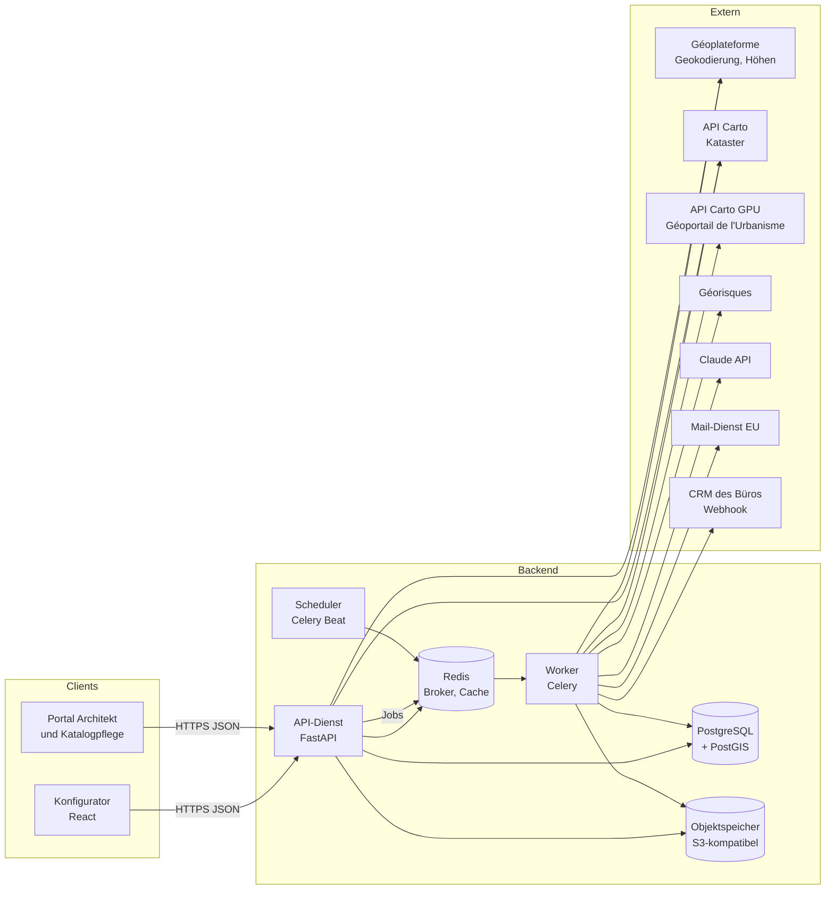
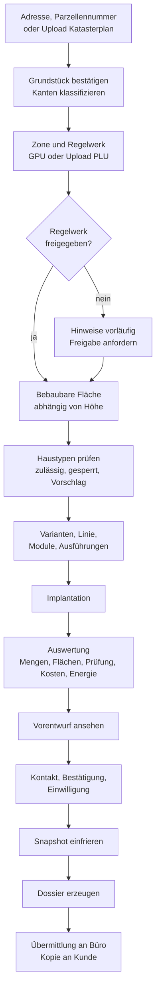
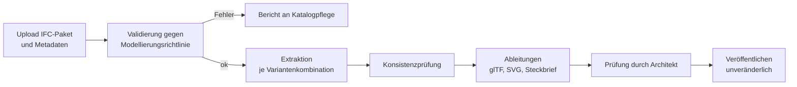
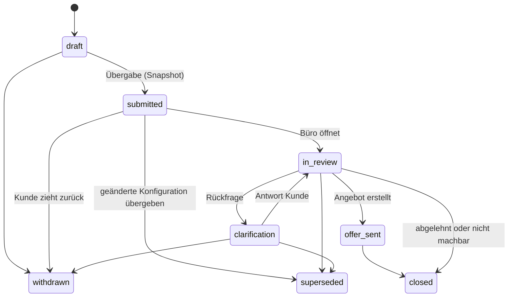
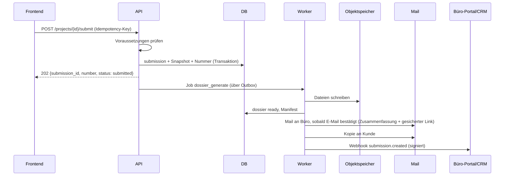

# Emprise Backend – Spezifikation für die Umsetzung mit Claude Code

> **Status:** Entwurf zur Umsetzung · **Stand:** 13.09.2026 (Kapitel 0 und Anhang E.4: 19.09.2026)
> **Bezug:** `Hauskonfigurator.jsx` (klickbares Frontend-Mockup), `Dokumentation.html` (Fachdokumentation des Mockups)
> **Zielgruppe:** Claude Code als umsetzender Agent, Entwickler, Architekturbüro

---

## 0. Wie dieses Dokument zu benutzen ist

**Für Claude Code:**

1. Lies vor Code-Arbeit die Kapitel 0–2 und die Kapitel, die der Modulabschnitt im Umsetzungsplan nennt (Überschriften per Grep `^#{2,4} `); Verweise darin nachlesen, weil die Kapitel voneinander abhängen. Vollständig nur, wenn die Aufgabe das ganze Dokument betrifft (Entscheidung des Auftraggebers vom 19.09.2026).
2. Kapitel 1 (Leitplanken) ist verbindlich. Kein Meilenstein darf eine Leitplanke verletzen.
3. Arbeite die Meilensteine aus Kapitel 14 in der angegebenen Reihenfolge ab. Jeder Meilenstein hat Abnahmekriterien; ein Meilenstein ist erst fertig, wenn seine Tests grün sind.
4. Kapitel 16 listet Entscheidungen, die der Auftraggeber treffen muss. Triff sie nicht selbst. Wenn ein Meilenstein eine offene Entscheidung berührt, frage nach oder implementiere hinter einer Konfigurationsoption mit dem dort genannten Vorschlag als Standard.
5. Alle externen Endpunkte in Kapitel 9 sind beim Start gegen die aktuelle Dokumentation der Anbieter zu prüfen. Kapsle jede externe Schnittstelle in einem Adapter mit aufgezeichneten Testantworten.
6. Für die Anbindung von Claude (PLU-Auswertung) die Skill `claude-api` laden und deren Vorgaben zu SDK, Modell und Fehlerbehandlung befolgen.
7. Wenn du eine Annahme triffst, die hier nicht gedeckt ist, dokumentiere sie in `docs/ANNAHMEN.md` (Umsetzungsplan 4.1) mit Datum und Begründung.
8. Anhang E protokolliert die Logikprüfung dieses Dokuments. Die Korrekturen aus E.1–E.3 sind im Text eingearbeitet; E.4 listet die noch nicht eingearbeiteten. Abweichungen der Umsetzung stehen in `UMSETZUNGSPLAN.md` Kapitel 7 und in `docs/ANNAHMEN.md`; für beauftragte Module gilt der Umsetzungsplan vor Kapitel 14.

**Sprachregelung:** Dieses Dokument ist deutsch. Code, Datenbank, API und Commit-Nachrichten sind englisch. Fachbegriffe werden über das Glossar in Kapitel 2 zugeordnet. Erzeugte Dokumente für Kunden und Büro sind zweisprachig vorzubereiten (Französisch, Deutsch).

**Verbindlichkeit:** **MUSS** = Pflicht für die genannte Version. **SOLL** = Standard, Abweichung nur mit dokumentierter Begründung. **KANN** = optional, spätere Ausbaustufe.

---

## 1. Ziel und Leitplanken

### 1.1 Ziel

Das Backend macht aus dem Mockup ein belastbares System. Es

- ermittelt **echte Parzellen** aus Katasterdaten oder hochgeladenen Katasterplänen,
- wertet **echte Bebauungspläne** (PLU: Zonenplan, schriftliche Festsetzungen) aus und leitet daraus die **bebaubare Fläche** und alle prüfbaren Grenzwerte ab,
- leitet **Haustypen aus ArchiCAD-/IFC-Modellen** ab, einschließlich Kennwerten, Varianten, Oberflächen und Räumen,
- wendet **Module** (Dachstuhl, Photovoltaik, Keller, Carport, Terrasse …) regelbasiert auf Haustypen an,
- ermittelt **Mengen von Oberflächen** aus dem Modell und berechnet daraus **Preisspannen** je Ausführung,
- verwaltet **ArchiCAD-Pläne als PDF** je Typ und Variante,
- erstellt **Raumprogramme und Flächenberechnungen** je Konfiguration,
- erzeugt aus dem fertigen Projekt ein **Projektdossier** (Beschreibung, Zeichnungen, Mengen, Modell, Datensatz) und übermittelt es an das Architekturbüro.

### 1.2 Leitplanken

| Nr. | Leitplanke |
|---|---|
| **L1** | **Kein Shop.** Keine Zahlung, kein Vertragsabschluss, keine Bestellung. Preise erscheinen ausschließlich als Spanne oder mit „ca.“. Die API liefert nie ein Feld, das als exakter Gesamtpreis gelesen werden kann. |
| **L2** | **Regeln sind nur nach Freigabe harte Grenzen.** Automatisch ausgelesene Festsetzungen sind Vorschläge. Erst ein von einer berechtigten Person freigegebenes Regelwerk darf Typen sperren oder Lagen verhindern. Nicht freigegebene Regeln erzeugen Hinweise mit Status `vorläufig`. |
| **L3** | **Jede abgeleitete Zahl hat eine Herkunft.** Menge, Fläche, Höhe, Preis und Prüfergebnis tragen Quelle, Methode, Version und Annahmen (`provenance`). |
| **L4** | **Veröffentlichte Katalogstände sind unveränderlich.** Haustypen, Module, Ausführungen, Preiskataloge und Regelwerke werden versioniert. Eine Änderung erzeugt eine neue Version. Eine Übergabe friert alle referenzierten Versionen ein. |
| **L5** | **Der Server ist maßgeblich für Geometrie und Prüfung.** Das Frontend darf für flüssige Interaktion vorrechnen, der Server prüft jede gespeicherte Konfiguration erneut. |
| **L6** | **Automatik schlägt vor, Menschen bestätigen.** PDF-Auswertung, Georeferenzierung, Kantenklassifikation und IFC-Import liefern Vorschläge mit Konfidenz. Nichts wird ohne Bestätigung veröffentlicht. |
| **L7** | **Grenzen der Aussage sind sichtbar.** Katasterplan ist keine Vermessung. Regelprüfung ist keine Bauantragsprüfung. RE2020-Status ist keine Wärmeschutzberechnung. Diese Hinweise erscheinen in UI-Daten und im Dossier. |
| **L8** | **Datenschutz.** Hosting in der EU, Datenminimierung, ausdrückliche Einwilligung vor Übermittlung personenbezogener Daten an das Büro, keine Kundendaten an Sprachmodelle. |

---

## 2. Glossar

| Deutsch | Französisch (Fachbegriff) | Bezeichner im Code |
|---|---|---|
| Parzelle | parcelle | `parcel` |
| Grundstück (eine oder mehrere Parzellen) | unité foncière | `site` |
| Grundstückskante | limite | `site_edge` |
| Katasterplan | plan cadastral (PCI), extrait cadastral | `cadastral_source` |
| Bebauungsplan | Plan local d'urbanisme (PLU / PLUi) | `land_use_plan` |
| Zonenplan | plan de zonage (règlement graphique) | `zoning_map` |
| Schriftliche Festsetzungen | règlement écrit | `regulation_text` |
| Zone | zone (z. B. UB) | `zone` |
| Regelwerk | règles applicables à la zone | `rule_set` |
| Abstand zur Straße | recul par rapport aux voies et emprises publiques | `setback_street` |
| Seitlicher Abstand | retrait par rapport aux limites séparatives | `setback_side` |
| Hinterer Abstand | retrait par rapport au fond de parcelle | `setback_rear` |
| Bebaubare Fläche | zone d'implantation possible | `buildable_area` |
| Grundflächenzahl | coefficient d'emprise au sol (CES) | `max_footprint_ratio` |
| Überbaute Grundfläche | emprise au sol | `footprint_area` |
| Firsthöhe / Traufhöhe / Attikahöhe | hauteur au faîtage / à l'égout / à l'acrotère | `ridge_height` / `eave_height` / `parapet_height` |
| Unversiegelte Fläche | espaces libres / pleine terre | `unsealed_area` |
| Geschossfläche (FR) | surface de plancher (SDP) | `floor_area_sdp` |
| Wohnfläche (FR) | surface habitable (SHAB) | `living_area_shab` |
| Haustyp | modèle | `building_type` |
| Variante | variante | `variant` |
| Modul | module / option | `module` |
| Oberflächenkategorie | – | `surface_category` |
| Ausführung (Material einer Oberfläche) | finition / revêtement | `finish` |
| Referenzausführung (im Basispreis enthalten) | prestation de base | `reference_finish` |
| Ausstattungslinie | gamme | `package` |
| Mengenermittlung | métré | `quantity_takeoff` |
| Raumprogramm | programme des pièces | `room_program` |
| Implantation | implantation | `placement` |
| Vorentwurf | esquisse / avant-projet sommaire | `preliminary_design` |
| Projektdossier | dossier de projet | `dossier` |
| Übergabe | transmission | `submission` |
| Wärmeschutz-/Energienachweis | étude thermique RE2020 | `energy_assessment` |

---

## 3. Systemübersicht

### 3.1 Komponenten



| Komponente | Aufgabe | Technik (Vorschlag) |
|---|---|---|
| API-Dienst | REST-API, Authentifizierung, schnelle Auswertungen, Job-Auslösung | Python 3.12, FastAPI, Pydantic v2, SQLAlchemy 2, Alembic |
| Worker | Rechenintensive und langlaufende Aufgaben: IFC, PDF, OCR, Georeferenzierung, LLM, Dossier | Celery 5 mit Redis; gleiches Code-Paket wie API |
| Scheduler | Aufräumen, Fristen, Erinnerungen, Index-Hinweise | Celery Beat |
| Datenbank | Fach- und Geodaten, Versionen, Audit | PostgreSQL 16 + PostGIS 3 |
| Cache/Broker | Job-Queue, Ergebnis-Cache für Auswertungen | Redis 7 |
| Objektspeicher | Uploads, IFC, PDF, Renderings, Dossiers | S3-kompatibel (lokal MinIO) |
| Mail | Transaktionsmails mit SPF/DKIM | EU-Anbieter über SMTP oder API |

**Warum Python:** Die zentralen Fachbibliotheken sind Python-nativ: IfcOpenShell (IFC), Shapely/GEOS und pyproj (Geometrie, Koordinatensysteme), GDAL/Fiona/rasterio (Geodaten), PyMuPDF (PDF), trimesh (Schnitte durch Raumkörper), WeasyPrint (PDF-Erzeugung), Anthropic Python SDK.

### 3.2 Bibliotheken

| Zweck | Bibliothek |
|---|---|
| IFC lesen, Geometrie, Mengen, IFC schreiben | `ifcopenshell` (inkl. `ifcopenshell.geom`, `ifcopenshell.util`, `ifcopenshell.api`), Kommandozeile `IfcConvert` für glTF/SVG |
| 2D-Geometrie | `shapely` 2.x |
| Koordinatentransformation | `pyproj` |
| Vektor-Geodaten lesen (GeoJSON, Shapefile, DXF, GML, EDIGEO) | `GDAL`/`fiona` bzw. `pyogrio` |
| Raster, Georeferenzierung | `rasterio`, `GDAL` |
| Netzschnitte, Schnittflächen von Raumkörpern | `trimesh` |
| PDF lesen, rendern, stempeln | `PyMuPDF` |
| OCR | `tesseract` mit Sprachpaketen `fra`, `deu` |
| PDF erzeugen | `WeasyPrint` aus HTML-Vorlagen (`Jinja2`) |
| Tabellen erzeugen | `openpyxl` |
| DXF erzeugen | `ezdxf` |
| Sichere Formelauswertung | eigener AST-Auswerter mit Whitelist (kein `eval`) |
| Sprachmodell | `anthropic` (Python SDK), Modell `claude-opus-5` |
| Tests | `pytest`, `hypothesis`, `respx` oder `vcrpy`, `testcontainers` |
| Qualität | `ruff`, `mypy --strict` für `domain/` |
| Beobachtbarkeit | `structlog` (JSON-Logs), OpenTelemetry, Sentry-kompatibles Fehler-Tracking |

Versionen: jeweils aktuelle stabile Version beim Projektstart festlegen und in `pyproject.toml` pinnen.

### 3.3 Betriebsumgebungen

- **Entwicklung:** Docker Compose mit `api`, `worker`, `beat`, `db` (postgis), `redis`, `minio`, `mailpit`.
- **Produktion:** Container-Plattform bei einem EU-Anbieter; verwaltete PostgreSQL-Instanz mit PostGIS; Objektspeicher im selben Rechenzentrum; Worker getrennt skalierbar, mit Ressourcenlimits (IFC-Verarbeitung ist speicherintensiv).
- Worker-Image enthält GDAL, IfcOpenShell inkl. `IfcConvert`, Tesseract, WeasyPrint-Abhängigkeiten, Schriften (Archivo, IBM Plex Sans, IBM Plex Mono).

### 3.4 Gesamtablauf



---

## 4. Datenmodell

### 4.1 Grundsätze

- Primärschlüssel `UUID`; jede Tabelle hat `created_at`, `created_by`.
- **Versionierte Katalogobjekte** bestehen aus einer Identität (`building_type`) und Versionen (`building_type_version`) mit `status ∈ {draft, review, published, retired}`. Ab `published` sind Versionen unveränderlich (Datenbank-Trigger verhindert `UPDATE` fachlicher Spalten).
- **Geometrie:** PostGIS `geometry` in **EPSG:2154 (Lambert-93)** für Frankreich-Festland. Das Quell-KBS wird am Quelldatensatz gespeichert. Übersee-Gebiete sind nicht Teil von Version 1.
- **Lokale Modellkoordinaten** (IFC) in Metern, getrennt gespeichert als JSON/WKB ohne KBS.
- **Einheiten:** Meter, Quadratmeter, Kubikmeter, Grad. Azimut 0° = Norden, im Uhrzeigersinn.
- **Geld:** Ganzzahl in Cent, Währung EUR, Preisbasis `net` (HT) ausdrücklich gespeichert. Mehrwertsteuer wird erst bei der Anzeige angewendet (Kapitel 5.6.6).
- **Spannen** werden immer als Paar `min`/`max` gespeichert, nie als Einzelwert mit Toleranz.
- **Herkunft** (`provenance`, JSONB) an allen abgeleiteten Werten: `{source, method, engine_version, input_versions[], assumptions[], confidence}`.
- **Verweise auf Preise** erfolgen immer über `price_item.code`, nie über IDs, weil jede Preiskatalogversion neue IDs erzeugt. Aufgelöst wird im Preiskatalog der Konfiguration. Die Veröffentlichung eines Katalogobjekts oder Preiskatalogs ist gesperrt, solange ein referenzierter Code fehlt.
- **Kontrolliertes Vokabular** für Materialklassen, Farbfamilien, Dachformen, Fassadenrollen und Raumtypen als Enums im Code. Regeln (`facade`, `roof`) und Ausführungen verwenden dieselben Werte, sonst ist keine Prüfung möglich.

### 4.2 Standort und Regeln

| Tabelle | Wichtige Felder | Hinweise |
|---|---|---|
| `source_file` | `kind` (`cadastre_vector`, `cadastre_pdf`, `zoning_map_pdf`, `zoning_vector`, `regulation_pdf`, `oap_pdf`, `ifc`, `plan_pdf`, `other`), `filename`, `mime`, `sha256`, `storage_key`, `size_bytes`, `page_count`, `crs_detected`, `scan_status`, `uploaded_by` | Deduplizierung über `sha256` |
| `georeference` | `source_file_id`, `page`, `method` (`control_points`, `auto_match`), `control_points` (Liste Pixel ↔ Lambert-93), `transform` (affin oder projektiv), `rmse_m`, `status` | RMSE ist Pflichtangabe |
| `parcel` | `idu` (14 Zeichen: Département, Gemeinde, Präfix, Sektion, Nummer), `commune_insee`, `section`, `number`, `geometry`, `area_official_m2` (contenance), `area_geometric_m2`, `source_id`, `accuracy_class`, `fetched_at` | `accuracy_class ∈ {api_vector, upload_vector, pdf_trace}` |
| `site` | `project_id`, `geometry` (Vereinigung der Parzellen), `parcel_ids[]`, `confirmed_by`, `confirmed_at`, `local_origin` (Lambert-93-Punkt für lokale Frontend-Koordinaten), `revision` | Muss zusammenhängend sein. Jede Änderung an Umriss oder Kanten erhöht `revision` und macht Auswertungen ungültig |
| `site_edge` | `site_id`, `seq`, `geometry` (LineString), `kind` (`street`, `side`, `rear`, `other`), `adjacent` (Straßenname oder Nachbar-IDU), `classification_source` (`auto`, `customer`, `architect`), `confidence` | Eine Zeile je vereinfachter Kante |
| `terrain` | `site_id`, `method` (`flat_assumption`, `ign_altimetry`, `survey_upload`), `reference_altitude_ngf`, `slope_percent`, `samples` (Punkte mit Höhe) | Grundlage für Höhenprüfung |
| `site_risk` | `site_id`, `kind` (z. B. `clay_shrink_swell`, `flood`), `level`, `source`, `fetched_at` | Hinweise, kein Ausschluss |
| `land_use_plan` | `commune_insee`, `kind` (`PLU`, `PLUi`, `carte_communale`, `RNU`), `gpu_document_id`, `approval_date`, `last_checked_at`, `superseded_by`, `documents` (Liste `source_file_id`) | Ohne PLU gilt nationales Recht (RNU) → nur Hinweise. Ein neuer Planstand erzeugt einen neuen Datensatz (5.2.5) |
| `zone` | `land_use_plan_id`, `code` (z. B. `UB`), `label`, `geometry`, `source` (`gpu`, `upload_trace`) | |
| `overlay_constraint` | `land_use_plan_id`, `kind` (`servitude`, `flood_risk_plan`, `heritage_perimeter`, `protected_trees`, `other`), `geometry`, `effect` (`no_build`, `rules`, `info`), `rule_ids[]` | |
| `rule_set` / `rule_set_version` | `zone_id`, `status` (`draft`, `validated`, `retired`), `validated_by`, `validated_at`, `coverage` (welche Regelarten entschieden sind) | Nur `validated` wirkt hart (L2) |
| `rule` | `rule_set_version_id`, `kind`, `params` (JSONB, Schema je Art), `applies_to` (Bedingungen), `severity` (`hard`, `soft`, `info`), `citation` `{source_file_id, page, quote}`, `extraction` `{method, model, confidence, quote_verified}`, `decision` (`accepted`, `edited`, `not_regulated`, `rejected`), `decided_by` | Kapitel 5.2.4 |

### 4.3 Katalog

| Tabelle | Wichtige Felder | Hinweise |
|---|---|---|
| `building_type` / `building_type_version` | `name`, `description`, `family`, `ifc_package_id` (nullable), `facts_source` (`ifc`, `manual`), `reference_finishes` (Map `surface_selector → finish_version_id`), `alternatives` (Liste von Typ-IDs als Vorschläge), `facts` (abgeleitete Kennwerte der Standardvarianten), `status` | Kennwerte werden aus IFC berechnet. `manual` nur für Vorabkatalog und Paritätstests; dann sind Umriss, Höhen, Dachform und Flächen Pflicht, und der Typ trägt die Kennzeichnung „ohne Modell“. Preise liegen im Preiskatalog, nicht an der Typversion |
| `ifc_package` | `schema` (`IFC2X3`, `IFC4`), `authoring_tool`, `files` (Haupt- und Variantendateien), `validation_report`, `model_north_note`, `ground_floor_offset_m` (OK FFB EG über Gelände) | |
| `variant_group` | `building_type_version_id`, `key` (z. B. `roof`, `garden_openings`), `label`, `required`, `default_variant_id`, `interacts_with[]` | `interacts_with`: Gruppen, die gemeinsam geprüft werden müssen (5.4.6) |
| `variant` | `variant_group_id`, `key` (z. B. `gable_35_trad`), `label`, `selector` (Element-GUIDs oder Eigenschaftsfilter), `facts_override` | |
| `type_facts` | `building_type_version_id`, `variant_key_hash`, `variant_selection`, `footprint_facade` (Polygon lokal), `footprint_projection` (Polygon lokal), `heights`, `roof`, `surfaces`, `spaces`, `openings`, `storeys`, `derivatives` (glTF, SVG) | Cache je Variantenkombination |
| `space_category_map` | `source_value` (ArchiCAD-Zonenkategorie oder Klassifikation), `room_type`, `counts_shab`, `counts_sdp`, `din277_group` | Pflege durch Architekt |
| `module` / `module_version` | `kind`, `label`, `geometry_mode` (`ifc_variant`, `parametric`, `none`), `parameters_schema`, `applicability`, `requires`, `excludes`, `effects`, `pricing`, `stage` (Reihenfolge, Kapitel 5.5.3) | Beispiel in Anhang B |
| `finish` / `finish_version` | `surface_category`, `label`, `render` `{color_hex, texture, texture_scale_m}`, `regulatory` `{material_class, color_family, reflectance_class}`, `price_item_code`, `energy_effect` | |
| `package` / `package_version` | Ausstattungslinie: `finishes` (Map `surface_selector → finish_version_id`), `included_modules[]`, `applicable_types[]` | Aufpreis je Typ im Preiskatalog (`package_type_price`) |
| `price_catalog` / `price_catalog_version` | `region`, `valid_from`, `index_name` (`BT01`), `index_base_value`, `price_basis` (`net`), `vat_rate_default`, `contingency_ratio`, `paths_lump_m2` | |
| `price_item` | `price_catalog_version_id`, `code`, `label`, `unit` (`m2`, `m`, `pcs`, `kwp`, `m3`, `lump_sum`), `unit_price_min_cents`, `unit_price_max_cents`, `measurement_rule_key` | Andere Objekte verweisen nur über `code` |
| `type_base_price` | `price_catalog_version_id`, `building_type_version_id`, `min_cents`, `max_cents` | Basispreis inkl. Referenzausführungen |
| `package_type_price` | `price_catalog_version_id`, `package_version_id`, `building_type_version_id`, `min_cents`, `max_cents` | Linienaufpreis hängt vom Typ ab (Fassadenfläche, Fenster, Wohnfläche) |
| `measurement_rule` | `key`, `method` (`gross`, `net`, `net_threshold`), `opening_threshold_m2`, `include_gables`, `include_plinth`, `description` | Abrechnungsregel für Flächen |
| `plan_document` | `building_type_version_id`, `source_file_id`, `page`, `plan_kind` (`floor_plan`, `section`, `elevation`, `detail`, `other`), `storey_key`, `scale`, `revision`, `applies_to_variants` (leer = alle), `ifc_package_id_at_upload`, `confirmed_by` | Kapitel 5.7 |
| `energy_assessment` | `building_type_version_id`, `package_version_id`, `module_keys[]`, `climate_zone` (`H1a` … `H3`), `altitude_band`, `orientation_range_deg` (geografischer Azimut der Gartenfassade), `bbio_ok`, `cep_ok`, `cep_nr_ok`, `ic_energy_ok`, `ic_construction_ok`, `dh_ok`, `gap_measures`, `gap_price_item_code`, `report_file_id`, `valid_until` | Liefert ein Thermik-Büro; Kapitel 5.9.6 |

### 4.4 Projekt, Konfiguration, Übergabe

| Tabelle | Wichtige Felder | Hinweise |
|---|---|---|
| `customer` | `email`, `email_verified_at`, `name`, `phone`, `locale` | Erst bei Kontaktaufnahme angelegt |
| `project` | `customer_id` (nullable), `site_id`, `status`, `access_token_hash`, `expires_at` | Zustandsautomat Kapitel 5.10.1 |
| `configuration` | `project_id`, `revision`, `building_type_version_id`, `variant_selection`, `package_version_id`, `modules` (Liste `{module_version_id, params}`), `finish_overrides` (Map `surface_selector → finish_version_id`), `placement` `{origin_e, origin_n, rotation_deg, ground_floor_offset_m}` (Offset optional, überschreibt den Typwert), `boundary_options` (z. B. Bauen auf Grenze je Kante), `price_catalog_version_id`, `deviations_acknowledged` | Jede Änderung erhöht `revision`. Regelwerke werden nicht an die Konfiguration gebunden: Jede Auswertung verwendet je Zone das jüngste freigegebene Regelwerk (sonst den jüngsten Entwurf) und protokolliert die verwendeten Versionen |
| `evaluation` | `configuration_id`, `revision`, `input_hash`, `engine_version`, `geometry`, `quantities`, `areas`, `room_program`, `compliance`, `costs`, `energy`, `warnings`, `computed_at` | Deterministisch; `input_hash` über Konfigurationsrevision, `site.revision`, alle verwendeten Katalog-, Preis- und Regelwerksversionen und `engine_version` |
| `submission` | `project_id`, `number`, `snapshot` (JSONB, vollständig), `consents` `{non_binding_confirmed_at, data_transfer_consent_at, consent_text_version}`, `status`, `status_history`, `supersedes_id`, `dossier_id`, `idempotency_key` | `number` aus Datenbank-Sequenz |
| `dossier` | `submission_id`, `files` (Liste mit `kind`, `storage_key`, `sha256`), `manifest`, `status` (`pending`, `ready`, `partial`, `failed`), `error` | |
| `message` | `submission_id`, `author_role`, `body`, `attachments` | Rückfragen zwischen Büro und Kunde |
| `job` | `kind`, `status`, `progress`, `input_ref`, `result_ref`, `error`, `attempts` | Spiegel der Celery-Tasks für die API |
| `outbox_event` | `kind`, `payload`, `created_at`, `dispatched_at` | Jobs, Mails und Webhooks werden in derselben Transaktion wie die fachliche Änderung vorgemerkt |
| `audit_log` | `actor`, `action`, `entity`, `entity_id`, `before`, `after`, `at` | Pflicht für Freigaben und Veröffentlichungen |

---

## 5. Funktionsweise

### 5.1 Parzelle und Grundstück ermitteln

#### 5.1.1 Eingangswege

| Weg | Eingabe | Verarbeitung | Ergebnis-Genauigkeit |
|---|---|---|---|
| A | Adresse | Geokodierung → Punkt → Kataster-API: Parzelle, die den Punkt enthält. Liegt der Punkt auf öffentlichem Raum (Adresspunkte liegen oft auf der Straße), alle Parzellen im Umkreis von 20 m zur Auswahl. Nutzer bestätigt auf der Karte | `api_vector` |
| B | Parzellennummer (Gemeinde, Sektion, Nummer) oder Klick in Karte | Kataster-API direkt | `api_vector` |
| C | Upload Vektordaten: GeoJSON, Shapefile (ZIP), DXF, GML, EDIGEO | Lesen mit GDAL; KBS aus Datei; fehlt es (typisch bei DXF), wählt der Nutzer das KBS oder setzt Passpunkte (Ähnlichkeitstransformation, sonst wie 5.1.2) | `upload_vector` |
| D | Upload PDF oder Bild (Katasterauszug, Lageplan) | Seite rendern (300 dpi) → Georeferenzierung → Umriss nachzeichnen | `pdf_trace` |

Für alle Wege werden danach die Nachbarparzellen im Umkreis von 50 m über die Kataster-API geladen, bei Weg C und D nach der Georeferenzierung. Ohne Nachbarparzellen ist keine automatische Kantenklassifikation möglich; der Nutzer klassifiziert die Kanten dann selbst.

#### 5.1.2 Georeferenzierung von PDF und Bild (Weg D)

1. Seite mit PyMuPDF rastern, Vorschau speichern.
2. **Passpunkte (MUSS):** Nutzer oder Architekt setzt mindestens 3 Punktpaare (Pixel ↔ Karte). Bei 3 Punkten affine Transformation, ab 4 Punkten projektive Transformation. Die API liefert den mittleren Restfehler `rmse_m`. Ab 1,0 m Restfehler ist die Übernahme nur mit Warnung möglich, ab 3,0 m gesperrt.
3. **Automatischer Abgleich (KANN):** Ist die Gemeinde bekannt, werden Katastervektoren der Umgebung geladen und Kanten des Rasters darauf eingepasst. Ergebnis ist nur ein Vorschlag für Passpunkte.
4. **Umriss (MUSS):** Nutzer zeichnet die Parzellengrenze auf dem georeferenzierten Raster nach. Stützpunkte rasten auf Katastervektoren ein, wenn vorhanden (Toleranz 0,5 m).
5. **Vektorisierung (KANN):** Linienerkennung als Vorschlag für den Umriss.

#### 5.1.3 Grundstück bilden

- Mehrere Parzellen werden vereinigt (`unary_union`). Ergebnis MUSS ein zusammenhängendes Polygon sein, sonst Fehler `site_not_contiguous`.
- Innenliegende Löcher sind erlaubt und werden bei Abständen wie Kanten behandelt (`kind = other`, Standardabstand = seitlicher Abstand).
- Vergleich geometrische Fläche mit amtlicher Fläche (`contenance`): Abweichung über 3 % erzeugt Warnung „Katastergeometrie weicht von amtlicher Fläche ab“.
- Hinweis L7 wird am Grundstück gespeichert: „Katastergrenzen sind nicht vermessungsgenau. Verbindliche Grenzen ermittelt ein Géomètre-expert.“

#### 5.1.4 Kanten klassifizieren

Die Abstandsregeln im PLU unterscheiden Straße, seitliche Grenze und hintere Grenze. Das Mockup kannte nur ein Rechteck mit Straße im Norden; das Backend muss beliebige Polygone behandeln.

1. Umriss vereinfachen (Toleranz 0,05 m). Aufeinanderfolgende Segmente mit Richtungsänderung unter 5° zu einer Kante zusammenfassen.
2. **Straßenkante:** Eine Kante grenzt an keine Nachbarparzelle (weniger als 50 % ihrer Länge liegt innerhalb 0,5 m einer Nachbarparzelle) und liegt an nicht katastrierter Fläche (öffentlicher Raum). KANN zusätzlich mit Straßenachsen aus IGN-Daten im Abstand bis 15 m bestätigt werden. Private Erschließungswege sind oft eigene Parzellen und würden als Nachbar erkannt; schmale Nachbarparzellen (unter 8 m Breite, ohne Gebäude) an einer Kante werden deshalb als `street`-Kandidat mit niedriger Konfidenz vorgeschlagen.
3. **Seitliche Kante:** Nicht-Straßenkante mit mindestens einem Endpunkt auf einer Straßenkante.
4. **Hintere Kante:** Übrige Kanten. Bei mehrdeutigen Fällen entscheidet der Winkel zur Hauptstraßenkante: unter 45° → hinten, sonst seitlich.
5. **Eckgrundstück:** Zwei oder mehr Straßenkanten → alle als Straße, Warnung „Eckgrundstück: Abstandsregeln durch Architekt prüfen“.
6. Jede Klassifikation ist durch Kunde oder Architekt überschreibbar; `classification_source` hält fest, wer entschieden hat.
7. **Gartenseite** (für Voreinstellungen und Beschriftung) = Kante(n) gegenüber der Hauptstraßenkante; Himmelsrichtung wird berechnet, nicht angenommen.

### 5.2 Bebauungsplan und Regelwerk

#### 5.2.1 Quellen

| Quelle | Inhalt | Verarbeitung |
|---|---|---|
| API Carto, Modul GPU | Zonen-Polygone (`zone-urba`), Dokument-Metadaten, Links zu schriftlichen Festsetzungen, flächige Vorschriften und Informationen | Automatischer Abruf nach Grundstücksbestätigung |
| Upload Zonenplan (PDF) | Graphischer PLU | Georeferenzierung wie 5.1.2, Zone durch Nachzeichnen oder Auswahl bestimmen |
| Upload Zonenplan (Vektor) | CNIG-konforme Daten | Lesen wie 5.1.1 C |
| Upload/Abruf schriftliche Festsetzungen (PDF) | règlement écrit | Textauswertung 5.2.3 |
| Upload OAP, Servituden, Risikopläne | Ergänzende Vorgaben | Als `overlay_constraint` oder Regel mit `severity = info` |

Existiert für die Gemeinde kein PLU (nationales Recht, RNU, oder Carte communale), wird das Grundstück als `rules_unavailable` markiert: Konfiguration bleibt möglich, alle Prüfungen haben Status `unknown`, das Dossier weist darauf hin.

#### 5.2.2 Zone bestimmen

- Grundstück mit Zonen verschneiden. Liegt es in mehreren Zonen, entstehen **Teilflächen** je Zone. Jede Teilfläche hat ihr eigenes Regelwerk; die bebaubare Fläche ist die Vereinigung der je Zone berechneten Flächen. Warnung „Grundstück liegt in mehreren Zonen“.
- Splitter unter 1 m² oder unter 1 % der Grundstücksfläche werden ignoriert und protokolliert.
- Überlagernde Vorgaben (`overlay_constraint`) werden verschnitten; `effect = no_build` wird von der bebaubaren Fläche abgezogen.

#### 5.2.3 Regeln aus dem Text gewinnen

1. **Text extrahieren** mit PyMuPDF. Seiten ohne Textschicht per OCR (`fra`).
2. **Zonenkapitel finden:** Überschriftenmuster wie „Dispositions applicables à la zone UB“, „Zone UB“, „Chapitre UB“, Artikelmuster „Article UB 6“ (ältere PLU mit nummerierten Artikeln) oder thematische Abschnitte wie „Implantation des constructions par rapport aux voies“ (modernisierte PLU). Seitenbereich speichern. Allgemeine Bestimmungen („Dispositions générales“) immer mitnehmen.
3. **Auswertung mit Claude** (`claude-opus-5`), Seitenbereich als PDF-Dokumentblock:
   - Ausgabe über ein Werkzeug mit striktem JSON-Schema (`strict: true`). Jede Regel enthält `kind`, `params`, `applies_to`, `page`, `quote` (wörtliches Zitat), `confidence`, `notes`.
   - Nicht als freie Antwort mit Zitatfunktion: Die Zitatfunktion der API lässt sich nicht mit strukturierter Ausgabe kombinieren. Stattdessen prüft der Server das Zitat selbst (Schritt 4).
   - Anweisung an das Modell: nur Aussagen aus dem Text, keine Ergänzung aus Allgemeinwissen; nicht Geregeltes als `not_regulated` melden; Bedingungen (z. B. „pour les annexes“) in `applies_to` abbilden; unklare Stellen als `kind = text_only`.
   - Keine Kundendaten im Prompt (L8). PLU-Dokumente sind öffentlich.
   - Wird ein Seitenausschnitt als eigenes PDF gesendet, zählt das Modell die Seiten ab 1. Der Server rechnet `page` auf die Seitennummer des Originaldokuments zurück, bevor Zitat und Seite gespeichert werden. Lange Kapitel werden unterhalb der Größen- und Seitengrenzen der API in Abschnitte mit einer Seite Überlappung geteilt.
   - Der Dokumenttext gilt als Daten, nicht als Anweisung: Ausgaben sind nur über das Schema möglich, und jede Regel durchläuft die Freigabe.
   - Fehlerbehandlung, Wiederholungen und Verweigerungs-Rückfall nach Vorgaben der Skill `claude-api`.
4. **Zitate prüfen:** Das Zitat MUSS auf der angegebenen Seite vorkommen (normalisierter Text, Ähnlichkeit ≥ 0,9). Sonst `quote_verified = false` und die Regel ist im Freigabedialog rot markiert.
5. **Freigabe (MUSS, L2):** Berechtigte Person sieht je Regel Wert, Zitat und die hervorgehobene Seite und entscheidet `accepted`, `edited`, `not_regulated` oder `rejected`. Ein Regelwerk wird erst `validated`, wenn für jede Pflichtregelart (Tabelle 5.2.4, Spalte „Pflicht“) eine Entscheidung vorliegt.
6. Manuelle Erfassung ohne Sprachmodell ist jederzeit möglich (gleiches Formular).

#### 5.2.4 Regelarten

Jede Art hat ein Pydantic-Schema (diskriminierte Union über `kind`). Beispiele in Anhang C.

| `kind` | Parameter | Pflicht | Wirkung |
|---|---|---|---|
| `setback_street` | `min_m`, `max_m`, `mode` (`min`, `fixed`, `range`, `alignment`), `measured_from` (`facade`, `roof_edge`, `any_projection`) | ja | Bebaubare Fläche |
| `setback_side` | `min_m`, `height_factor` (z. B. 0,5 für H/2), `height_basis` (`eave`, `ridge`, `facade_point`), `allow_on_boundary`, `on_boundary_max_height_m`, `measured_from` | ja | Bebaubare Fläche, höhenabhängig |
| `setback_rear` | wie `setback_side` | ja | Bebaubare Fläche, höhenabhängig |
| `setback_between_buildings` | `min_m`, `height_factor` | nein | Abstand Haus ↔ Nebengebäude |
| `max_footprint_ratio` | `ratio`, `counts_overhangs`, `terrace_counts_above_m` (Standard 0,60) | ja | Prüfung Grundfläche |
| `max_height` | `ridge_m`, `eave_m`, `parapet_m`, `storeys` (z. B. `R+1+C`), `reference` (`natural_terrain`, `street_level`), `measured_at` (`highest_point`, `mean`), `includes_roof_installations` | ja | Prüfung Höhe |
| `roof` | `allowed_forms[]`, `pitch_min_deg`, `pitch_max_deg`, `flat_roof` (`allowed`, `annex_only`, `green_only`, `forbidden`), `ridge_orientation` (`any`, `parallel_to_street`, `perpendicular_to_street`), `materials_allowed[]` | ja | Typ-/Variantensperre, bei `ridge_orientation` auch Lage |
| `facade` | `materials_allowed[]`, `materials_forbidden[]`, `color_families_allowed[]` | ja | Ausführungssperre |
| `unsealed_min` | `ratio`, `full_soil_ratio`, `counting` (Anrechnung durchlässiger Beläge) | ja | Prüfung Freifläche |
| `parking` | `spaces_per_dwelling`, `spaces_per_m2_sdp`, `min_dimensions` | nein | Prüfung Stellplätze |
| `annex` | `max_footprint_m2`, `max_height_m`, `setback_overrides` | nein | Carport, Nebengebäude |
| `planting` | `trees_per_m2`, `min_green_ratio` | nein | Hinweis |
| `fence` | `max_height_m`, `materials` | nein | Hinweis |
| `text_only` | `summary` | – | Hinweis im Dossier |

Jede Regel kann über `applies_to` eingeschränkt werden, z. B. `{"roof_role": "main"}` oder `{"building_kind": "annex"}`. **Ohne Einschränkung gilt sie für alle Baukörper**, auch für Carport und Nebengebäude; ein Flachdachverbot ohne `roof_role = main` würde sonst jeden Carport mit Flachdach sperren.

Für `setback_street` mit `mode = fixed` oder `range` gilt zusätzlich: Mindestens ein Fassadenabschnitt mit Rolle `street` muss im Band `[min_m, max_m]` liegen. Das ist keine Flächenbedingung und wird in 5.3.4 geprüft.

#### 5.2.5 Änderungen des PLU

- Ein wöchentlicher Job (`plu_update_check`) vergleicht Dokumentdatum und Kennung im GPU mit dem gespeicherten Plan.
- Neuer Planstand → neuer `land_use_plan`-Datensatz, alte Regelwerke `retired`, Freigabe neu erforderlich.
- Offene Projekte im betroffenen Gebiet erhalten die Warnung `rules_outdated`. Bis zur neuen Freigabe sind ihre Prüfergebnisse nicht bindend; eine Übergabe setzt eine Neuauswertung voraus (5.10.2).
- Übergebene Projekte bleiben unverändert (Snapshot); das Büro erhält einen Hinweis.

### 5.3 Bebaubare Fläche und Umrisse ableiten

#### 5.3.1 Grundsatz

Die bebaubare Fläche ist **keine feste Fläche**, sobald Abstände von der Gebäudehöhe abhängen (in französischen PLU häufig: Abstand ≥ H/2, mindestens 3 m). Sie wird daher als Funktion der Höhe berechnet und für jede Konfiguration mit deren tatsächlichen Höhen ausgewertet. Vor der Typwahl zeigt das Frontend zwei Konturen: `B(H_max)` mit der zulässigen Maximalhöhe als „sicher bebaubar“ (kleinste Fläche) und `B(0)`, bei der nur die Mindestabstände wirken, als „bebaubar bei niedriger Bauweise“ (größte Fläche). Ohne höhenabhängige Regeln sind beide gleich.

#### 5.3.2 Algorithmus

Für eine Zonen-Teilfläche `P` mit Kanten `e_i` und Klassen `c_i`:

```
d_i(H) = 0                                   wenn Bauen auf Grenze gewählt und erlaubt (on_boundary)
d_i(H) = max(min_m(c_i), height_factor(c_i) × H_basis)   sonst

B(H)   = P − ⋃_i buffer(e_i, d_i(H), cap_style = round)
B(H)   = B(H) − ⋃ overlay_constraint(no_build)
```

- `buffer` mit runden Enden entspricht exakt der Aussage „Abstand zur Grenzlinie mindestens d“ und behandelt konvexe und einspringende Ecken richtig.
- `height_basis = facade_point` (Höhe der jeweils zugewandten Fassade) lässt sich nicht als eine Fläche darstellen. `B(H)` wird dann mit der größten Fassadenhöhe berechnet (sichere Seite); maßgeblich ist die Prüfung je Fassadenabschnitt in 5.3.4.
- Ergebnis kann ein Multipolygon sein. Flächen unter 4 m² oder mit einer Breite unter 2 m (Test über `buffer(-1).buffer(1)`) werden entfernt.
- `B(H)` für die Anzeige wird in lokalen Koordinaten (Ursprung `site.local_origin`, Achsen Ost/Nord, Meter) und als GeoJSON (EPSG:4326) geliefert.
- Maximale Grundfläche je Teilfläche: `ratio × Fläche(P)`.
- Höhen-Hüllkörper (schräge Lichtraumprofile) sind nicht Teil von Version 1. Regeln, die ein solches Profil verlangen, erzeugen `status = unknown` mit Hinweis.

#### 5.3.3 Bezugskontur des Gebäudes

- `measured_from = facade`: Außenkontur der Außenwände (`footprint_facade`).
- `measured_from = roof_edge` oder `any_projection`: vertikale Projektion aller oberirdischen Bauteile inklusive Dachüberstände (`footprint_projection`).
- Die überbaute Grundfläche (emprise au sol) nach Code de l'urbanisme schließt nicht abgestützte Dachüberstände und Zierelemente aus, abgestützte Vorsprünge ein. Die Anrechnung ist über `counts_overhangs` konfigurierbar; der Standard folgt dieser Definition.

#### 5.3.4 Lage prüfen

```
F_i      = T(placement) ∘ Bezugskontur nach measured_from der Regel für Kante e_i   (5.3.3)
gültig ⇔ für jede Kante e_i: dist(F_i, e_i) ≥ d_i(H_config) − 0,01
         bei height_basis = facade_point: für jeden Fassadenabschnitt k
             dist(k, e_i) ≥ max(min_m, height_factor × h_k) − 0,01
         bei setback_street mit mode fixed/range: ein Straßenfassadenabschnitt im Band [min_m, max_m]
         und geometrische Module auf dem Grundstück (Carport, Terrasse) erfüllen ihre eigenen Regeln
         und kein Bauteil überlappt ein anderes
```

- **Alle** verletzten Regeln werden zurückgegeben, jeweils mit Kante, Soll- und Istabstand. (Das Mockup meldete nur eine Regel.)
- `B(H)` dient der Anzeige und der schnellen Suche (5.3.5, 5.3.6). Maßgeblich ist die Prüfung je Kante, weil verschiedene Regeln verschiedene Bezugskonturen haben können (z. B. Straße ab Fassade, Nachbar ab Dachüberstand).
- Bei `ridge_orientation ≠ any` ist die Drehung Teil der Prüfung: Die Firstrichtung nach Implantation muss innerhalb von ± 10° zur Vorgabe liegen.
- Transformation `T`: Drehung `θ = rotation_deg` im Uhrzeigersinn um den Modellursprung, dann Verschiebung auf `(origin_e, origin_n)`:
  `E = origin_e + x·cos θ + y·sin θ`, `N = origin_n − x·sin θ + y·cos θ`.
- Beliebige Drehwinkel sind erlaubt. Das Frontend bietet Einrasten an den Richtungen der Grundstückskanten (± 90°).

#### 5.3.5 Voreinstellungen der Lage

Für beliebige Grundstücke werden die drei Schnellstellungen des Mockups als Optimierung über gültige Lagen berechnet (Raster 0,25 m, Drehungen: Richtung der Hauptstraßenkante und +90°):

| Voreinstellung | Zielfunktion |
|---|---|
| `street_near` | minimaler Abstand zur Hauptstraßenkante; bei Gleichstand mittig entlang der Straße |
| `set_back` | Schwerpunkt möglichst in der Mitte der Tiefe von `B(H)` |
| `garden_max` | größte zusammenhängende unbebaute Fläche auf der Gartenseite (Fläche des größten Teilpolygons von `site − F_placed − Module`) |

#### 5.3.6 Passt ein Typ überhaupt?

Für die Typauswahl wird geprüft, ob **irgendeine** gültige Lage existiert: Rastersuche wie 5.3.5 mit vorbereiteter Geometrie (`shapely.prepared`). Kandidaten werden in `B(0)` gesucht (größte Fläche, keine gültige Lage geht verloren) und jeweils mit der exakten Prüfung aus 5.3.4 bestätigt; `B(H)` allein ist bei höhenabhängigen Regeln zu streng. Bei einem Grundstück von 20 × 31 m sind das rund 10 000 Positionen je Drehung; Zielzeit unter 300 ms. Ergebnis wird je `(site, rule_set_version, type_facts)` gecacht.

### 5.4 Haustypen aus ArchiCAD- und IFC-Modellen

#### 5.4.1 Importablauf



1. **Upload:** Haupt-IFC, optional weitere IFC-Dateien je Variante im gleichen Koordinatensystem. ArchiCAD-Originaldateien (`.pln`, `.pla`) KÖNNEN zur Archivierung mit hochgeladen werden, werden aber nicht verarbeitet.
2. **Validierung** gegen Anhang A. Fehler der Stufe `blocker` verhindern die Veröffentlichung.
3. **Extraktion** (Worker, IfcOpenShell) für die Standardkombination sofort, für weitere Kombinationen bei Bedarf.
4. **Konsistenzprüfung** (5.4.5).
5. **Ableitungen:** glTF (`.glb`) je Kombination für einen 3D-Viewer im Frontend, axonometrische SVG-Vorschau im Stil des Mockups, Grundriss-Umrisse, Steckbrief.
6. **Freigabe** durch Architekt, danach unveränderlich (L4).

#### 5.4.2 Varianten im Modell

- Elemente ohne Variantenkennzeichnung gehören zum **Kern** und sind immer enthalten.
- Varianten werden über die Eigenschaftsgruppe `Emprise` gekennzeichnet: `VariantGroup` (z. B. `roof`) und `VariantKey` (z. B. `gable_35_trad`). Alternativ in getrennten IFC-Dateien, deren Elemente vollständig einer Variante gehören.
- Jede Variantengruppe MUSS genau eine Standardvariante haben. Varianten einer Gruppe schließen sich gegenseitig aus.
- Die Anzahl der Kombinationen wächst multiplikativ. Kennwerte werden deshalb nur für tatsächlich angefragte Kombinationen berechnet und gecacht (`type_facts`).

#### 5.4.3 Extrahierte Kennwerte

| Kennwert | Methode |
|---|---|
| Geschosse | `IfcBuildingStorey` mit Höhe; Zuordnung zur PLU-Notation (`R`, `R+1`, `R+1+C`) über Geschossart in der Eigenschaft `Emprise.StoreyRole` (`ground`, `upper`, `attic`, `basement`) |
| `footprint_facade` | Vereinigung der XY-Projektionen der Außenwände (`Pset_WallCommon.IsExternal = true`) **aller oberirdischen Geschosse** und der Bodenplatte des Erdgeschosses; äußere Hülle ohne Löcher. Auskragende Obergeschosse sind damit enthalten |
| `footprint_projection` | Vereinigung der XY-Projektionen aller oberirdischen Bauteile inklusive Dach und Vorsprünge |
| Abmessungen | Minimales gedrehtes Rechteck um `footprint_facade`: Länge, Breite, Hauptrichtung |
| Firsthöhe | Größter Z-Wert der Dachbauteile (`IfcRoof`, `IfcSlab` mit `PredefinedType = ROOF`, Dachdeckung) über OK FFB EG |
| Traufhöhe | Z-Wert der Schnittlinie Dachfläche ↔ Außenwand-Außenseite an den Traufseiten; bei Flachdach Oberkante Attika |
| Dachflächen | Ebene Flächen der Dachbauteile mit Normalen-Z > 0,1: wahre Fläche, Neigung, Azimut (lokal), Umriss |
| Dachform | Aus den Dachflächen: eine geneigte Fläche → Pultdach; zwei gegenüberliegende (Azimut-Differenz 180° ± 5°) → Satteldach; vier, paarweise gegenüberliegend → Walmdach; horizontal → Flachdach; sonst `complex` |
| Firstrichtung | Schnittlinie der Satteldachflächen; `längs`, wenn parallel zur Längsseite (± 5°) |
| Oberflächen | Kapitel 5.6 |
| Räume | `IfcSpace`: Name, Kategorie (über `space_category_map`), Geschoss, Nettofläche, Höhe, Schnittfläche bei 1,80 m (Kapitel 5.8) |
| Öffnungen | `IfcWindow`, `IfcDoor`: Breite, Höhe, Fläche, Wirtswand, lokale Ausrichtung, Fassadenrolle |
| Zimmerzahl, Bäder | Anzahl Räume je `room_type` |
| Bezugshöhe | `ifc_package.ground_floor_offset_m`: OK FFB EG über Gelände (Standard 0,20 m, im Modell als Eigenschaft `Emprise.GroundFloorOffset` am `IfcBuilding`) |

Mengen werden bevorzugt aus `IfcElementQuantity` (`Qto_*BaseQuantities`) gelesen und gegen die Geometrie geprüft; weichen sie mehr als 3 % ab oder fehlen sie, gilt der geometrisch berechnete Wert (`provenance.method = geometry`).

#### 5.4.4 Ausrichtung

- Die Modell-Y-Achse ist **Modellnord**. `TrueNorth` im IFC wird nicht für die Lage verwendet; die Himmelsrichtung entsteht erst durch die Implantation.
- Jede Fassade trägt eine **Fassadenrolle** (`Emprise.FacadeRole ∈ {street, garden, side_left, side_right}`), gesetzt am Wandbauteil. Optionen beziehen sich auf Rollen, nicht auf Himmelsrichtungen.
- Nach der Implantation: Rasterazimut einer Fassade = `(lokaler Azimut + θ) mod 360`. Für Ertragsberechnungen (Photovoltaik) wird der geografische Azimut über die Meridiankonvergenz von Lambert-93 korrigiert (in Treillières rund 3°). Vorzeichen per Test an einem bekannten Punkt absichern.
- Die UI beschriftet Optionen mit Rolle und aktueller Richtung, z. B. „Holzverschalung Gartenfassade (derzeit Südsüdwest)“. (Das Mockup hatte „Südfassade“ fest verdrahtet; nach einer Drehung wäre das falsch gewesen.)

#### 5.4.5 Konsistenzprüfungen beim Import

| Prüfung | Grenze | Stufe |
|---|---|---|
| Einheiten Meter | – | blocker |
| Mindestens ein Geschoss mit `StoreyRole = ground` | – | blocker |
| Außenwände gekennzeichnet | ≥ 1 | blocker |
| Räume vorhanden | ≥ 1 je beheiztem Geschoss | blocker |
| Dachneigung aus Metadaten vs. Geometrie | ± 2° | error |
| Neigung aus First- und Traufhöhe vs. Dachflächen | ± 2° | error |
| Summe Raumflächen vs. Geschossfläche innen | 75–95 % | warning |
| Basismengen vs. Geometrie | ± 3 % | warning |
| Variantengruppen mit genau einer Standardvariante | – | blocker |
| Elemente überlappen zwischen Varianten derselben Gruppe nicht mit Kern | – | error |

Beispiel aus dem Mockup: Ligne mit Traufe 5,6 m, First 8,4 m und 8,0 m Tiefe ergibt eine Neigung von `atan(2,8 / 4,0) = 35,0°`, die Daten nennen 40°. Der Import würde das als Fehler melden.

#### 5.4.6 Steckbrief und Zulässigkeit je Grundstück

- Der Steckbrief (Name, Kubatur, Grundfläche, Abmessungen, Wohnfläche, Zimmer, Dach, Höhen, Basispreis) wird aus den Kennwerten der Standardvarianten erzeugt. Die Werte des Mockups (`HAUSTYPEN`) werden dadurch ersetzt.
- **Zulässigkeit** wird für jedes Grundstück berechnet, nicht gespeichert. Alle Kombinationen zu prüfen widerspräche 5.4.2 (multiplikatives Wachstum). Geprüft werden deshalb die Standardkombination und jede Kombination, in der genau eine Variantengruppe abweicht (bei n Gruppen mit je k Varianten `n × (k − 1) + 1` statt `k^n`). Gruppen mit `interacts_with` werden gemeinsam kombiniert. Typbezogene Prüfungen: Dachform, Neigung, Firstrichtung, Höhen, Grundfläche, 5.3.6 „passt“. Optionale Module bleiben unberücksichtigt; sie werden bei Auswahl geprüft.
  - Mindestens eine Kombination zulässig → Typ wählbar; unzulässige Varianten werden einzeln gesperrt.
  - Keine Kombination zulässig → Typ gesperrt, **alle** Gründe im Klartext.
  - Sperren entstehen nur aus freigegebenen Regelwerken (L2). Ist das Regelwerk nicht freigegeben, bleibt der Typ wählbar und zeigt die Gründe als Hinweis.
- **Vorschläge:** zuerst `building_type_version.alternatives`, dann Typen derselben `family`, die zulässig sind, sortiert nach Ähnlichkeit (Wohnfläche, Zimmerzahl). Das bildet „Plateau → Plateau angepasst“ ab.

### 5.5 Module

#### 5.5.1 Begriff

Ein Modul ist ein wählbarer Baustein, der auf einen Haustyp angewendet wird und dabei Geometrie, Mengen, Flächen, Regelprüfung, Kosten oder Energie verändert. Ausführungen von Oberflächen (Fassade, Dachdeckung, Bodenbelag) sind **keine** Module, sondern `finish`-Auswahlen auf Oberflächenkategorien (Kapitel 5.6).

#### 5.5.2 Geometriemodi

| Modus | Bedeutung | Beispiele |
|---|---|---|
| `ifc_variant` | Das Modul wählt eine Variante im Typmodell (Kapitel 5.4.2). Die Geometrie ist im ArchiCAD-Modell je Typ modelliert. | Dachstuhl und Dachform, bodentiefe Fenster Gartenfassade, Gauben |
| `parametric` | Das Backend erzeugt Geometrie aus Parametern und Bezugsgeometrie des Typs. | Photovoltaik, Keller, Terrasse, Carport |
| `none` | Keine Geometrie; wirkt auf Kosten, Energie oder Raumprogramm. | Lüftungsanlage, Sanitärserie |

#### 5.5.3 Anwendungsreihenfolge

Die Auswertung ist eine reine Funktion `evaluate(configuration, catalog_versions, site, rule_sets) → evaluation`. Module werden in festen Stufen angewendet, weil spätere Stufen Ergebnisse früherer benötigen:

| Stufe | Inhalt | Beispiel für Abhängigkeit |
|---|---|---|
| 1 | Variantenauswahl im Typmodell (inkl. Module mit `ifc_variant`) | Dachstuhl bestimmt Dachflächen und Dachraum |
| 2 | Gebäudebezogene parametrische Module ohne Ausrichtungsbezug | Keller unter Teil des Erdgeschosses |
| 3 | Implantation: Lage, Drehung, Himmelsrichtung der Fassadenrollen | – |
| 4 | Module, die Stufe 1–3 benötigen | Photovoltaik braucht endgültige Dachflächen **und** den geografischen Azimut |
| 5 | Grundstücksbezogene Module | Carport, Terrasse, Zufahrt |
| 6 | Ausführungen (Linie, Einzelauswahl) | Fassadenbekleidung je Rolle |
| 7 | Mengen und Flächen | – |
| 8 | Raumprogramm | Dachraum nutzbar oder nicht; SDP für Stellplatzregel |
| 9 | Regelprüfung | Höhen aus Stufe 1 und 4, Lage aus Stufe 3 |
| 10 | Energiestatus | Linie, Module, Ausrichtung |
| 11 | Kosten | Mengen aus Stufe 7, Konformitätsaufpreis aus Stufe 10 |

#### 5.5.4 Abhängigkeiten und Ausschlüsse

- `applicability`: erlaubte Typen, Typfamilien, Dachformen, Variantenschlüssel.
- `requires`: Ausdrücke, z. B. `roof_faces(true_azimuth_range=[90,270], pitch_max=60).area >= 20`.
- `excludes`: andere Module oder Varianten, z. B. vollflächige und Gartenfassaden-Holzverschalung.
- Konflikte werden nie still aufgelöst. Die API liefert `invalid_selection` mit allen Gründen; das Frontend bietet die Alternativen an.
- Ausdrücke werden mit einem eigenen, begrenzten Auswerter verarbeitet (Whitelist von Funktionen und Operatoren), nie mit `eval`.

#### 5.5.5 Modularten

**Dachstuhl und Dachform (`roof_structure`, `ifc_variant`)**
- Varianten je Typ im ArchiCAD-Modell, z. B. `gable_35_trad` (traditioneller Dachstuhl, Dachraum ausbaubar) und `gable_35_trusses` (Nagelplattenbinder, Dachraum nicht nutzbar).
- Wirkung: Firsthöhe, Traufhöhe, Dachflächen, Dachform (Regel `roof`), nutzbarer Dachraum (Raumprogramm, Wohnfläche und SDP), Mengen (Dachdeckung, Dämmung), Preis.
- Der Wechsel von ausbaubarem zu nicht nutzbarem Dachraum MUSS das Raumprogramm und die Flächen ändern.

**Photovoltaik (`pv`, `parametric`)**
- Parameter: `target_kwp` oder `max`, `mounting` (`on_roof`, `in_roof`), Modultyp aus Katalog (`width_m`, `height_m`, `wp`).
- Belegung: geeignete Dachflächen (geografischer Azimut 90–270°, Neigung ≤ 60°), Randabstand 0,5 m, Hindernisse aus dem Modell (Dachfenster, Kamine) als Sperrflächen, Rasterbelegung hochkant und quer, die bessere gewinnt.
- `kwp = Anzahl × wp / 1000`. Ist `target_kwp` größer als die Kapazität → ungültig mit Angabe der Kapazität.
- Wirkung: Preis je kWp, Energiestatus. Höhe: Durch den Randabstand liegen Module unterhalb des Firsts und ändern die Firsthöhe nicht. `on_roof` hebt die Dachfläche um 0,15 m an; das zählt nur, wenn die Höhenregel Dachaufbauten einschließt (`includes_roof_installations`).
- Ausrichtung ändert sich mit der Implantation → Belegung und Ertragshinweis werden neu berechnet.

**Keller (`basement`, `parametric`)**
- Parameter: `coverage` (Anteil der Erdgeschossfläche, Standard 0,5), `depth_m` (2,50–2,80), `use` (`storage`, `technical`, `living`).
- Geometrie: Extrusion eines Teils von `footprint_facade` nach unten; Lage im Modell über Ankerbereich `Emprise.BasementZone` oder als Rechteck an der Straßenseite.
- Wirkung: Mengen (Aushub m³, Wände, Bodenplatte), Räume (Anrechnung nach `space_category_map`), Preis, Hinweis auf Baugrund (Kapitel 5.9.5).

**Terrasse (`terrace`, `parametric`)**
- Parameter: `area_m2` oder `width_m × depth_m`, `facade_role` (Standard `garden`), `finish` (Holz, Stein, durchlässiger Belag), `height_above_terrain_m`.
- Wirkung: Versiegelung (Faktor aus Ausführung), Grundfläche nur wenn `height_above_terrain_m` über `max_footprint_ratio.terrace_counts_above_m` liegt (Standard 0,60 m, vom Architekten je Regelwerk zu bestätigen), Mengen, Preis, Darstellung im Lageplan.

**Carport (`carport`, `parametric`)**
- Parameter: `spaces` (1 oder 2), `width_m`, `depth_m`, Lage (Nutzer platziert, Vorschlag an der Hauptstraßenkante).
- Wirkung: Nebengebäuderegeln (`annex`), Grundfläche, Versiegelung, Stellplatzprüfung, Zufahrt (Kapitel 5.9.3), Preis.

**Module ohne Geometrie** (`none`): wirken nur über `effects`, z. B. Lüftungsanlage auf Energiestatus.

#### 5.5.6 Ausstattungslinien

- Eine Linie (`package_version`) setzt Ausführungen je Oberflächenkategorie und schließt Module ein.
- **Eingeschlossene Module** werden nicht zusätzlich berechnet. Die explizite Auswahl des Kunden bleibt gespeichert; wechselt er zu einer Linie ohne das Modul, wird es wieder berechnet (Verhalten des Mockups).
- **Überschreibt der Kunde eine Ausführung der Linie**, wird die Differenz gegenüber der **Linienausführung** berechnet, nicht gegenüber der Referenzausführung. Sonst würde der in der Linie enthaltene Anteil doppelt bezahlt.
- Der Linienaufpreis ist **je Haustyp** im Preiskatalog hinterlegt (`package_type_price`), weil Fassadenflächen, Fensterzahl und Wohnfläche je Typ verschieden sind. (Das Mockup verwendete für alle Typen denselben Aufpreis.) Er KANN später bottom-up aus Ausführungsdifferenzen berechnet werden; bis dahin prüft ein Plausibilitätsbericht, ob Pauschale und Summe der Differenzen um mehr als 25 % abweichen.
- **Selektoren** für Ausführungen: `<surface_category>` für die ganze Kategorie oder eingeschränkt, z. B. `ext_wall_cladding[facade_role=garden]`, `floor_finish[room_type=bathroom]`, `ext_wall_cladding[storey=ground]`. Die spezifischere Auswahl gewinnt. Zwei Auswahlen gleicher Spezifität für dieselbe Fläche werden beim Speichern abgelehnt.

### 5.6 Oberflächen, Mengen und Preise

#### 5.6.1 Oberflächenkategorien

| `surface_category` | Quelle im Modell | Aufteilung | Einheit |
|---|---|---|---|
| `ext_wall_cladding` | Außenseite der Außenwände inkl. Giebelflächen | Fassadenrolle, Geschoss, Himmelsrichtung nach Implantation | m² |
| `plinth` | Sockelzone der Außenwände (Höhe aus Metadaten, Standard 0,30 m) | Fassadenrolle | m² |
| `roof_covering` | Wahre Fläche der geneigten Dachflächen inkl. Überstand | Dachfläche | m² |
| `flat_roof_covering` | Flachdachflächen | – | m² |
| `soffit` | Unterseite der Dachüberstände | – | m² |
| `windows` | Fensterflächen (Rohbaumaß) | Fassadenrolle, Geschoss | m², Stück |
| `ext_doors` | Außentüren | Fassadenrolle | Stück |
| `floor_finish` | Nettoraumflächen | `room_type`, Geschoss | m² |
| `ceiling_finish` | Deckenunterseiten je Raum | `room_type` | m² |
| `int_wall_finish` | Wandflächen je Raum (KANN, Version 2) | `room_type` | m² |
| `terrace_surface` | Modul Terrasse | – | m² |
| `site_sealed` | Zufahrt, Wege, Stellplätze | Art | m² |

#### 5.6.2 Mengenermittlung

Drei Methoden in fester Rangfolge, jede mit Kennzeichnung in `provenance.method`:

| Rang | Methode | Wann |
|---|---|---|
| M1 | **IFC-Basismengen** (`Qto_WallBaseQuantities.NetSideArea`, `Qto_SpaceBaseQuantities.NetFloorArea`, `Qto_RoofBaseQuantities.NetArea` …) | Vorhanden und innerhalb ± 3 % der Geometrie |
| M2 | **Geometrische Berechnung** aus der Modellgeometrie: je Kante der Fassadenkontur Länge × Wandhöhenprofil (bei Giebeln aus der Schnittlinie mit den Dachflächen), abzüglich Öffnungen | Standard, wenn M1 fehlt oder abweicht |
| M3 | **Schätzformel** aus Umfang, Geschosshöhe und Geschosszahl | Nur für Typen ohne Modell (Vorabkatalog) und als Plausibilitätsprüfung; Ergebnis immer als `estimate` markiert |

**Abrechnungsregel** (`measurement_rule`) je Preisposition:
- `gross`: ohne Abzug von Öffnungen,
- `net`: alle Öffnungen abgezogen,
- `net_threshold`: nur Öffnungen über `opening_threshold_m2` abgezogen (z. B. 2,5 m²),
- `include_gables`, `include_plinth`: Giebeldreiecke und Sockelzone ein- oder ausgeschlossen.

#### 5.6.3 Vom Rohwert zur Abrechnungsfläche

Das Rechenbeispiel aus der Anforderung

```
Umfang Außenwand 50 m × Geschosshöhe 3 m × Geschosszahl 3 = 450 m²
Hinterlüftete Ziegelfassade 150 €/m² × 450 m² = 67.500 €
```

ist als Schätzformel M3 zulässig, überschätzt aber die Kosten aus mehreren Gründen. Das Backend rechnet deshalb in dieser Kette:

1. **Brutto-Fassadenfläche** = Σ (Kantenlänge × Wandhöhe) + Giebelflächen. Wandhöhe ist die Höhe bis Traufe bzw. Attika, nicht Geschosshöhe × Geschosszahl (Sockel, Deckenstärken und Kniestock verändern sie).
2. **Öffnungen abziehen** nach Abrechnungsregel.
3. **Sockelzone abziehen**, wenn sie eine eigene Ausführung hat.
4. **Aufpreis gegenüber Referenz:** Der Basispreis des Typs enthält bereits die Referenzausführung (z. B. Putz). Kostenwirksam ist nur die Differenz.

```
Aufpreis_min = A_netto × (EP_neu_min − EP_ref_min)
Aufpreis_max = A_netto × (EP_neu_max − EP_ref_max)
wenn Aufpreis_min > Aufpreis_max: tauschen
negativ erlaubt (Minderpreis), Anzeige „− ca.“
```

Die Mindest- und Höchstwerte werden paarweise verrechnet, weil beide Einheitspreise vom selben Markt abhängen. Eine Kreuzrechnung (neu max − ref min) würde die Spanne künstlich aufblähen.

**Rechenbeispiel mit den Werten der Anforderung** (Einheitspreise und Öffnungsanteil sind Beispielannahmen):

| Schritt | Rechnung | Ergebnis |
|---|---|---|
| Brutto (Flachdach, keine Giebel) | 50 m × 9,00 m Wandhöhe | 450,0 m² |
| Öffnungen (Annahme 18 %) | − 81,0 m² | 369,0 m² |
| Vollpreis Ziegelfassade | 369,0 m² × 140–160 €/m² | 51.660 – 59.040 € |
| Referenz Putz | 369,0 m² × 60–75 €/m² | 22.140 – 27.675 € |
| **Aufpreis** | 369,0 × (140 − 60) bis 369,0 × (160 − 75) | **29.520 – 31.365 €** |

Statt 67.500 € liegt der kostenwirksame Aufpreis bei rund 30.000 €. Hinweis: In Zone UB wäre eine Wandhöhe von 9 m wegen der Traufhöhe von höchstens 6,0 m unzulässig; das Beispiel dient nur der Rechenlogik.

**Rechenbeispiel Ligne** (12,0 × 8,0 m, Traufe 5,60 m, First 8,40 m; Öffnungen und Preise als Annahme):

| Schritt | Rechnung | Ergebnis |
|---|---|---|
| Wandflächen | 40,0 m × 5,60 m | 224,0 m² |
| Giebeldreiecke | 2 × ½ × 8,0 m × 2,80 m | 22,4 m² |
| Brutto | | 246,4 m² |
| Öffnungen (Annahme) | − 30,0 m² | 216,4 m² |
| Sockel 0,30 m | − 40,0 m × 0,30 m | 204,4 m² |
| Aufpreis Ziegel | 204,4 × (140 − 60) bis 204,4 × (160 − 75) | 16.352 – 17.374 € |

#### 5.6.4 Preisregeln

| `pricing.type` | Berechnung | Beispiel |
|---|---|---|
| `fixed` | `[min, max]` | Lüftungsanlage |
| `per_unit` | Menge × `[EP_min, EP_max]`, Menge aus Auswertung | Photovoltaik je kWp, Terrasse je m² |
| `finish_delta` | Kapitel 5.6.3 | Fassadenbekleidung |
| `tiered` | Stufen nach Menge | Aushub bis/über 100 m³ |
| `formula` | Begrenzter Ausdruck über Mengen | `area('roof_covering') * [8, 12]` |

Jede Position erscheint in `evaluation.costs.items` mit Menge, Einheit, Einheitspreisspanne, Abrechnungsregel, Preiskatalogversion und Methode.

#### 5.6.5 Kostenkorridor

```
K_min = Basis_min + Linie_min + Σ Module_min + Σ Ausführungsdifferenzen_min
        + Energiekonformität_min + Standortpositionen_min + Reserve_min
K_max = analog mit allen max-Werten
```

- **Reserve** (`contingency`): Prozentsatz je Preiskatalog, Standard 0 %, auf die Summe ohne Reserve.
- **Standortpositionen:** nur, wenn im Katalog hinterlegt (z. B. Zuschlag für Baugrundgutachten); sonst nur Hinweis.
- **Preisindex:** Einheitspreise gelten zum Indexstand des Katalogs. Beim Anlegen einer neuen Katalogversion KANN der Index BT01 (INSEE) zur Fortschreibung verwendet werden (`Preis × Index_neu / Index_alt`). Keine automatische Fortschreibung bestehender Versionen (L4).
- **Keine Einzelzahl:** Die API liefert nur `min`, `max` und Anzeigetexte. Anzeige auf 1.000 € gerundet mit „ca.“ (L1).
- **Katalogstand:** Die Konfiguration merkt sich ihre `price_catalog_version_id`. Erscheint vor der Übergabe ein neuerer Katalog, wird neu berechnet und der Kunde muss den geänderten Korridor vor dem Absenden sehen.

#### 5.6.6 Mehrwertsteuer

- Gespeichert wird netto (HT). Angezeigt wird für Privatkunden brutto (TTC) mit dem Satz aus dem Katalog (Standard 20 %), immer mit Kennzeichnung „inkl. MwSt.“ bzw. „TTC“.
- Ermäßigte Sätze (z. B. in bestimmten Förderzonen) sind nicht Teil von Version 1; der Satz ist je Projekt überschreibbar durch den Architekten.
- Das Mockup ließ offen, ob Preise brutto oder netto sind. Diese Festlegung steht unter Vorbehalt der offenen Entscheidung E4 (Kapitel 16).

### 5.7 ArchiCAD-Pläne als PDF

#### 5.7.1 Import

1. Upload einer oder mehrerer PDF-Dateien je Typversion.
2. Mehrseitige PDF werden in Seiten zerlegt; jede Seite ist ein `plan_document`.
3. **Metadaten je Seite:** Planart, Geschoss, Maßstab, Revision, Titel, betroffene Varianten.
4. **Vorschläge automatisch:**
   - aus dem Dateinamen nach Konvention `<TYP>_<VERSION>_<PLANART>_<GESCHOSS>_<VARIANTE|ALL>_<REV>.pdf`, z. B. `LIGNE_v3_GR_EG_ALL_B.pdf` (Planarten: `GR` Grundriss, `SN` Schnitt, `AN` Ansicht, `DE` Detail),
   - aus dem Textinhalt des Planstempels (Regex für `1:50`, `1:100`, Geschossbezeichnungen).
5. Bestätigung durch Katalogpflege (L6).
6. Ableitungen: Vorschau-PNG (150 dpi), Miniatur (72 dpi), Volltext für Suche.

#### 5.7.2 Planstand und Modellstand

- Pläne gehören zu einer Typversion. Ein neues IFC-Paket erzeugt eine neue Typversion (L4). Beim Anlegen KÖNNEN die Pläne der Vorversion übernommen werden; sie erhalten den Status `stale`, bis die Katalogpflege bestätigt, dass sie zum neuen Modell passen, oder sie ersetzt.
- Eine Typversion mit IFC-Paket kann nur veröffentlicht werden, wenn mindestens ein Grundriss je oberirdischem Geschoss für die Standardvarianten vorliegt und keiner `stale` ist. Typversionen mit `facts_source = manual` sind ausgenommen.

#### 5.7.3 Verwendung

- Das Frontend zeigt Pläne der gewählten Kombination.
- Im Dossier werden Pläne gewählt, deren `applies_to_variants` die Konfiguration abdeckt. Gibt es für eine gewählte Variante keinen eigenen Plan, wird der Plan der Standardvariante verwendet und mit einem Stempel versehen: „Darstellung Grundvariante. Gewählt: <Varianten>“.
- Zusätzlich erhält jede Planseite im Dossier einen Stempel mit Nordpfeil der tatsächlichen Implantation und der Vorgangsnummer. Der Stempel wird als eigene Ebene aufgebracht (PyMuPDF), die Zeichnung selbst bleibt unverändert.
- PDF-Pläne bilden parametrische Module (Photovoltaik, Terrasse, Carport, Keller) nicht ab. Diese erscheinen in den erzeugten Zeichnungen (Lageplan, Axonometrie) und im Stempeltext.

### 5.8 Raumprogramm und Flächenberechnung

#### 5.8.1 Quellen

- Räume (`IfcSpace`) der gewählten Variantenkombination,
- Räume aus Modulen (Keller, ausgebauter Dachraum),
- Zuordnung über `space_category_map` (ArchiCAD-Zonenkategorie → `room_type`, Anrechnungsflags).

#### 5.8.2 Flächenarten

| Fläche | Definition (Kurzfassung) | Berechnung |
|---|---|---|
| **Wohnfläche (SHAB)** | Code de la construction et de l'habitation: Bodenfläche der Wohnräume nach Abzug von Wänden, Treppenöffnungen, Leibungen; ohne Flächen unter 1,80 m lichter Höhe, ohne Keller, Garagen, Terrassen, nicht ausgebaute Dachräume | Je Raum mit `counts_shab`: Schnittfläche des Raumkörpers bei 1,80 m über Fußboden |
| **Surface de plancher (SDP)** | Code de l'urbanisme: Summe der Geschossflächen geschlossener, überdeckter Ebenen mit lichter Höhe über 1,80 m, gemessen ab Innenseite der Fassadenwände, abzüglich definierter Flächen (u. a. Treppen- und Aufzugsöffnungen, Stellplätze, nicht ausbaubare Dachräume, bestimmte Technik- und Kellerräume) | Je Geschoss: Vereinigung der Raumschnitte bei 1,80 m, Lücken bis zur Innenwanddicke geschlossen (`buffer(+0,25).buffer(−0,25)`), begrenzt auf die Innenkontur der Außenwände. So zählen Innenwände mit, Bereiche unter 1,80 m nicht. Danach Abzüge laut `space_category_map` |
| **Emprise au sol** | Vertikale Projektion des Baukörpers, Vorsprünge inkl., nicht abgestützte Dachüberstände und Zierelemente exkl. | `footprint_projection` nach 5.3.3 plus Module mit Grundfläche |
| **DIN 277 / WoFlV** (KANN) | Für deutschsprachige Auswertung: BGF, NRF, NUF, TF, VF; Wohnfläche mit Anrechnung 50 % zwischen 1 und 2 m Höhe | Gleiche Schnittmethode mit zwei Schnitthöhen |

Artikelnummern der französischen Definitionen (u. a. Code de l'urbanisme R.111-22 und R.420-1, CCH R.156-1) sind vor Umsetzung gegen den geltenden Wortlaut zu prüfen. Welche Keller- und Technikräume abgezogen werden, legt der Architekt über `space_category_map` fest.

#### 5.8.3 Schnittflächen bei Dachschrägen

1. Raumkörper aus `ifcopenshell.geom` als Dreiecksnetz.
2. Horizontalschnitt mit `trimesh.section` bei `z_Fußboden + 1,80 m` (und bei DIN-Auswertung zusätzlich bei 1,00 m und 2,00 m).
3. Schnittpolygon mit Shapely bereinigen, Fläche berechnen.
4. Räume ohne geschlossenen Körper: Fallback auf `NetFloorArea` mit Warnung `space_geometry_open`.

#### 5.8.4 Ausgabe

- Raumliste je Geschoss: Name, `room_type`, Nettofläche, Fläche ≥ 1,80 m, Anrechnung SHAB/SDP, Höhe.
- Summen: SHAB, SDP, Emprise au sol, Nutzflächen je Art, Zimmerzahl, Bäder.
- Abgleich mit Kundenwünschen (KANN): Mindestzimmerzahl, Mindestwohnfläche → Trefferanzeige je Typ.
- Hinweis: SDP über 150 m² → Architektenpflicht für den Bauantrag (Code de l'urbanisme; Schwelle vor Umsetzung prüfen). Im Dossier als Information.
- Im Mockup waren Wohnflächen feste Katalogwerte. Das Backend ersetzt sie durch berechnete Werte; Abweichungen über 2 % zum Marketingwert der Typversion erzeugen eine Importwarnung.

### 5.9 Regelprüfung

#### 5.9.1 Ergebnisformat

Jede Prüfung liefert:

```json
{
  "rule_id": "…",
  "kind": "max_height",
  "status": "pass | fail | warning | unknown | not_applicable",
  "binding": true,
  "measured": {"value": 8.60, "unit": "m", "method": "geometry"},
  "limit": {"value": 9.00, "unit": "m"},
  "message_key": "height.ridge.pass",
  "message_params": {"measured": "8,60", "limit": "9,00"},
  "citation": {"source_file_id": "…", "page": 42, "quote": "…"},
  "assumptions": ["terrain_flat"]
}
```

- `binding = false`, wenn das Regelwerk nicht freigegeben ist (L2). Dann wird `fail` im Frontend als Hinweis angezeigt und sperrt nichts.
- `unknown`, wenn Daten fehlen (z. B. Traufhöhe nicht ermittelbar). `unknown` gilt **nie** als bestanden.

#### 5.9.2 Prüfungen

| Regel | Messwert | Bemerkung |
|---|---|---|
| `setback_*` | Minimaler Abstand Bezugskontur ↔ Kante je Klasse | Mit höhenabhängigem Soll `d_i(H)` |
| `max_footprint_ratio` | Emprise au sol aller Baukörper inkl. Carport und angerechneter Terrassen | Je Zonen-Teilfläche: Grundfläche mit der Teilfläche verschnitten, Grenzwert `ratio × Fläche der Teilfläche` |
| `max_height` | First-, Trauf-, Attikahöhe über Bezugsgelände (5.9.4) | Dachaufbauten nur bei `includes_roof_installations` |
| `max_height.storeys` | Geschossfolge aus `StoreyRole` | `R+1+C`: höchstens Erdgeschoss, ein Obergeschoss, Dachgeschoss |
| `roof` | Dachform und Neigung aller Hauptdachflächen | Nebengebäude nach `applies_to` |
| `facade` | Materialklasse und Farbfamilie aller gewählten Fassadenausführungen | Aus `finish_version.regulatory` |
| `unsealed_min` | Grundstücksfläche − versiegelte Fläche (5.9.3) | |
| `parking` | Angebotene Stellplätze (Carport, Garage, Stellplatzmodul) | Nur `warning`, da Stellplätze auch später geplant werden können |
| `annex` | Grundfläche, Höhe und Abstände der Nebengebäude | |
| Überlagerungen | Baukörper schneidet `no_build`-Fläche | Immer `fail` |

#### 5.9.3 Versiegelte Fläche

```
versiegelt = Emprise der Gebäude
           + Terrassen × Versiegelungsfaktor der Ausführung
           + Carport
           + Zufahrt: kürzeste Verbindung Straßenkante → Carport-Einfahrt bzw. Garagentor
                      (IfcDoor mit Emprise.GarageDoor = true) × 3,00 m Breite
           + Wege: Pauschale je Katalog (Standard 10 m²)
unversiegelt = Grundstücksfläche − versiegelt
```

Die Zufahrt fehlte im Mockup. Ohne Carport oder Garage wird keine Zufahrt angesetzt, aber eine Warnung „Stellplätze nicht nachgewiesen“ erzeugt.

#### 5.9.4 Höhenbezug und Gelände

- Höhen im Modell beziehen sich auf OK FFB EG (±0,00).
- Höhe über Gelände: `H_Gelände = H_Modell + ground_floor_offset_m + (Geländehöhe_unter_Gebäude − Geländehöhe_Bezug)`. Liegt das Gebäude höher als der Bezugspunkt, wird es höher gemessen. `ground_floor_offset_m` kommt aus dem Typ und KANN je Konfiguration vom Architekten überschrieben werden.
- **Version 1:** Geländehöhen aus dem IGN-Höhendienst an 9 Punkten im Raster über der Grundfläche. Neigung = Ausgleichsebene. Bis 5 % Neigung gilt „eben“ mit Bezugshöhe = Mittelwert; darüber Status `unknown` für alle Höhenprüfungen mit Hinweis „Geländeneigung: Höhen durch Architekt prüfen“.
- Bezugspunkt nach Regel (`reference`): natürliches Gelände (Standard) oder Straßenniveau (Höhe am Mittelpunkt der Hauptstraßenkante).
- Ein Vermessungsplan (Upload) ersetzt die Höhenabfrage (`terrain.method = survey_upload`).

#### 5.9.5 Standortrisiken

- Abfrage Géorisques (u. a. Schrumpfen und Quellen toniger Böden, Hochwasser) nach Grundstücksbestätigung.
- Ergebnisse sind Hinweise (`site_risk`), keine Sperren. Bei mittlerer oder starker Exposition gegenüber tonigen Böden Hinweis auf geotechnische Pflichten (Loi ELAN) und auf Auswirkungen auf die Gründung, besonders bei gewähltem Keller.

#### 5.9.6 Energie (RE2020)

- Das Backend **berechnet keine RE2020-Kennwerte**. Es verwaltet Bewertungen (`energy_assessment`), die ein Thermik-Büro je Typversion, Linie, relevanter Module, Klimazone und Höhenlage liefert.
- Klimazone aus Département (Tabelle im Code, Loire-Atlantique = H2b), Höhenlage aus dem Höhendienst.
- Auswahl der Bewertung: exakte Übereinstimmung von Typversion, Linie und energierelevanten Modulen; geografischer Azimut der Gartenfassade (Rolle `garden`) innerhalb von `orientation_range_deg`.
- Kein Treffer → Status `unknown`, Hinweis „Energiestatus nicht bewertet, Wärmeschutznachweis erforderlich“.
- Befund „nicht konform“ mit `gap_measures` → Aufpreis zur Konformität in den Korridor (Verhalten des Mockups bei Linie Base).
- Photovoltaik beeinflusst andere Kennwerte als die Gebäudehülle. Deshalb ist Photovoltaik nur dann energierelevant, wenn die Bewertung sie ausdrücklich als Modul führt.

### 5.10 Projektdossier und Übermittlung an das Architekturbüro

#### 5.10.1 Zustände



- Nach `submitted` ist die Konfiguration unveränderlich. Änderungen nach Rückfrage erzeugen eine **neue Konfigurationsrevision** und eine **neue Übergabe** mit Verweis auf die vorherige (`supersedes_id`). Die vorherige erhält den Status `superseded`.
- Das Angebot selbst entsteht außerhalb des Systems. `offer_sent` ist nur ein Status.

#### 5.10.2 Voraussetzungen der Übergabe

1. Grundstück bestätigt, Typ, Linie und Implantation gesetzt. Gespeicherte Konfigurationen sind immer auswahlgültig, weil `PUT` und `PATCH` unzulässige Auswahlen ablehnen (Punkt 6).
2. Auswertung auf aktuellem Stand: neuester Preiskatalog (5.6.5), neuestes Regelwerk (5.2.5), unveränderte `site.revision`. Sonst Neuberechnung und erneute Anzeige vor dem Absenden. Ist eine verwendete Typversion inzwischen `retired`, bleibt die Übergabe möglich; das Dossier weist darauf hin.
3. Kontaktdaten: Name und gültige E-Mail (Pflicht), Telefon, gewünschter Baubeginn, Finanzierung geklärt (freiwillig). Die E-Mail-Adresse MUSS bestätigt sein (Code oder Link), bevor die Mail an das Büro geht. Die Übergabe wird vorher gespeichert; der Versand wartet auf die Bestätigung, höchstens 7 Tage, danach verfällt die Übergabe. So gehen keine Übergaben mit fremden Adressen an das Büro.
4. **Bestätigung „unverbindliche Vorentwurfsskizze“** (aus dem Mockup, Regel R8).
5. **Einwilligung in die Übermittlung** der Kontaktdaten und des Projekts an das namentlich genannte Architekturbüro (L8). Der Einwilligungstext hat eine Version, die gespeichert wird.
6. Prüfergebnisse wirken so:

| Ergebnis | Wirkung |
|---|---|
| Unzulässige Auswahl bei freigegebenem Regelwerk: Typ, Variante, Ausführung, Lage außerhalb der Abstände oder Firstrichtung | Speichern abgelehnt (`invalid_selection`, `placement_violation`); kann nie übergeben werden |
| Dieselben Fälle bei nicht freigegebenem Regelwerk | Speichern mit Hinweis; Übergabe möglich, im Dossier hervorgehoben |
| Ergebniswerte mit `fail` bei freigegebenem Regelwerk: Grundfläche mit Modulen, Freifläche, Stellplätze, Nebengebäude | Übergabe nur mit ausdrücklicher Bestätigung „Mit Abweichungen zur Prüfung übergeben“ (`deviations_acknowledged`); das Büro sieht die Kennzeichnung zuerst |
| `unknown` | Übergabe möglich, im Dossier als offener Prüfpunkt |

#### 5.10.3 Ablauf



- **Idempotenz:** Gleicher `Idempotency-Key` innerhalb von 24 h liefert dieselbe Übergabe.
- **Kein verlorener Job:** Der Dossier-Job wird als `outbox_event` in derselben Transaktion wie die Übergabe gespeichert und erst danach an die Queue gegeben. Stürzt die API nach dem Commit ab, holt ein Dispatcher offene Ereignisse nach.
- **Vorgangsnummer:** `EMP-<JJJJ>-<6-stellige Sequenz>` aus einer Datenbank-Sequenz. (Das Mockup erzeugte `VE-<Kennung>-<TTMM>` und hätte am selben Tag Dubletten erzeugt.)
- **Fehler bei der Dossiererzeugung:** bis zu 3 Wiederholungen mit Backoff. Danach Status `dossier_failed`, Benachrichtigung an Betrieb und Büro mit Snapshot-Link; der Kunde bekommt keine Fehlermeldung, weil seine Übergabe gespeichert ist.
- **Bestätigungsseite** im Frontend erst nach `202` der API (im Mockup ohne Serverquittung).

#### 5.10.4 Snapshot

Der Snapshot ist ein selbsttragendes JSON-Dokument (Schema versioniert, `snapshot_schema_version`). Er enthält ohne weitere Datenbankabfrage lesbar:

- Grundstück: Parzellen, Geometrien (GeoJSON Lambert-93 und WGS84), Quellen, Genauigkeit, Kantenklassen, Gelände, Risiken,
- Regelwerke: Zone, alle Regeln mit Parametern, Zitaten, Freigabestatus,
- Katalogobjekte: vollständige Kopien der verwendeten Typ-, Varianten-, Modul-, Ausführungs- und Linienversionen sowie aller verwendeten Preispositionen, Basispreise und Linienaufpreise (nicht nur IDs); IFC-Pakete und Pläne mit Speicherschlüssel und SHA-256,
- Konfiguration und vollständige Auswertung,
- Kontakt, Bestätigungen, Einwilligungen mit Zeitstempel und Textversion.

#### 5.10.5 Dossierinhalt

| Datei | Inhalt | Erzeugung |
|---|---|---|
| `00_Index.pdf` | Deckblatt, Vorgang, Status „unverbindlich“, Verzeichnis | WeasyPrint |
| `01_Projektbeschreibung.pdf` | Gliederung 5.10.6 | WeasyPrint |
| `02_Lageplan_1-500.pdf` / `.svg` / `.dxf` | Grundstück, Nachbarn, Straßen, Kantenklassen, Abstandslinien, bebaubare Fläche, Baukörper, Module, Maßketten, Nordpfeil, Maßstabsleiste; DXF georeferenziert in Lambert-93 | SVG-Renderer, `ezdxf` |
| `03_Plaene_Typ.pdf` | Ausgewählte ArchiCAD-PDF mit Stempeln (5.7.3) | PyMuPDF |
| `04_Ansichten_Axonometrie.pdf` | Vier Ansichten nach tatsächlicher Himmelsrichtung und Axonometrie mit Materialfarben, aus dem zusammengesetzten Modell | `IfcConvert` SVG bzw. eigener Renderer |
| `05_Mengen.xlsx` / `.csv` | Mengen je Oberflächenkategorie, Bauteil, Geschoss, Fassadenrolle, Himmelsrichtung; Einheitspreisspannen, Differenzen, Methode, Abrechnungsregel | `openpyxl` |
| `06_Raumprogramm_Flaechen.xlsx` | Raumliste, SHAB, SDP, Emprise, optional DIN 277 | `openpyxl` |
| `07_Regelpruefung.pdf` | Alle Prüfergebnisse mit Messwert, Grenzwert, Zitat, Bindung, Annahmen | WeasyPrint |
| `08_Modell.ifc` | Zusammengesetztes IFC4: Typ mit gewählten Varianten, parametrische Module als passende IFC-Klassen, Implantation über `IfcMapConversion` (EPSG:2154), `IfcSite` mit Grundstücksgrenze; Eigenschaften `Emprise` mit Ausführungen | `ifcopenshell.api` |
| `08_Modell.glb` | Dasselbe als glTF für Viewer | `IfcConvert` |
| `09_Datensatz.json` | Snapshot | – |
| `10_Quellen/` | Vom Kunden hochgeladene Kataster- und PLU-Dateien | Kopie |
| `manifest.json` | Dateiliste mit SHA-256, Größe, Erzeugungszeit, Engine-Version | – |
| `Dossier_<Nummer>.zip` | Alles zusammen | – |

#### 5.10.6 Gliederung der Projektbeschreibung

1. Zusammenfassung: Typ, Linie, Kennzahlen (SHAB, SDP, Emprise, First- und Traufhöhe), Kostenkorridor, Anzahl offener Prüfpunkte
2. Kunde: Kontakt, Baubeginn, Finanzierung, Wünsche, Bestätigungen
3. Standort: Parzellen, Quellen und Genauigkeit, Kantenklassen, Gelände, Risiken
4. Regelwerk: Plan, Zone, Freigabestatus, Regeln mit Zitaten
5. Entwurf: Typversion, Varianten, Module mit Parametern, Ausführungen je Oberfläche und Fassadenrolle
6. Implantation: Koordinaten, Drehung, Abstände je Kante, Voreinstellung
7. Flächen und Raumprogramm
8. Mengen (Kurzfassung, Verweis auf Tabelle)
9. Kosten: Korridor, Positionen, Katalogstand, Indexstand, MwSt.
10. Regelprüfung: Ergebnis je Regel, Abweichungen zuerst
11. Energie: RE2020-Status, Quelle der Bewertung
12. Annahmen, offene Punkte, Haftungshinweise (L7)
13. Anlagenverzeichnis

#### 5.10.7 Mails

- **An das Büro:** Betreff `Vorentwurf <Nummer> · Parzelle <Kennung> <Gemeinde> · <Typ> / <Linie>`; Inhalt wie das Beispiel in `Dokumentation.html`, Abschnitt 5, ergänzt um die Zahl der Abweichungen; **gesicherter Link** zum Büro-Portal (Anmeldung erforderlich). Anhang nur `01_Projektbeschreibung.pdf`, wenn kleiner als 10 MB. Antwort-an = Kunde.
- **An den Kunden:** Betreff `Ihr Vorentwurf für Parzelle <Kennung> liegt beim Architekturbüro`; Zusammenfassung ohne interne Prüfhinweise, Link zur eigenen Projektansicht, nächste Schritte.
- Keine personenbezogenen Daten in Links oder Betreffzeilen. Links sind signiert, laufen nach 30 Tagen ab und erfordern für Büro-Inhalte eine Anmeldung.
- Wortwahl ohne Handelsbegriffe (keine „Bestellung“, kein „Auftrag“, L1).

#### 5.10.8 Büro-Portal

- Liste der Übergaben mit Status, Abweichungskennzeichen, Filter.
- Detailansicht: Dossierdateien, 3D-Viewer, Lageplan, Prüfergebnisse, Nachrichten an den Kunden, Statuswechsel.
- Aus einer Übergabe KANN der Architekt eine Kopie als neue Konfiguration anlegen, um Anpassungen vorzuschlagen.
- Webhooks für das CRM des Büros: `submission.created`, `submission.status_changed`, `message.created`; HMAC-SHA256-Signatur im Header, Wiederholung mit Backoff bis 24 h.

---

## 6. API

### 6.1 Konventionen

- REST mit JSON, Präfix `/api/v1`, OpenAPI-Beschreibung automatisch aus FastAPI, Beispiele je Endpunkt.
- Fehler nach RFC 9457 (`application/problem+json`) mit stabilem `code`, z. B. `site_not_contiguous`, `invalid_selection`, `placement_violation`, `rules_not_validated`.
- Lange Vorgänge antworten mit `202 Accepted` und `job_id`; Status über `GET /jobs/{id}` oder Server-Sent Events `GET /jobs/{id}/events`.
- `Idempotency-Key` Pflicht bei Uploads und Übergabe.
- Optimistische Sperre bei Konfigurationen über `If-Match: <revision>`; Konflikt → `409`.
- Koordinaten: Frontend arbeitet in lokalen Metern (`site.local_origin`), API akzeptiert und liefert lokal und GeoJSON.
- Zahlen in der API sind Rohwerte (Punkt als Dezimaltrennzeichen). Formatierte Anzeigetexte zusätzlich in `display` je `Accept-Language` (`fr-FR`, `de-DE`).

### 6.2 Rollen

| Rolle | Anmeldung | Rechte |
|---|---|---|
| `customer` | Projekt-Token (Magic Link per E-Mail, später optional Konto) | Eigenes Projekt lesen und ändern, übergeben |
| `architect` | OIDC | Übergaben des eigenen Büros, Grundstücks- und Kantenkorrekturen, Regelwerk-Freigabe (wenn berechtigt), Status |
| `catalog_admin` | OIDC | Typen, Varianten, Module, Ausführungen, Linien, Preise, Pläne |
| `rules_admin` | OIDC | Regelwerke erfassen, auswerten, freigeben |
| `ops` | OIDC | Jobs, Logs, Wiederholungen |

Vor Eingabe einer E-Mail-Adresse arbeitet der Kunde mit einem anonymen Projekt-Token (Cookie, `HttpOnly`, `SameSite=Lax`), das nach 90 Tagen ohne Aktivität verfällt.

### 6.3 Endpunkte Kunde

| Methode | Pfad | Zweck |
|---|---|---|
| POST | `/projects` | Projekt anlegen, Token ausgeben |
| GET | `/geocode?q=` | Adressvorschläge |
| POST | `/projects/{id}/parcels/lookup` | Parzellen per Adresse, IDU oder Punkt |
| POST | `/projects/{id}/uploads` | Datei hochladen (`kind`), liefert `source_file_id` und Job |
| POST | `/projects/{id}/uploads/{file}/georeference` | Passpunkte setzen, liefert Transformation und RMSE |
| POST | `/projects/{id}/uploads/{file}/trace` | Nachgezeichneten Umriss speichern |
| PUT | `/projects/{id}/site` | Grundstück aus Parzellen bestätigen |
| PATCH | `/projects/{id}/site/edges/{seq}` | Kantenklasse überschreiben |
| GET | `/projects/{id}/site` | Grundstück, Kanten, Gelände, Risiken |
| GET | `/projects/{id}/rules` | Zone(n), Regeln, Freigabestatus, Hinweise |
| POST | `/projects/{id}/rules/request-validation` | Freigabe bei Büro anfordern |
| GET | `/projects/{id}/buildable?height_m=&eave_m=` | Bebaubare Fläche für Höhen |
| GET | `/projects/{id}/catalog/types` | Typen mit Zulässigkeit, Gründen, Vorschlägen |
| GET | `/catalog/types/{type_version}` | Steckbrief, Varianten, Pläne, 3D-Dateien |
| GET | `/catalog/types/{type_version}/facts?variants=` | Kennwerte einer Kombination |
| GET | `/projects/{id}/catalog/options` | Linien, Module, Ausführungen mit Anwendbarkeit für aktuelle Auswahl |
| GET | `/projects/{id}/configuration` | Aktuelle Konfiguration |
| PUT | `/projects/{id}/configuration` | Konfiguration speichern (vollständig), liefert Auswertung oder Job |
| PATCH | `/projects/{id}/configuration` | Teiländerung (JSON Merge Patch) |
| POST | `/projects/{id}/configuration/placement-presets` | Voreinstellungen `street_near`, `set_back`, `garden_max` berechnen |
| GET | `/projects/{id}/evaluation` | Letzte Auswertung |
| GET | `/projects/{id}/evaluation/drawings/{kind}` | Lageplan, Axonometrie als SVG |
| PUT | `/projects/{id}/contact` | Kontaktdaten speichern, Bestätigungscode senden |
| POST | `/projects/{id}/contact/verify` | E-Mail-Adresse bestätigen |
| POST | `/projects/{id}/submit` | Übergabe |
| GET | `/projects/{id}/submission` | Status, Nachrichten |
| POST | `/projects/{id}/submission/messages` | Antwort auf Rückfrage |
| POST | `/projects/{id}/withdraw` | Zurückziehen |
| GET | `/projects/{id}/export` | Alle Projektdaten und Dateien als ZIP (Datenschutz) |
| DELETE | `/projects/{id}` | Projekt und personenbezogene Daten löschen (Datenschutz) |
| POST | `/auth/magic-link` | Zugangslink zu eigenen Projekten per E-Mail |
| GET | `/legal/notices` | Hinweis- und Einwilligungstexte in aktueller Version |
| GET | `/jobs/{id}` | Jobstatus |

### 6.4 Endpunkte Büro und Katalogpflege

| Methode | Pfad | Zweck |
|---|---|---|
| GET | `/admin/submissions` | Liste mit Filtern |
| GET | `/admin/submissions/{id}` | Details, Dossier-Links |
| PATCH | `/admin/submissions/{id}` | Status ändern |
| POST | `/admin/submissions/{id}/messages` | Rückfrage an Kunden |
| POST | `/admin/submissions/{id}/clone` | Kopie als neue Konfiguration |
| POST | `/admin/land-use-plans` | PLU anlegen (GPU-Import oder Upload) |
| POST | `/admin/rule-sets/{id}/extract` | LLM-Auswertung starten |
| GET | `/admin/rule-sets/{id}/review` | Regeln mit Zitaten und Seitenbildern |
| PATCH | `/admin/rules/{id}` | Entscheidung je Regel |
| POST | `/admin/rule-sets/{id}/validate` | Regelwerk freigeben |
| POST | `/admin/types` | Typ anlegen |
| POST | `/admin/types/{id}/versions` | Version mit IFC-Paket anlegen |
| GET | `/admin/type-versions/{id}/validation` | Validierungsbericht |
| POST | `/admin/type-versions/{id}/plans` | PDF-Pläne hochladen |
| PATCH | `/admin/plans/{id}` | Planmetadaten bestätigen |
| POST | `/admin/type-versions/{id}/publish` | Veröffentlichen |
| CRUD | `/admin/modules`, `/admin/finishes`, `/admin/packages` | Pflege mit Versionen |
| POST | `/admin/price-catalogs/{id}/versions/import` | Preisliste aus XLSX/CSV |
| POST | `/admin/price-catalogs/versions/{id}/publish` | Preiskatalog veröffentlichen |
| CRUD | `/admin/space-category-map` | Raumkategorien und Anrechnung |
| CRUD | `/admin/energy-assessments` | RE2020-Bewertungen mit Bericht |
| POST | `/admin/jobs/{id}/retry` | Job wiederholen |

### 6.5 Antwortbeispiel Auswertung (gekürzt)

```json
{
  "configuration_revision": 7,
  "input_hash": "sha256:…",
  "engine_version": "1.3.0",
  "geometry": {
    "footprint_local": {"type": "Polygon", "coordinates": [[[4.0, 5.0], [16.0, 5.0], [16.0, 13.0], [4.0, 13.0], [4.0, 5.0]]]},
    "heights": {"ridge_m": 8.60, "eave_m": 5.80, "reference": "natural_terrain", "method": "geometry"},
    "buildable_local": {"type": "MultiPolygon", "coordinates": []}
  },
  "areas": {"shab_m2": 151.2, "sdp_m2": 164.8, "footprint_m2": 98.4, "unsealed_m2": 441.6},
  "compliance": {"summary": {"pass": 11, "fail": 0, "warning": 1, "unknown": 1}, "checks": []},
  "costs": {
    "net": {"min_cents": 38374600, "max_cents": 41810800},
    "gross": {"min_cents": 38374600, "max_cents": 41810800},
    "vat_rate": 0.0, "display_basis": "gross",
    "display": {"de-DE": "ca. 384.000 – 418.000 €"},
    "items": [
      {"code": "TYPE_BASE", "label": "Ligne", "min_cents": 32800000, "max_cents": 36200000},
      {"code": "PKG_CONFORT", "label": "Linie Confort", "min_cents": 3400000, "max_cents": 3400000},
      {"code": "FIN_CLAD_LARCH_GARDEN", "label": "Lärche Gartenfassade", "quantity": 72.4, "unit": "m2",
       "method": "finish_delta", "reference": "Putz durchgefärbt (Linie Confort)",
       "unit_new_min_cents": 22500, "unit_new_max_cents": 24500,
       "unit_ref_min_cents": 6000, "unit_ref_max_cents": 7500,
       "min_cents": 1194600, "max_cents": 1230800},
      {"code": "MOD_TERRACE", "label": "Terrasse Holz 24 m²", "method": "fixed", "min_cents": 980000, "max_cents": 980000}
    ]
  },
  "energy": {"status": "pass", "assessment_id": "…"},
  "warnings": [{"code": "terrain_assumed_flat"}]
}
```

Die Beträge folgen dem Paritätskatalog ohne Mehrwertsteuer (11.2); Menge und Einheitspreise der Lärche sind Beispielannahmen. Rechnung: unten 328.000 + 34.000 + 72,4 × (225 − 60) + 9.800 = 383.746 €, oben 362.000 + 34.000 + 72,4 × (245 − 75) + 9.800 = 418.108 €, angezeigt „ca. 384.000 – 418.000 €“. Es gibt bewusst kein Feld `total` (L1).

---

## 7. Hintergrundaufgaben

| Job | Auslöser | Ergebnis | Zeitlimit | Wiederholung |
|---|---|---|---|---|
| `parcel_fetch` | Lookup | Parzellen, Nachbarn | 30 s | 3 |
| `site_enrich` | Grundstück bestätigt | Kanten, Zone, Gelände, Risiken | 60 s | 3 |
| `source_ingest` | Upload | Virenscan, Typ, KBS, Seiten, Vorschau | 120 s | 2 |
| `georeference_auto` | Upload Katasterplan | Passpunktvorschlag | 120 s | 1 |
| `regulation_text_extract` | PLU-Upload/Import | Text, OCR, Zonenkapitel | 10 min | 2 |
| `rule_extract_llm` | Admin | Regelvorschläge mit Zitaten | 15 min | 2 |
| `ifc_validate` | Typversion | Validierungsbericht | 10 min | 1 |
| `ifc_extract` | Validierung ok / Kombination angefragt | `type_facts` | 20 min | 1 |
| `ifc_derivatives` | Nach Extraktion | glTF, SVG | 20 min | 2 |
| `plan_ingest` | PDF-Upload | Seiten, Vorschau, Metadatenvorschlag | 5 min | 2 |
| `evaluate_heavy` | Konfiguration ohne gecachte Kennwerte | Auswertung | 2 min | 1 |
| `dossier_generate` | Übergabe | Dossier | 15 min | 3 |
| `mail_send` | Dossier fertig, Statuswechsel | Mails | 60 s | 5 |
| `webhook_deliver` | Ereignisse | Zustellung | 30 s | Backoff bis 24 h |
| `retention_cleanup` | täglich | Löschung abgelaufener Entwürfe und Dateien | 30 min | 1 |
| `plan_staleness_check` | Neue Typversion mit übernommenen Plänen | `stale`-Markierung | 60 s | 1 |
| `plu_import` | GPU-Abruf oder Admin | Dokumente geladen, `source_file` angelegt | 5 min | 3 |
| `plu_update_check` | wöchentlich | Neue Planstände erkannt (5.2.5) | 30 min | 1 |
| `submission_verification_expiry` | täglich | Unbestätigte Übergaben nach 7 Tagen verfallen | 5 min | 1 |
| `outbox_dispatch` | laufend | Offene `outbox_event` an Queue | 10 s | unbegrenzt |

- Jobs laufen in zwei Queues: `net` darf nach außen (`parcel_fetch`, `site_enrich`, `georeference_auto`, `plu_import`, `plu_update_check`, `rule_extract_llm`, `mail_send`, `webhook_deliver`); `sandbox` läuft ohne Netzwerk mit Speicher- und CPU-Grenzen (IFC, PDF, OCR, Dossier). Downloads geschehen in `net`, die Verarbeitung der Datei danach in `sandbox`.
- Jeder Job ist idempotent über seine Eingabe (`input_hash`).

---

## 8. Anbindung des Frontends und Übergang vom Mockup

### 8.1 Zuordnung

| Mockup (`Hauskonfigurator.jsx`) | Backend |
|---|---|
| `PARZELLE` | `parcel`, `site`, `site_edge` über `/projects/{id}/site` |
| `REGELWERK` | `rule_set_version` + `rule` über `/projects/{id}/rules` |
| `BEBAUBARE_FLAECHE` | Berechnet: `/projects/{id}/buildable` |
| `ENERGIE` | `energy_assessment`, Ergebnis in `evaluation.energy` |
| `HAUSTYPEN` (inkl. `status`, `sperrgruende`) | `building_type_version` + `type_facts`; Zulässigkeit berechnet über `/projects/{id}/catalog/types` |
| `LINIEN` | `package_version` |
| `OPTIONEN` mit `enthalten_in` | `module_version` und `finish_version`; Einschluss über `package_version.included_modules` bzw. `finishes` |
| `AUSSCHLUESSE` | `module_version.excludes` |
| `MATERIAL` (Farben) | `finish_version.render` |
| `korridorBerechnen` | Kostenmodul, `evaluation.costs` |
| `lageBegrenzen` | Clientseitige Vorschau mit `buildable_local`; verbindlich `PUT /configuration` → `placement_violation` mit allen verletzten Regeln |
| `voreinstellung` | `/configuration/placement-presets` |
| `materialien` | Ausführungen je Oberflächenkategorie und Fassadenrolle |
| `pruefungen` | `evaluation.compliance` |
| `KONTAKTFORMULAR`, Bestätigung | `/projects/{id}/submit` mit Einwilligungen |
| Vorgangsnummer `VE-…` | `submission.number` `EMP-…` |

### 8.2 Interaktion beim Verschieben

- Beim Betreten der Implantation lädt das Frontend `buildable_local` für die Höhen der aktuellen Auswahl und die Bezugskontur des Typs.
- Während des Ziehens prüft das Frontend lokal (Punkt-in-Polygon bzw. einfache Polygonprüfung) und zeigt Abstände.
- Beim Loslassen: `PATCH /configuration` mit `placement`. Die Serverantwort ist maßgeblich; weicht sie ab, springt der Baukörper auf die letzte gültige Lage und zeigt alle Serverfehler.
- Höhenabhängige Abstände: Ändert sich die Höhe (z. B. Dachvariante), lädt das Frontend `buildable_local` neu.

### 8.3 3D-Darstellung

- Axonometrie im Stil des Mockups: KANN weiter clientseitig aus vereinfachter Geometrie gezeichnet werden (`/evaluation/drawings/axonometry` liefert SVG).
- 3D-Viewer: glTF aus `type_facts.derivatives`; Farben aus `finish_version.render` je Oberflächenkategorie und Fassadenrolle. Der Viewer ist nicht Teil des Backend-Auftrags.

---

## 9. Externe Schnittstellen

Alle Endpunkte sind **vor Umsetzung gegen die aktuelle Dokumentation zu prüfen**; französische Geodienste wurden in den letzten Jahren auf die Géoplateforme umgezogen. Jede Schnittstelle bekommt einen Adapter (`backend/app/integrations/<name>.py`) mit Protokoll-Interface, Zeitlimit, Wiederholung, Antwort-Cache in der Datenbank (`fetched_at`) und aufgezeichneten Testantworten.

| Dienst | Zweck | Stand der Kenntnis (prüfen) | Ausfallverhalten |
|---|---|---|---|
| Géoplateforme Geokodierung (Base Adresse Nationale) | Adresse → Koordinate | `data.geopf.fr/geocodage/search`, früher `api-adresse.data.gouv.fr` | Upload-Weg, manuelle Kartenauswahl |
| API Carto, Modul Kataster (IGN) | Parzellen nach Gemeinde, Sektion, Nummer oder Geometrie | `apicarto.ign.fr/api/cadastre/parcelle` | Upload-Weg; Bulk-Daten von `cadastre.data.gouv.fr` als Rückfall |
| API Carto, Modul GPU | Zonen, Dokumente, Vorschriften je Geometrie | `apicarto.ign.fr/api/gpu/zone-urba`, `…/document` u. a. | Upload des PLU |
| Géoportail de l'Urbanisme | Download der PLU-Dokumente | Links aus Dokument-Metadaten | Upload |
| Géoplateforme Höhendienst | Geländehöhen | `data.geopf.fr/altimetrie/…` | Annahme eben mit Warnung |
| Géorisques | Standortrisiken | `georisques.gouv.fr/api/…` | Hinweis „nicht abgefragt“ |
| Claude API (Anthropic) | Regelvorschläge aus PLU-Text | Python SDK, Modell `claude-opus-5`, Vorgaben der Skill `claude-api` | Manuelle Erfassung |
| Mail-Dienst (EU) | Transaktionsmails | SMTP oder API, SPF/DKIM/DMARC | Warteschlange, Wiederholung |
| CRM des Büros | Webhooks | Konfigurierbare URL + Geheimnis | Wiederholung bis 24 h, danach Alarm |

Nutzungsbedingungen und Zugriffsgrenzen der Dienste sind zu beachten; Massenabrufe vermeiden, Antworten cachen.

---

## 10. Sicherheit, Datenschutz, Recht

### 10.1 Sicherheit

- Uploads: Größenlimits (IFC 500 MB, PDF 100 MB, Vektordaten 50 MB), Inhaltstyp-Prüfung über Dateisignatur, Virenscan (ClamAV), Verarbeitung nur im Worker mit Ressourcenlimits und ohne Netzwerk.
- IFC und PDF gelten als nicht vertrauenswürdige Eingaben: Zeitlimits, Speicherlimits, keine eingebetteten Skripte ausführen.
- Objektspeicher privat; Zugriff nur über signierte, kurzlebige URLs.
- Geheimnisse ausschließlich über Umgebungsvariablen oder Secret-Manager, nie im Repository.
- Rate-Limits je Token und IP für öffentliche Endpunkte (`/geocode`, `/parcels/lookup`, `/uploads`).
- CORS nur für die Frontend-Domains; Cookies `Secure`, `HttpOnly`, `SameSite`.
- Audit-Log für Freigaben, Veröffentlichungen, Statuswechsel, Löschungen.

### 10.2 Datenschutz (DSGVO)

| Thema | Festlegung |
|---|---|
| Zwecke | Erstellung des Vorentwurfs; Übermittlung an das Büro nur nach Einwilligung |
| Datenminimierung | Vor der Übergabe keine Pflicht zu personenbezogenen Daten |
| Katasterauszüge | Können Eigentümernamen enthalten → als personenbezogen behandeln, nur Projektbeteiligte sehen sie |
| Aufbewahrung | Entwürfe ohne Kontakt: 90 Tage nach letzter Aktivität. Übergaben: nach Vertrag mit dem Büro (Vorschlag 3 Jahre). Konfigurierbar |
| Betroffenenrechte | Export (`GET /projects/{id}/export`), Löschung (`DELETE /projects/{id}`), Protokoll der Einwilligungen |
| Auftragsverarbeitung | Verträge mit Hosting, Mail-Dienst, Anthropic |
| Sprachmodell | Nur öffentliche Planungsdokumente, keine Kundendaten, keine Uploads von Kunden ohne deren Zustimmung |

### 10.3 Rechtliche Hinweise (L7)

Texte in Französisch und Deutsch, versioniert, erscheinen in API-Antworten (`notices`) und im Dossier:

1. Katastergrenzen sind nicht vermessungsgenau.
2. Die Regelprüfung ersetzt keine Prüfung durch Architekt und Baubehörde.
3. RE2020-Angaben beruhen auf Typbewertungen und ersetzen keinen Wärmeschutznachweis.
4. Preise sind Schätzspannen; verbindlich ist nur das Angebot des Büros.
5. Standortrisiken sind Hinweise aus öffentlichen Daten.

---

## 11. Qualität und Tests

### 11.1 Teststufen

| Stufe | Inhalt |
|---|---|
| Einheitstests | Geometrie, Regelauswertung, Mengen, Preise, Formelauswerter, Kantenklassifikation |
| Eigenschaftsbasierte Tests (`hypothesis`) | Implantation: für jede als gültig gemeldete Lage ist der Abstand je Kante und Bezugskontur nie unter Soll; jede Lage innerhalb von `B(H)` mit Fassadenkontur und festen Abständen wird als gültig gemeldet; Korridor `min ≤ max` |
| Goldene Tests | Parität mit dem Mockup (11.2); synthetische IFC-Modelle mit analytisch bekannten Mengen (11.3) |
| Integrationstests | API gegen PostGIS in `testcontainers`; Worker-Jobs |
| Vertragstests | Externe Dienste mit aufgezeichneten Antworten |
| Auswertung Sprachmodell | Getrennter, manuell gestarteter Lauf auf Referenz-PLU (11.4), nie in der normalen CI |

### 11.2 Parität mit dem Mockup

Testdaten: Rechteckparzelle 20 × 31 m, Straße im Norden, Nachbarn Ost und West, Regelwerk Zone UB mit festen Abständen (keine Höhenabhängigkeit), Katalog mit den Mockup-Werten als manuell erfasste Typen ohne IFC.

| Fall | Erwartung |
|---|---|
| Bebaubare Fläche | Rechteck 14,0 × 21,0 m, 294,0 m² |
| Plateau (16,5 × 8,0 m, Flachdach) | Gesperrt wegen Dachform; Vorschlag „Plateau — angepasst“. **Kein** Grund „passt nicht“: um 90° gedreht (8,0 × 16,5 m) liegt Plateau innerhalb von 14,0 × 21,0 m. Das Mockup nannte die Breite als Sperrgrund, erlaubte aber Drehungen |
| Plateau mit `ridge_orientation = parallel_to_street` | Zusätzlich Grund „passt nicht“ (First parallel zur Straße erzwingt 16,5 m Breite) |
| Ligne, Base | Korridor ca. 338.000 – 372.000 € (inkl. RE2020-Konformität 9.500 €) |
| Ligne, Confort | ca. 362.000 – 396.000 € |
| Ligne, Confort, Lärche Garten, Terrasse | ca. 384.000 – 418.000 € |
| Ligne, Signature | In der Linie enthaltene Module erhöhen den Korridor nicht |
| Ligne straßennah | Abstände Straße 5,00 · West 4,00 · Ost 4,00 · hinten 18,00 m |
| Zug nach Norden über die Grenze | `placement_violation` mit Regel `setback_street` |
| Ecke Nordwest | Zwei Verletzungen (Straße und West) gleichzeitig |

Diese Fälle nutzen die Preisbasis des Mockups ohne Mehrwertsteuerumrechnung (`vat_rate = 0` im Testkatalog), damit die Zahlen vergleichbar bleiben.

### 11.3 Synthetische IFC-Modelle

Mit `ifcopenshell.api` im Test erzeugen (keine Binärdateien im Repository):

| Modell | Geometrie | Erwartete Werte |
|---|---|---|
| `box_gable` | 12,0 × 8,0 m, Wände 0,30 m, Traufe 5,60 m, First 8,40 m, Satteldach, 4 Fenster 1,25 × 1,30 m Süd | Neigung 35,0°; Wandfläche außen 224,0 m² + Giebel 22,4 m²; Fensterfläche 6,5 m²; Dachform Satteldach, First längs |
| `box_flat_partial` | 16,5 × 8,0 m, EG 3,40 m, Teilobergeschoss 6,5 m lang bis 6,80 m | Dachform Flachdach; Firsthöhe 6,80 m; Grundfläche 132,0 m² |
| `attic_spaces` | Satteldach mit Dachraum, Kniestock 1,00 m | SHAB-Fläche des Dachraums = Schnittfläche bei 1,80 m |
| `variants_roof` | Kern + zwei Dachvarianten | Kennwerte je Kombination unterschiedlich; Überlappungsprüfung besteht |
| `broken_units` | Einheiten in Millimetern ohne Umrechnung | Validierung `blocker` |

### 11.4 Referenzmenge PLU

- 5 bis 10 reale schriftliche Festsetzungen verschiedener Gemeinden und Bauarten (alte Artikelgliederung, modernisierte Gliederung, PLUi).
- Je Zone von Hand erfasste Sollwerte.
- Messgrößen je Regelart: Trefferquote, Genauigkeit der Werte, Anteil verifizierter Zitate.
- Ergebnis als Bericht; Änderungen an Prompt oder Modell nur mit Vergleich gegen den letzten Bericht.

### 11.5 Leistungsziele

| Vorgang | Ziel (95. Perzentil) |
|---|---|
| `PATCH /configuration` mit gecachten Typkennwerten | < 800 ms |
| `/buildable` | < 300 ms |
| Zulässigkeit aller Typen für ein Grundstück (≤ 20 Typen) | < 3 s |
| IFC-Extraktion Einfamilienhaus (≤ 50 MB) | < 5 min |
| Dossier | < 5 min |

---

## 12. Projektstruktur

```
backend/
  pyproject.toml
  docker/
    api.Dockerfile
    worker.Dockerfile
  docker-compose.yml
  alembic/
  app/
    main.py                  # FastAPI-App
    config.py                # Einstellungen (pydantic-settings)
    api/
      v1/                    # Router je Bereich: projects, site, rules, catalog, configuration, submission, admin
      deps.py                # Auth, DB-Session
      problems.py            # RFC 9457
    domain/                  # Reine Fachlogik, keine I/O
      geometry/              # buffer, placement, presets, edges, footprints
      rules/                 # Schemas je kind, Auswertung
      ifc/                   # Extraktion, Validierung, Varianten (I/O über Adapter)
      modules/               # Stufen, Abhängigkeiten, parametrische Generatoren
      quantities/            # Oberflächen, Abrechnungsregeln
      pricing/               # Korridor, Preisregeln, Formelauswerter
      areas/                 # SHAB, SDP, Emprise, DIN 277
      energy/
      evaluation.py          # evaluate(): Stufen 1–11
    models/                  # SQLAlchemy
    schemas/                 # Pydantic (API)
    services/                # Anwendungsfälle, Transaktionen
    integrations/            # geocoding, cadastre, gpu, altimetry, georisques, anthropic, mail, webhooks, storage
    workers/                 # Celery-Tasks
    documents/               # Dossier: Vorlagen, Renderer, Lageplan-SVG, DXF, IFC-Export
      templates/
    security/
  tests/
    unit/
    property/
    golden/
    integration/
    fixtures/                # Aufgezeichnete Antworten, Testkataloge
  docs/
    ANNAHMEN.md
    MODELLIERUNGSRICHTLINIE.md
```

- `domain/` hängt nicht von FastAPI, SQLAlchemy oder Celery ab.
- `evaluation.py` ist deterministisch: gleiche Eingabe → gleiches Ergebnis und gleicher `input_hash`.

---

## 13. Konventionen für die Umsetzung

- Python 3.12, vollständige Typannotationen, `mypy --strict` für `domain/`.
- `ruff` für Format und Lint; Pre-Commit-Hooks.
- Datenbankänderungen nur über Alembic-Migrationen.
- Geldbeträge nur als `int` (Cent); Flächen und Längen als `Decimal` bei Speicherung, `float` in der Geometrieberechnung, Rundung auf 3 Nachkommastellen bei Speicherung.
- Alle Toleranzen als benannte Konstanten in `domain/geometry/tolerances.py`.
- Logs strukturiert (JSON) mit `request_id`, `project_id`, `job_id`; keine personenbezogenen Daten in Logs.
- Übersetzbare Texte über Schlüssel (`message_key`) mit Katalogen `fr`, `de`.
- Jede öffentliche Funktion in `domain/` mit Docstring, der Einheiten und Koordinatensystem nennt.
- Commits klein und je Meilenstein nachvollziehbar; jeder Meilenstein endet mit grünem Testlauf.

---

## 14. Meilensteine

| Nr. | Inhalt | Abnahmekriterien |
|---|---|---|
| **M0** | Gerüst: Compose, API-Skelett, DB mit PostGIS, Worker, Objektspeicher, Auth-Stubs, CI | `docker compose up` startet alles; `/health` grün; Migrationen laufen; CI mit Lint, Typprüfung, Tests |
| **M1** | Datenmodell und Katalog manuell: Typen mit `facts_source = manual`, Linien, Module (`none`, einfache `parametric`), Ausführungen, Preiskatalog mit Basispreisen und Linienaufpreisen je Typ, RE2020-Bewertungen; Kostenkorridor | Paritätstests 11.2 für Korridore grün; Katalogobjekte nach Veröffentlichung unveränderlich (Test) |
| **M2** | Grundstück: Kataster-API, Vektor-Upload, Kantenklassifikation, Gelände (Annahme eben + Höhendienst) | Parzelle über Adresse und IDU; Rechteck- und unregelmäßige Testparzellen korrekt klassifiziert; Mehrparzellen-Vereinigung |
| **M3** | Regelwerk manuell + bebaubare Fläche + Implantation + Voreinstellungen + Regelprüfung (Abstände, Grundfläche, Höhe, Dach, Fassade, Freifläche) | Paritätstests 11.2 für Fläche, Abstände, Verletzungen; Eigenschaftstests grün; höhenabhängiger Abstand an eigenem Testfall |
| **M4** | IFC-Import: Validierung, Extraktion, Varianten, Konsistenzprüfung, glTF/SVG, Steckbrief, Zulässigkeit je Grundstück | Synthetische Modelle 11.3 liefern Sollwerte; Typ aus IFC ersetzt Mockup-Typ in Paritätstest |
| **M5** | Oberflächen, Mengen, Abrechnungsregeln, `finish_delta`, Module `pv`, `basement`, `terrace`, `carport`, Anwendungsstufen | Rechenbeispiele 5.6.3 als Tests; Photovoltaik-Belegung reagiert auf Drehung; Linienüberschreibung ohne Doppelberechnung |
| **M6** | Raumprogramm und Flächen (SHAB, SDP, Emprise), `space_category_map`, Dachstuhlvariante ändert Flächen | `attic_spaces` liefert Sollwerte; Wechsel Binder ↔ traditioneller Dachstuhl ändert SHAB |
| **M7** | PDF-Pläne: Import, Metadaten, `stale`, Stempel | Mehrseitiges PDF wird zerlegt; Veröffentlichung ohne Grundriss gesperrt; Stempel im Dossier sichtbar |
| **M8** | PLU-Upload, Georeferenzierung, Textauswertung mit Claude, Freigabedialog-API, GPU-Import, Erkennung neuer Planstände | Referenzlauf 11.4 dokumentiert; unverifizierte Zitate markiert; nicht freigegebenes Regelwerk sperrt nichts |
| **M9** | Übergabe: E-Mail-Bestätigung, Snapshot, Outbox, Dossier (alle Dateien 5.10.5), Mails, Webhooks, Büro-API, Zustände | Durchlauf A des Mockups erzeugt vollständiges Dossier; Idempotenz; `08_Modell.ifc` öffnet in einem IFC-Viewer mit korrekter Lage |
| **M10** | Härtung: Datenschutzfunktionen, Rate-Limits, Virenscan, Beobachtbarkeit, Lasttest | Löschung entfernt Daten und Dateien; Leistungsziele 11.5 erreicht |

---

## 15. Annahmen und Grenzen von Version 1

- Nur Frankreich-Festland (Lambert-93), nur Einfamilienhäuser, ein Hauptgebäude je Grundstück.
- Keine schrägen Lichtraumprofile, keine Abstandsregeln relativ zu Nachbargebäuden außerhalb des Grundstücks.
- Gelände bis 5 % Neigung als eben behandelt.
- Keine RE2020-Berechnung, nur verwaltete Bewertungen.
- Keine Bearbeitung von ArchiCAD-Dateien; Austausch nur über IFC und PDF.
- Keine automatische Übernahme von Regeln ohne Freigabe.
- Keine Online-Zahlung, keine Verträge (L1).

---

## 16. Offene Entscheidungen

| Nr. | Frage | Vorschlag als Standard |
|---|---|---|
| E1 | Hosting-Anbieter und Region | EU-Anbieter mit Rechenzentrum in Frankreich |
| E2 | Mail-Dienst | Französischer oder EU-Anbieter mit Auftragsverarbeitungsvertrag |
| E3 | Kundenanmeldung | Magic Link ohne Passwort |
| E4 | Preise brutto (TTC) oder netto (HT) anzeigen | Brutto mit 20 % für Privatkunden, netto gespeichert |
| E5 | Flächenstandard in Dossier | Französisch (SHAB, SDP, Emprise); DIN 277 zusätzlich, wenn das Büro deutschsprachig arbeitet |
| E6 | Wer gibt Regelwerke frei | Architekt des Büros mit Rolle `rules_admin` |
| E7 | Sprachmodell für PLU-Auswertung zulässig | Ja, nur öffentliche Dokumente, mit Freigabe |
| E8 | 3D-Viewer im Frontend | glTF mit three.js; nicht Teil dieses Auftrags |
| E9 | CRM-Anbindung des Büros | Webhooks; konkrete Integration später |
| E10 | Aufbewahrungsfrist für Übergaben | 3 Jahre |
| E11 | Gibt es mehrere Büros (Mandanten)? | Version 1 ein Büro, Datenmodell mit `office_id` vorbereiten |
| E12 | Wer liefert RE2020-Bewertungen je Typ und Linie | Thermik-Büro im Auftrag des Katalogbetreibers |

---

## Anhang A. Modellierungsrichtlinie für ArchiCAD und IFC

Diese Richtlinie wird als `backend/docs/MODELLIERUNGSRICHTLINIE.md` gepflegt und vom Validator geprüft.

### A.1 Export

| Punkt | Vorgabe | Validator |
|---|---|---|
| Schema | IFC4 (Reference View oder Design Transfer View); IFC2X3 nur mit Warnung | error/warning |
| Einheiten | Meter, Quadratmeter, Kubikmeter, Grad | blocker |
| Basismengen | Im ArchiCAD-Übersetzer „IFC-Basismengen exportieren“ aktivieren | warning, wenn fehlend |
| Eigenschaften | Eigenschaftsgruppe `Emprise` über Eigenschaften-Manager exportieren | blocker für Pflichtfelder |
| Zonen | ArchiCAD-Zonen als `IfcSpace` exportieren, mit Zonenkategorie | blocker |
| Ursprung | Projektnullpunkt = Südwest-Ecke der Außenwandkontur auf OK FFB EG; Modell-Y = Modellnord = Richtung Straßenfassade | warning bei Abweichung > 1 m |
| Georeferenz | Nicht erforderlich; wird bei der Implantation gesetzt | – |

### A.2 Pflichteigenschaften

| Element | Eigenschaft (`Emprise.*`) | Werte |
|---|---|---|
| `IfcBuilding` | `TypeKey`, `GroundFloorOffset` | z. B. `LIGNE`, `0.20` |
| `IfcBuildingStorey` | `StoreyRole` | `basement`, `ground`, `upper`, `attic` |
| Außenwände | `Pset_WallCommon.IsExternal = true`, `FacadeRole` | `street`, `garden`, `side_left`, `side_right` |
| Dachbauteile | `RoofRole` | `main`, `annex` |
| Variantenelemente | `VariantGroup`, `VariantKey` | z. B. `roof` / `gable_35_trad` |
| Ankerbereiche | `Anchor` an `IfcVirtualElement` oder `IfcAnnotation` | z. B. `basement_zone`, `pv_exclusion` |
| Garagentor | `GarageDoor = true` an `IfcDoor` | Ausgangspunkt der Zufahrt (5.9.3) |
| `IfcSpace` | Zonenkategorie, Name, Raumnummer | Zuordnung über `space_category_map` |

### A.3 Modellierregeln

- Außenwände geschlossen, ohne Lücken an Ecken (Toleranz 1 cm).
- Dachflächen als eigene Bauteile mit ebenen Flächen, Überstände modelliert.
- Fenster und Türen als echte Öffnungen in Wänden (`IfcOpeningElement`).
- Räume raumhoch bis zur Unterseite Decke bzw. Dachschräge (für Schnittflächen bei 1,80 m).
- Varianten derselben Gruppe dürfen sich überlappen, nicht aber mit Kernelementen.
- Keine Möblierung erforderlich; vorhandene Möblierung wird ignoriert.

---

## Anhang B. Beispiel Moduldefinition

```yaml
key: pv
kind: pv
label: {de: "Photovoltaik", fr: "Photovoltaïque"}
geometry_mode: parametric
stage: 4
parameters_schema:
  type: object
  additionalProperties: false
  required: [target_kwp, mounting]
  properties:
    target_kwp: {type: number, minimum: 1, maximum: 12}
    mounting: {enum: [on_roof, in_roof]}
applicability:
  roof_forms: [gable, hip, mono_pitch]
requires:
  - "roof_faces(true_azimuth_range=[90, 270], pitch_max=60).area >= 20"
excludes: []
effects:
  roof_surface_offset_m: {on_roof: 0.15, in_roof: 0.0}
  energy_relevant: true
pricing:
  type: per_unit
  quantity: "pv.kwp"
  price_item: PV_KWP
```

---

## Anhang C. Beispiel Regeln (Zone UB aus dem Mockup)

```json
[
  {"kind": "setback_street", "params": {"min_m": 5.0, "mode": "min", "measured_from": "facade"},
   "severity": "hard", "citation": {"page": 0, "quote": "(Mockup-Wert, ohne Quelle)"}},
  {"kind": "setback_side", "params": {"min_m": 3.0, "height_factor": null, "allow_on_boundary": false, "measured_from": "facade"},
   "severity": "hard"},
  {"kind": "setback_rear", "params": {"min_m": 5.0, "height_factor": null, "allow_on_boundary": false, "measured_from": "facade"},
   "severity": "hard"},
  {"kind": "max_footprint_ratio", "params": {"ratio": 0.40, "counts_overhangs": "per_code", "terrace_counts_above_m": 0.60}, "severity": "hard"},
  {"kind": "max_height", "params": {"ridge_m": 9.0, "eave_m": 6.0, "storeys": "R+1+C", "reference": "natural_terrain", "measured_at": "highest_point", "includes_roof_installations": false},
   "severity": "hard"},
  {"kind": "roof", "params": {"allowed_forms": ["gable", "hip"], "pitch_min_deg": 35, "pitch_max_deg": 45, "flat_roof": "forbidden", "ridge_orientation": "any"},
   "applies_to": {"roof_role": "main"}, "severity": "hard",
   "notes": "Mockup: Satteldach 35°–45°, Walmdach ohne Neigungsangabe (Neigung hier auf beide angewendet, vom Architekten zu bestätigen). Flachdach nur als Hauptdach unzulässig, deshalb applies_to roof_role main: ein Carport mit Flachdach bleibt zulässig"},
  {"kind": "facade", "params": {"materials_allowed": ["render_light", "natural_wood", "brick"], "materials_forbidden": [], "color_families_allowed": ["light", "natural"]},
   "severity": "hard"},
  {"kind": "unsealed_min", "params": {"ratio": 0.30}, "severity": "hard"}
]
```

---

## Anhang D. Rechenbeispiele als Testfälle

| Nr. | Beschreibung | Eingabe | Erwartung |
|---|---|---|---|
| D1 | Schätzformel Anforderung | Umfang 50 m, Geschosshöhe 3 m, 3 Geschosse, 150 €/m² | 450 m², 67.500 €, `method = estimate` |
| D2 | Netto und Differenz | D1 mit 18 % Öffnungen, Ziegel 140–160, Putz 60–75 €/m² | 369,0 m², Aufpreis 29.520 – 31.365 € |
| D3 | Ligne Fassade | 12 × 8 m, Traufe 5,60, First 8,40, Öffnungen 30 m², Sockel 0,30 m | 204,4 m², Aufpreis Ziegel 16.352 – 17.374 € |
| D4 | Höhenabhängiger Abstand | Seitlich `max(3,0; H/2)`, Traufe 7,0 m | Abstand 3,50 m |
| D5 | Drehung und Fassadenrolle | Gartenfassade lokal Azimut 180°, Drehung 90° | Rasterazimut 270° (West); Beschriftung „Gartenfassade (derzeit West)“ |
| D6 | Linienüberschreibung | Linie mit Putz durchgefärbt, Kunde wählt Ziegel | Differenz gegenüber Putz durchgefärbt, nicht gegenüber Referenz |
| D7 | Passt mit Drehung | Plateau 16,5 × 8,0 m, bebaubare Fläche 14,0 × 21,0 m, `ridge_orientation = any` | passt (gedreht um 90°); mit `parallel_to_street` passt es nicht |
| D8 | Höhenbezug | H_Modell 8,40 m, Offset 0,20 m, Gelände unter Gebäude 12,30 m NGF, Bezug Straße 12,00 m NGF | 8,90 m |
| D9 | Bezugskontur je Regel | Straße ab Fassade 5,0 m, seitlich ab Dachüberstand 3,0 m, Überstand 0,50 m | Fassade mindestens 3,50 m von der seitlichen Grenze |
| D10 | Zonen-Teilflächen | Grundstück 600 m², davon 500 m² UB (40 %) und 100 m² N (0 %), Haus 120 m² | a) vollständig in UB: Grenzwert UB 200 m², bestanden. b) 10 m² davon in N: UB bestanden, N `fail` (0 m² zulässig) |

---

## Anhang E. Prüfprotokoll

Nach der ersten Fassung wurde das Dokument vollständig gegengelesen. Die folgenden Logiklücken wurden gefunden und im Text behoben. Nummern verweisen auf die Kapitel der überarbeiteten Fassung.

### E.1 Widersprüche und Fehler in der ersten Fassung

| Nr. | Lücke | Folge ohne Korrektur | Behoben in |
|---|---|---|---|
| 1 | Die Anwendungsreihenfolge setzte Photovoltaik (Stufe 3) vor die Implantation (Stufe 4), obwohl die Belegung den geografischen Azimut braucht | PV-Belegung mit falscher Himmelsrichtung | 5.5.3, Anhang B |
| 2 | Kosten (Stufe 9) wurden vor dem Energiestatus (Stufe 10) berechnet, der Konformitätsaufpreis hängt aber vom Energiestatus ab | RE2020-Aufpreis fehlt im Korridor | 5.5.3 |
| 3 | Die bebaubare Fläche vor der Typwahl war mit Maximalhöhe berechnet und als „höchstens“ beschriftet; mit Maximalhöhe ist sie aber am kleinsten | Irreführende Anzeige | 5.3.1 |
| 4 | Die Lageprüfung nutzte eine einzige Gebäudekontur, obwohl jede Abstandsregel eine andere Bezugskontur haben kann (Fassade oder Dachüberstand) | Falsch als gültig gemeldete Lagen | 5.3.4, D9 |
| 5 | Höhenabhängige Abstände mit Bezug auf die jeweilige Fassadenhöhe waren nicht als Fläche darstellbar, wurden aber so behandelt | Falsche Abstände bei Häusern mit Giebel- und Traufseiten | 5.3.2, 5.3.4 |
| 6 | Straßenabstände mit fester Bauflucht oder Band (`fixed`, `range`) ließen sich nicht durch Flächenabzug prüfen | Bauflucht-Vorgaben ungeprüft | 5.2.4, 5.3.4 |
| 7 | Die Zulässigkeit sollte „jede Variantenkombination“ prüfen, während Kennwerte wegen multiplikativen Wachstums nur bei Bedarf berechnet werden | Nicht umsetzbar oder zu langsam | 5.4.6, 4.3 |
| 8 | Die Typsperre ignorierte L2: auch nicht freigegebene Regeln hätten Typen gesperrt | Widerspruch zu Leitplanke L2 | 5.4.6 |
| 9 | Photovoltaik `on_roof` sollte die Firsthöhe erhöhen, obwohl die Module mit Randabstand unterhalb des Firsts liegen | Unnötige Höhenverstöße | 5.5.5, 5.2.4 |
| 10 | Das Flachdachverbot galt ohne `applies_to` für alle Baukörper | Jeder Carport mit Flachdach gesperrt | 5.2.4, Anhang C |
| 11 | Die Höhenformel hatte ein falsches Vorzeichen beim Geländeunterschied | Höhen falsch, sobald Gebäude und Bezugspunkt unterschiedlich hoch liegen | 5.9.4, D8 |
| 12 | Linienaufpreise waren pauschal für alle Typen, obwohl Flächen und Fenster je Typ verschieden sind | Zu niedrige oder zu hohe Korridore bei großen oder kleinen Typen | 4.3, 5.5.6 |
| 13 | Basispreise lagen an der unveränderlichen Typversion, Preisänderungen hätten ein neues IFC-Paket erzwungen | Preispflege praktisch unmöglich | 4.3 (`type_base_price`) |
| 14 | Preispositionen wurden über IDs referenziert, die sich mit jeder Katalogversion ändern | Brüchige Verweise nach Katalogupdate | 4.1, 4.3 |
| 15 | Pläne sollten beim neuen IFC-Paket `stale` werden, gehören aber zu einer Typversion, die sich nie ändert | Regel nicht umsetzbar | 5.7.2 |
| 16 | Die Pflicht zu Grundrissen vor Veröffentlichung hätte Typen ohne Modell (Meilenstein M1) blockiert | M1 nicht abschließbar | 4.3, 5.7.2 |
| 17 | Die SDP sollte aus der Innenkontur „geschnitten bei 1,80 m“ entstehen; ein Wandumriss enthält keine Information über Dachschrägen | SDP im Dachgeschoss zu groß | 5.8.2 |
| 18 | `footprint_facade` berücksichtigte nur Außenwände des Erdgeschosses | Auskragende Obergeschosse ohne Abstandsprüfung | 5.4.3 |
| 19 | Die Regelprüfung der Grundflächenzahl „je Teilfläche“ sagte nicht, wie ein Gebäude über zwei Zonen aufgeteilt wird | Nicht eindeutig umsetzbar | 5.9.2, D10 |
| 20 | Die Energiebewertung verwies auf eine „Hauptfassade“, die nirgends definiert war | Bewertung nicht auswählbar | 4.3, 5.9.6 |
| 21 | Bindende Verstöße sollten die Übergabe nicht sperren, gleichzeitig lehnt der Server unzulässige Lagen ab; unklar, welche Verstöße überhaupt gespeichert werden können | Widersprüchliches Verhalten bei der Übergabe | 5.10.2 Punkt 6 |
| 22 | Keine Bestätigung der E-Mail-Adresse vor dem Versand an das Büro | Übergaben unter fremden Adressen, Spam an das Büro | 4.4, 5.10.2, 6.3 |
| 23 | Ein Absturz nach dem Speichern der Übergabe konnte den Dossier-Job verlieren | Übergabe ohne Dossier und ohne Mail | 4.4 (`outbox_event`), 5.10.3 |
| 24 | Nach einer geänderten Neuübergabe blieb die alte Übergabe aktiv | Zwei aktive Vorgänge für dasselbe Projekt | 5.10.1 |
| 25 | Regelwerksversionen waren an die Konfiguration gebunden; eine spätere Freigabe hätte nie gewirkt | Projekte blieben dauerhaft auf vorläufigen Regeln | 4.4, 5.10.2 |
| 26 | Keine Behandlung von PLU-Änderungen | Prüfung gegen veraltetes Recht | 5.2.5, Kapitel 7 |
| 27 | Seitenzahlen der LLM-Auswertung bezogen sich auf den gesendeten Ausschnitt, nicht auf das Originaldokument | Falsche Zitatstellen im Freigabedialog | 5.2.3 |
| 28 | Nachbarparzellen wurden nur beim Weg „Adresse“ geladen | Kantenklassifikation bei Uploads unmöglich | 5.1.1 |
| 29 | Adresspunkte liegen oft auf der Straße, die Suche „Parzelle enthält Punkt“ schlägt dann fehl | Keine Parzelle gefunden | 5.1.1 |
| 30 | Das Antwortbeispiel der Auswertung passte nicht zur Preislogik (gleiche Min- und Max-Differenz trotz Preisspanne, Bruttoangabe ohne passende Steuer) | Falsche Vorlage für die Implementierung | 6.5 |
| 31 | Export-Endpunkt und Magic Link wurden im Text genannt, fehlten aber in der API-Liste | Unvollständige Umsetzung | 6.3, 10.2 |
| 32 | Netzwerkfreigabe der Jobs vergaß Downloads (`georeference_auto`, PLU-Import) | Jobs scheitern in der Sandbox | Kapitel 7 |
| 33 | Die Zufahrt verwies auf „Garage“ ohne Angabe, wo im Modell das Tor liegt | Zufahrt nicht berechenbar | 5.9.3, Anhang A |
| 34 | Typsuche und Eigenschaftstest behandelten `B(H)` als maßgeblich; nach den Korrekturen 4 und 5 ist `B(H)` nur Anzeige und bei höhenabhängigen Regeln zu streng | Zulässige Typen fälschlich gesperrt, Tests prüfen das Falsche | 5.3.6, 11.1 |

### E.2 Lücken des Mockups, die das Backend schließt

| Nr. | Lücke im Mockup | Lösung |
|---|---|---|
| M1 | Plateau war wegen 16,5 m Breite gesperrt, obwohl die Implantation Drehungen um 90° erlaubte; gedreht passt Plateau in 14 × 21 m | Zulässigkeit prüft alle Drehungen; Breite sperrt nur mit Firstrichtungsvorgabe (5.4.6, 11.2, D7) |
| M2 | Ligne: Traufe 5,6 m, First 8,4 m und 8 m Tiefe ergeben 35°, angegeben waren 40° | Kennwerte aus der Geometrie, Konsistenzprüfung beim Import (5.4.5) |
| M3 | Optionen hießen „Südfassade“ fest, auch nach einer Drehung | Fassadenrollen mit berechneter Himmelsrichtung (5.4.4) |
| M4 | Nur eine verletzte Abstandsregel wurde gemeldet | Alle Verstöße mit Soll und Ist (5.3.4) |
| M5 | Gleicher Linienaufpreis für alle Haustypen | Aufpreis je Typ (5.5.6) |
| M6 | Keine Zufahrt in der Freiflächenrechnung | Zufahrt und Wege (5.9.3) |
| M7 | Vorgangsnummer konnte am selben Tag doppelt vergeben werden | Datenbank-Sequenz (5.10.3) |
| M8 | Brutto oder netto war offen | Netto speichern, Anzeige nach Entscheidung E4 (5.6.6) |
| M9 | Rechteckige Parzelle mit Straße im Norden fest angenommen | Beliebige Polygone, Kantenklassifikation (5.1.4) |
| M10 | Übergabe ohne Serverquittung und ohne Einwilligung zur Datenweitergabe | Quittung, Einwilligung, E-Mail-Bestätigung (5.10) |

### E.3 Bewusst offen gelassen

- Schräge Lichtraumprofile und Abstände zu Nachbargebäuden (Kapitel 15).
- Gelände über 5 % Neigung: nur Status `unknown`, keine Berechnung.
- Exakte Wortlaute und Artikelnummern französischer Flächendefinitionen und Schwellen: vor Umsetzung zu prüfen (5.8.2, 5.8.4).
- Aktuelle Endpunkte der französischen Geodienste: vor Umsetzung zu prüfen (Kapitel 9).

### E.4 Offene Korrekturen (noch nicht eingearbeitet)

S1–S13 aus der Prüfung vom 13.09.2026, S14 nach D11 (14.09.2026), S15–S17 aus der Umsetzung von H2 (19.09.2026). Dazu kommen die Abweichungen in Umsetzungsplan Kapitel 7, die bei Freigabe des Plans hier einzuarbeiten sind.

| Nr. | Befund | Stelle | Gelöst im Plan (13.09.) | Stand 19.09.2026 |
|---|---|---|---|---|
| S1 | Ligne-Neigung `atan(2,8/4,0)` = 34,99° < 35° → ohne Winkeltoleranz gesperrt | Spez. 11.3, Anhang C | ja, Plan 3.7 | in H1 umgesetzt (Toleranz 0,1°, Plan H1 3.5) |
| S2 | Firstrichtungstest mit Plateau sinnlos (Flachdach hat keinen First) | Spez. 11.2, D7 | ja, Plan 3.8 | in H2 mit Satteldachtyp getestet (Plan H2 10.1 Nr. 1) |
| S3 | „Gespeicherte Konfigurationen sind immer auswahlgültig“ stimmt nicht → Neuprüfung beim Absenden | Spez. 5.10.2 Punkt 1 | ja, Plan 3.10 | H2 prüft bei jedem Abruf neu (HP13); Neuprüfung beim Absenden kommt mit V |
| S4 | Zulässigkeit mit Einzelabweichungen sperrt Typen fälschlich, wenn nur zwei Gruppen gemeinsam passen | Spez. 5.4.6 | teilweise, Plan 3.8; automatische Erkennung zusammenwirkender Gruppen fehlt noch | ruht: H1 hat keine Variantengruppen (H02) |
| S5 | Zustände für E-Mail-Bestätigung und `dossier_failed` fehlen; Projekt- und Übergabestatus vermischt | Spez. 5.10.1, 5.10.2 | teilweise (Code vor Absenden, Plan 3.6); Zustandsautomat offen | Code vor Absenden in A umgesetzt; Zustandsautomat offen (V) |
| S6 | Preise und RE2020-Bewertungen an Typversion gekoppelt | Spez. 4.3 | ja, Plan 3.7 | in H1 umgesetzt (H05) |
| S7 | Rückfall auf Entwurfsregeln zeigt ungeprüfte Regeln beim Kunden | Spez. 4.4 | ja, Plan 3.4 | durch D11 überholt |
| S8 | Traufhöhe an Wandaußenseite gemessen; viele PLU messen am Tiefpunkt der Traufe (bis ca. 0,35 m Unterschied) → Messpunkt als Regelparameter | Spez. 5.4.3 | nein | offen |
| S9 | Queue `sandbox` „ohne Netzwerk“ braucht DB und Objektspeicher → „ohne Internetzugang“ | Spez. 7 | nein (Plan X2 formuliert richtig) | offen (Queues noch nicht eingeführt, A20) |
| S10 | Löschrecht `DELETE /projects/{id}` kollidiert mit Aufbewahrung beim Büro | Spez. 6.3, 10.2 | nein | vorläufig entschärft: `409` nach einer Anfrage (Plan A 3.9), D6 offen |
| S11 | Paritätstest Lärche in M1 nur zufällig gleich gerundet (Pauschale vs. `finish_delta`) | Spez. 11.2 | teilweise, Plan 3.9 | offen (H3) |
| S12 | Flachdach-Testmodell nennt „Firsthöhe“ statt Attikahöhe | Spez. 11.3 | nein | offen |
| S13 | Spezifikation (~60.000 Tokens) aufteilen: Kerndokument plus Dokument je Modul; Anhang E auslagern | Spez. gesamt | nein | nicht aufgeteilt; seit 19.09.2026 kapitelweise gelesen (Kapitel 0 Punkt 1) |
| S14 | Leitplanken L2 und L6, 3.4, 4.2 (`rule_set`), 5.2.3 Schritt 5, 5.2.5, 5.9.1, 5.10.2 an D11 anpassen | siehe Befund | Plan 7, ANNAHMEN RW-Abschnitt | offen |
| S15 | `/buildable?height_m=` entfällt; ersetzt durch die Fläche zulässiger Ursprünge je Drehung (`GET /projects/{id}/configuration/placement-area`) | Spez. 6.3, 8.1, 8.2, 11.5 | – | HP04 |
| S16 | Rastersuche ersetzt durch die Fläche zulässiger Ursprünge; Drehung in festen Schritten | Spez. 5.3.4–5.3.6 | Plan 3.8, 7 | in H2 umgesetzt (Plan H2 3.2, 3.3) |
| S17 | `placement` wird in Lambert-93 gespeichert, die API nimmt und liefert lokale Meter | Spez. 4.4, 6.1 | – | HP12 |
