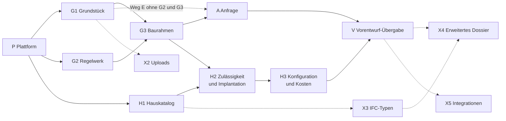
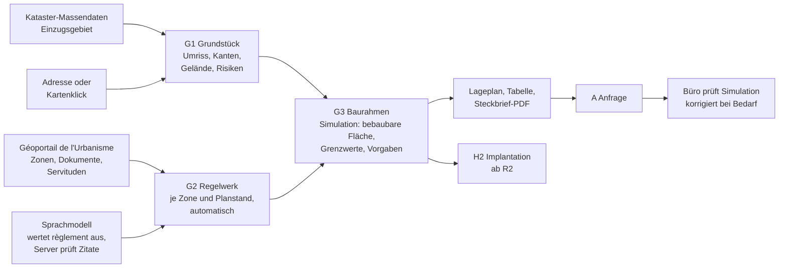
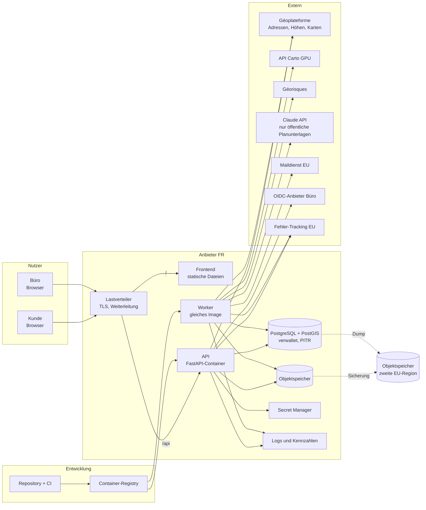

# Emprise – Umsetzungsplan in Modulen

> **Status:** Vorschlag zur Entscheidung; daraus beauftragt und umgesetzt: R0 (Modul P), G1, G2, G3, H1, A, H2, H3 und V; Entscheidungen in Kapitel 9. Daneben ist das zweite Produkt „Emprise Analyse“ beauftragt (D18, eigener Plan [docs/PLAN_ANALYSE.md](docs/PLAN_ANALYSE.md)) · **Stand:** 25.09.2026 · Umsetzungsstand je Modul: [HANDOFF.md](HANDOFF.md) Abschnitt 1; Festlegungen der Umsetzung: [docs/ANNAHMEN.md](docs/ANNAHMEN.md); Modulpläne: `docs/PLAN_<Modul>.md`
> **Bezug:** `BACKEND_SPEZIFIKATION.md` (fachliche Regeln und Algorithmen), `Hauskonfigurator.jsx` (Oberfläche)
> **Verhältnis zur Spezifikation:** Dieser Plan legt Zuschnitt, Reihenfolge und IT-Infrastruktur fest. Fachliche Details stehen weiter in der Spezifikation und werden hier nur mit Kapitelnummer verwiesen („Spez. 5.3“). Wo der Plan abweicht, steht es in Kapitel 7. Nach Freigabe ersetzt er Kapitel 14 (Meilensteine) der Spezifikation; die Abweichungen werden dort eingearbeitet.

---

## 1. Grundsätze

1. **Jedes Release ist allein produktiv nutzbar.** Kein Modul wartet auf ein späteres, um Nutzen zu stiften.
2. **Risiko zuerst.** Früh geprüft werden: Qualität der Katasterdaten, Qualität der automatischen Regelauswertung, Nachfrage.
3. **Inhalte gehören zum Release.** Ein Modul ohne Typdaten oder Rechtstexte ist nicht produktiv (Kapitel 8). Regelwerke entstehen automatisch (3.4).
4. **Wenige Bausteine.** Modularer Monolith, eine Datenbank, verwaltete Dienste in Frankreich.
5. **Ausbau nach Auslösern, nicht nach Kalender.** Aufwendige Automatik (IFC, Uploads) erst, wenn messbar gebraucht (Kapitel 3.11). Ausnahme: Die Auswertung des PLU per Sprachmodell gehört zu G2, weil G2 ohne Eingaben des Büros funktionieren muss (D11).
6. **Einheitliche Produktionsreife** für jedes Modul (Kapitel 4).
7. **Simulation vor Prüfung.** Grundstück, Regeln und Baurahmen entstehen vollautomatisch und sind eine unverbindliche Simulation. Das Büro prüft das Ergebnis erst, wenn der Kunde Kontakt aufnimmt (A). Kein Kundenschritt wartet auf das Büro (Annahme G21, D11).

---

## 2. Modullandkarte

### 2.1 Module

| Kürzel | Modul | Liefert | Release |
|---|---|---|---|
| **P** | Plattform | Hosting, Auslieferung, Anmeldung, Rollen, Queue, Speicher, Mail, Rechtstexte, Überwachung, Büro-Rahmen | R0 |
| **G1** | Grundstück | Aus Adresse oder Kartenklick ein bestätigtes Grundstück mit eingeordneten Kanten, Gelände, Risiken; alternativ ein frei gezeichnetes, bemaßtes Grundstück ohne Bebaubarkeitscheck (Weg E, 3.3) | R1 |
| **G2** | Regelwerk | Zone, Planunterlagen, automatisch per Sprachmodell ausgewertete Regeln mit geprüftem Zitat, Abdeckung, Planstandsprüfung – ohne Eingaben des Büros | R1 |
| **G3** | Baurahmen | Simulierte Rahmenbedingungen des Grundstücks: bebaubare Fläche, Grenzwerte, Vorgaben, Hinweise; Steckbrief als PDF | R1 |
| **A** | Anfrage | Kontakt, E-Mail-Bestätigung, Einwilligung, Snapshot, Mail an Büro, Zugangslink, Export und Löschung, Anfragenliste im Büro, Prüfung der Simulation durch das Büro | R1 |
| **H1** | Hauskatalog | Typen, Varianten, Linien, Optionen, Preise, RE2020-Bewertungen – von Hand gepflegt, versioniert | R2 |
| **H2** | Zulässigkeit und Implantation | Welche Typen passen, Lage verschieben und drehen, Prüfung je Kante, Schnellstellungen | R2 |
| **H3** | Konfiguration und Kosten | Linie, Optionen, Ausschlüsse, Regelprüfung der Auswahl, RE2020-Status, Kostenkorridor | R2 |
| **V** | Vorentwurf-Übergabe | Neuprüfung beim Absenden, Snapshot, Dossier-PDF, Lageplan als DXF, Zustände, Nachrichten | R2 |
| **X2–X5** | Ausbau | Uploads, IFC-Typen, erweitertes Dossier, Integrationen (X1 ist in G2 aufgegangen) | nach Auslöser |

Oberflächen für das Büro gehören jeweils zu ihrem Fachmodul (Kantenkorrektur zu G1, Korrektur von Regeln zu G2, Katalogpflege zu H1). Das Büro nutzt sie beim Prüfen einer Anfrage (A); kein Kundenschritt setzt sie voraus. P stellt nur Anmeldung, Navigation und Rechte bereit.

A funktioniert auch ohne Baurahmen: Liegt ein Grundstück außerhalb des Einzugsgebiets oder konnte die Simulation nicht erstellt werden (kein PLU im GPU, Auswertung gescheitert), entsteht eine Anfrage ohne Baurahmen. Die Abhängigkeit G3 → A ist deshalb weich.

**A bleibt Notausgang, auch mit Baurahmen und auch nach H1–H3 (Entscheidung D14, 17.09.2026):** Der geplante Regelweg für den fertigen Konfigurator ist G3 → H2 → H3 → V – eine einzige Anfrage erst nach der vollständigen Konfiguration (Spez. 3.4 Gesamtablauf), ohne Büro-Input davor (D11). A direkt nach G3 bleibt aber dauerhaft als zusätzlicher, schnellerer Weg bestehen: Wer nicht konfigurieren will oder kann, fragt sofort mit der Simulation aus G1–G3 an, auch wenn ein gültiger Baurahmen vorliegt. V erweitert dieselbe Anfrage um Konfiguration und Auswertung, falls der Kunde doch noch konfiguriert (3.10).

G1 liefert außerdem einen fünften Weg ganz ohne Kataster (Weg E, 3.3): Wer sein Grundstück nicht über Adresse oder Karte einordnen will oder kann, zeichnet den Umriss selbst und bemaßt ihn. Für diesen Weg entfallen G2 und G3 vollständig – die Abhängigkeit zu G3 ist hier nicht nur weich, sondern besteht gar nicht.

### 2.2 Abhängigkeiten



### 2.3 Releases

| Release | Module | Produktiver Nutzen | Größe (grob) |
|---|---|---|---|
| **R0 Fundament** | P | Betriebsfähige Plattform, auf die Module ohne Umbau aufsetzen | 3–5 PW |
| **R1 Bebaubarkeitscheck** | G1, G2, G3, A | „Was darf ich auf diesem Grundstück bauen?“ als unverbindliche Simulation mit Lageplan, Grenzwerten und Zitaten, ohne Vorarbeit des Büros; qualifizierte Anfrage, die das Büro mit der Simulation prüft | 15–24 PW |
| **R2 Hauskonfigurator** | H1, H2, H3, V | Vorentwurf mit Typ, Linie, Optionen, Lage und Kostenkorridor auf echtem Grundstück | 15–25 PW |
| **R3+ Ausbau** | X2–X5 | Mehr Gemeinden, mehr Typen, mehr Büros | je Modul |

Größen in Personenwochen (PW) für eine erfahrene Entwicklerperson mit Claude Code, ohne Inhaltsarbeit, Rechtstexte und Gestaltung. Grobe Größenordnung; nach R1 anhand der tatsächlichen Dauer nachkalibrieren.

Jedes Release wird in drei Stufen eingeführt: **intern** (Büro testet mit echten Grundstücken) → **geschlossene Beta** (ausgewählte Interessenten) → **öffentlich** im Einzugsgebiet. Freigeschaltet wird über Feature-Flags, nicht über getrennte Codestände.

---

## 3. Module im Einzelnen

Jedes Modul ist ein senkrechter Schnitt: Tabellen, Fachlogik, API, Oberfläche für Kunde und Büro, Hintergrundjobs, Tests, Überwachung, Betriebsanleitung.

### 3.1 Kette vom Plan zum Baurahmen



Die ganze Kette bis zum Steckbrief läuft ohne Eingaben des Büros. Das Büro greift erst nach der Kontaktaufnahme ein (A). Seine Korrekturen verbessern das Regelwerk der Zone für spätere Simulationen, sind aber nie Voraussetzung.

### 3.2 P – Plattform (R0)

**Zweck:** Alles, was jedes Modul braucht, einmal richtig.

| Bereich | Umfang |
|---|---|
| Code | Ein Repository (`frontend/`, `backend/`, `infra/`, `docs/`), Schutz des Hauptzweigs, Pull Requests mit CI |
| Auslieferung | Pipeline Test → Staging → Produktion, Migrationen als eigener Schritt, Rückrollen auf das vorige Image (Kapitel 6.5) |
| Anmeldung | Kunden: anonymes Projekt-Cookie, später E-Mail-Code (in A). Büro: OIDC mit MFA (Kapitel 6.7) |
| Rechte | Rollen `customer`, `architect`, `rules_admin`, `catalog_admin`, `ops` (Spez. 6.2); Prüfung je Endpunkt, getestet |
| Querschnitt | Audit-Log, Job-Queue in PostgreSQL, Objektspeicher, Mailversand, Feature-Flags, Problem-Details-Fehler (Spez. 6.1) |
| Sprache | Französisch führend, Deutsch zusätzlich, ab dem ersten Bildschirm über Übersetzungsschlüssel |
| Rechtstexte | Mechanismus für versionierte Texte (Hinweise L7, Einwilligungen, Datenschutzerklärung) mit Ausgabe über `GET /legal/notices`; die Texte selbst entstehen in R1 (Kapitel 8) |
| Überwachung | Strukturierte Logs, Fehler-Tracking, Uptime-Prüfung, Alarme, Sicherung mit getesteter Wiederherstellung |
| Büro-Rahmen | Anmeldung, Navigation, leere Startseite unter `/buero` |
| Frontend | Vite, React, TypeScript, Tailwind im Build (kein CDN-Skript), API-Client aus OpenAPI erzeugt; Planblatt-, Lageplan- und Maßkettenkomponenten aus dem Mockup übernommen |

**Codeaufbau Backend** (nach Fachmodulen statt nach Schichten, damit Module einzeln lieferbar sind):

```
backend/app/
  platform/        Anmeldung, Rollen, Audit, Queue, Speicher, Mail, Rechtstexte, Flags
  integrations/    geoplateforme, gpu, georisques, mail
  site/            G1   je Modul: domain/ (rein, ohne I/O), models.py, service.py, api.py, jobs.py
  rules/           G2
  envelope/        G3
  inquiry/         A, erweitert durch V
  catalog/         H1
  placement/       H2
  configuration/   H3
```

Module rufen einander nur über `service.py` auf, nie über fremde Tabellen. `domain/` hängt nicht von FastAPI, SQLAlchemy oder der Queue ab (Spez. 12). Umgesetzt liegt H2 in `configuration/` (ein Paket `placement/` gibt es nicht); laut Plan H2 4.1 erweitern H3 und V dasselbe Paket.

**Abnahme:** Leere Anwendung läuft in Staging und Produktion; Auslieferung und Rückrollen per Pipeline vorgeführt; Wiederherstellung einer Sicherung in Staging vorgeführt; Alarm bei Ausfall kommt an; Anmeldung Büro mit MFA; Übersetzung fr/de wirksam.

### 3.3 G1 – Grundstück (R1)

**Zweck:** Aus Adresse oder Kartenklick ein bestätigtes Grundstück mit eingeordneten Kanten.

**Umfang:**
- Adresssuche mit Vorschlägen
- Karte mit Luftbild oder Plan und Parzellen; Auswahl einer oder mehrerer zusammenhängender Parzellen
- Grundstück bilden, Flächenvergleich, Kanten vereinfachen und einordnen (Spez. 5.1.3, 5.1.4)
- Kantenkorrektur: Kunde einfach („Straße“ oder „Nachbar“), Architekt vollständig. Eine Korrektur durch den Kunden kann den Baurahmen vergrößern; sie wird deshalb in der Simulation als unbestätigt gekennzeichnet und vom Architekten beim Prüfen einer Anfrage bestätigt
- Gelände über den Höhendienst (Spez. 5.9.4), Risiken über Géorisques (Spez. 5.9.5)
- Hinweis zur Katastergenauigkeit (L7)

**Nicht in R1:** Datei-Uploads und Georeferenzierung (→ X2). Grundstücke außerhalb des Einzugsgebiets: keine Parzellenauswahl, da es dort ohnehin keine Regelwerke gibt; stattdessen Hinweis und Anfrage ohne Baurahmen (A).

**Daten:**

| Tabelle | Inhalt |
|---|---|
| `ref_parcel`, `ref_building` | Kataster-Massendaten des Einzugsgebiets in Lambert-93, GiST-Index |
| `ref_import` | Quelle, Stand, SHA-256, Anzahl, Importzeit |
| `parcel`, `site`, `site_edge`, `terrain`, `site_risk` | Projektdaten nach Spez. 4.2; `parcel` ist eine Kopie zum Zeitpunkt der Auswahl |

**Ablauf:**

1. `GET /geocode?q=` – Weiterleitung mit Cache an die Géoplateforme; Rate-Limit.
2. `GET /cadastre/parcels?bbox=` – GeoJSON aus `ref_parcel` ab Zoomstufe 17. Die Karte zeigt dieselben Daten, die ausgewählt werden; ein fremder Kartenlayer mit anderem Datenstand würde Klick und Anzeige auseinanderlaufen lassen.
3. `POST /projects/{id}/parcels/lookup` – Parzelle am Punkt (`ST_Contains`), sonst alle im Umkreis von 20 m zur Auswahl.
4. `PUT /projects/{id}/site` – Vereinigung, Zusammenhangsprüfung, Kanteneinordnung mit Nachbarparzellen und Gebäuden; `site.revision + 1`.
5. Job `site_enrich` – Höhen und Risiken; bei Ausfall Hinweis „nicht abgefragt“, kein Abbruch.
6. `PATCH /projects/{id}/site/edges/{seq}` – Korrektur mit Audit.

**Massendaten-Import:** Job im Rhythmus der Quelle (Etalab-Kataster, Rhythmus prüfen): Download je Département → Staging-Tabelle → Plausibilität (Anzahl ± 2 % zum Vorstand, gültige Geometrien) → Tabellentausch in einer Transaktion. Bestätigte Grundstücke behalten ihre Kopie. Die Kataster-API (Spez. 9) wird erst gebraucht, wenn das Einzugsgebiet ohne Import erweitert werden soll.

**Ausfallverhalten:** Parzellen kommen aus der eigenen Datenbank. Fällt die Géoplateforme aus, fehlen Adresssuche und Hintergrundkarte, die Parzellen bleiben aber sichtbar und per Klick wählbar.

**Schwierige Fälle** (Pflicht in den Tests): Eckgrundstück; Pfeifenstielgrundstück (terrain en drapeau), bei dem die Regel aus Spez. 5.1.4 die Kanten des hinterliegenden Teils nicht eindeutig einordnen kann – die richtige Einordnung hängt vom Lexique des PLU ab, deshalb niedrige Konfidenz und Bestätigung durch den Architekten; Privatweg als eigene Parzelle; mehrere Parzellen; Flächenabweichung über 3 %.

**Abnahme:** Jede Kante korrigierbar. Parzellensuche p95 unter 500 ms. Simulierter Ausfall der Géoplateforme: Parzellenwahl per Klick funktioniert weiter. ~~Testmenge von 40 realen Grundstücken mit von Hand bestimmten Kantenarten, mindestens 90 % automatisch richtig~~ – **entfällt (Entscheidung 14.09.2026, Annahme G21):** Die Kanten werden automatisch eingeordnet; der Architekt prüft sie erst, wenn eine Anfrage eingeht (Modul A).

**Größe:** M (3–5 PW).

**Zusatz zu G1: Weg E – Freies Zeichnen (ohne Bebaubarkeitscheck)**

**Zweck:** Wer sein Grundstück nicht über Adresse oder Kataster einordnen will oder kann – etwa bei eigener Vermessung, einem vorliegenden Certificat d'urbanisme oder wenn der Bebaubarkeitscheck bewusst nicht gebraucht wird –, zeichnet den Umriss selbst und bemaßt ihn. Das Ergebnis ist direkt Grundlage für den Konfigurator, ganz ohne Regelprüfung.

**Abgrenzung zu den Wegen A–D (Spez. 5.1.1):** kein Bezug zu Kataster oder Karte, kein Kartenhintergrund, keine Georeferenzierung, kein GDAL. Bewusst der einfachste der fünf Wege – deshalb zusammen mit G1 umsetzbar, nicht erst mit X2 (Uploads, Georeferenzierung).

**Umfang:**
- Adresse (Pflicht, nur Beschriftung für Anzeige und eine spätere Anfrage; keine Geokodierung, keine Parzellensuche)
- Zeichnen auf einem freien Koordinatenraster ohne Kartenbezug: Punkte setzen, Umriss schließen
- Bemaßung je Kante: Länge eintragen, Winkel aus der Zeichnung; das Polygon wird aus den eingegebenen Maßen serverseitig neu aufgebaut (L5), nicht nur clientseitig gezeichnet – Bemaßung ist damit exakt, nicht nur eine Näherung der Zeichnung. Die zuletzt gezogene Kante schließt das Polygon automatisch und ist nicht frei bemaßbar: Bei `n` Kanten legen Länge und Winkel von `n − 1` Kanten das Polygon eindeutig fest, die letzte Kante ergibt sich aus dem Schlusspunkt (Anzeige „wird berechnet“)
- Live-Vorschau mit Flächenangabe vor dem Bestätigen
- **G2 und G3 werden für diesen Weg nicht aufgerufen:** kein Baurahmen, kein Steckbrief, keine Kosten für Regelauswertung
- Eigener Hinweistext (L7), deutlich abgesetzt vom Hinweis der anderen Wege: „Diese Fläche wurde nicht mit dem Bebauungsplan abgeglichen. Die Vereinbarkeit mit den geltenden Vorschriften ist nicht geprüft.“ (neuer Schlüssel `notice.manual_sketch`, Rückfalltext bis eine endgültige Formulierung vorliegt, wie bei den übrigen Hinweistexten aus G16)

**Nicht:** Kantenklassifikation (Straße/Nachbar/hinten) entfällt inhaltlich, da es keine PLU-Abstände zu prüfen gibt; Gelände- und Risikoabfrage entfallen, da sie an der echten Position hängen; nachträglicher Wechsel von `manual_sketch` zu einem Kataster-Grundstück am selben Projekt – dafür ein neues Projekt anlegen.

**Daten:** Abweichend von Spez. 4.2 (Tabelle `site`) neues Feld `site.origin ∈ {parcel, manual_sketch}`. Bei `manual_sketch` bleibt `parcel_ids[]` leer (kein `parcel`-Datensatz, da kein Kataster beteiligt ist); `site_edge`, `terrain`, `site_risk` bleiben ebenfalls leer. Bestehende und über die Wege A–D gebildete Grundstücke erhalten `origin = parcel`.

**Ablauf:**
1. Projekt anlegen (wie bisher), Adresse eingeben.
2. Zeichnen und Bemaßen im Frontend; bestehender Endpunkt `PUT /projects/{id}/site` um eine Variante ohne `parcel_ids` ergänzt, stattdessen `edges: [{length_m, angle_deg}]` für `n − 1` Kanten, woraus der Server das geschlossene Polygon baut.
3. Serverseitige Prüfung (Schranken statt Freigabe, wie in G2/G3): keine Selbstüberschneidung, Mindestfläche und Mindestkantenlänge plausibel.
4. Kein Job `site_enrich`, kein Aufruf von G2/G3 (`GET /projects/{id}/envelope` liefert wie bei anderen fehlenden Voraussetzungen Status `unavailable` mit `reason = manual_sketch`, kein Fehler).
5. Ergebnis direkt sichtbar: Umriss, Fläche, Hinweistext; weiter zum Konfigurator (R2, siehe unten).

**Abnahme:** Zeichnen und Bemaßen ergibt exakt das eingegebene Polygon (Rundungstoleranz 1 cm); Selbstüberschneidung wird abgelehnt mit verständlicher Meldung; G2 und G3 werden nachweislich nicht aufgerufen (kein Job, keine Kosten); der Hinweistext erscheint sichtbar getrennt vom Baurahmen-Hinweis der anderen Wege.

**Größe:** M (2–4 PW) – kein Kataster, keine Nachbarparzellen, keine Kantenklassifikation und keine externen Dienste, aber ein eigenes interaktives Zeichen- und Bemaßungswerkzeug (Frontend) mit serverseitigem Polygonaufbau und Schließungslogik (Backend) ist mehr als reine Datenverdrahtung.

**H2 ohne Baurahmen (D13):** nach Empfehlung genommen, freier Modus im Umriss (ANNAHMEN HP02).

**Umgesetzt am 17.09.2026**, Abnahme erfüllt. Abweichungen von diesem Abschnitt (ANNAHMEN G26–G30): `PUT …/site` erweitert statt eines zweiten Endpunkts (`parcel_idus` oder `edges`, G27); ein Grundstück anderer Herkunft wird nicht überschrieben (`409 site_origin_mismatch`, G28); eigene Ansicht `ManuelleZeichnungAnsicht` statt `GrundstueckPruefen` (G30).

### 3.4 G2 – Regelwerk (R1)

**Zweck:** Für jede Zone im Einzugsgebiet automatisch ein Regelwerk mit geprüften Zitaten, das den Baurahmen als Simulation speist, **ohne Eingaben des Büros** (Entscheidung D11 vom 14.09.2026).

**Grundsatz:** Die Auswertung ist nicht kontraktuell, sondern eine Simulation auf Grundlage öffentlicher Planunterlagen. Kunden sehen sie sofort und deutlich als Simulation gekennzeichnet (L7). Das Büro prüft sie erst, wenn eine Anfrage eingeht (3.6). Verbindlich ist allein das Certificat d'urbanisme.

**Warum das tragfähig ist:** Regeln gelten je Zone eines Planstands, nicht je Parzelle. Die Auswertung läuft einmal je Zone und Planstand, nicht je Kunde. Kosten und Laufzeit fallen beim Eingang eines Planstands an, nicht im Kundenablauf.

**Umfang:**
- Zone automatisch aus dem GPU ermitteln, einschließlich Sektoren (z. B. `UBa`) und Teilflächen bei mehreren Zonen (Spez. 5.2.1, 5.2.2)
- Planunterlagen (règlement écrit, Zonenplan) automatisch laden und mit SHA-256 ablegen. Ist ein Link defekt oder fehlt der Text: Status `nicht verfügbar`, Anfrage ohne Baurahmen (2.1); das Büro muss nichts hochladen
- Überlagernde Vorgaben aus dem GPU als Hinweis, u. a. Servituden wie der Schutzbereich eines Baudenkmals (Zustimmung des Architecte des Bâtiments de France nötig)
- **Automatische Regelauswertung** nach Spez. 5.2.3 Schritte 1–4: Text extrahieren (OCR bei Bedarf), Zonenkapitel und allgemeine Bestimmungen finden, Auswertung per Claude mit strengem JSON-Schema, Zitat serverseitig auf der angegebenen Seite prüfen. Schritt 5 (Freigabe) entfällt
- **Automatische Schranken statt Freigabe:**
  - Eine Regel ohne verifiziertes Zitat wirkt nicht auf den Baurahmen: Status `unknown` mit Hinweis und Link zur Seite
  - Plausibilitätsgrenzen je Regelart (z. B. Abstände 0–50 m, Grundflächenzahl 0–1, Höhen bis 30 m); Werte außerhalb ergeben `unknown`
  - `not_regulated` nur mit verifiziertem Zitat (z. B. „non réglementé“), sonst `unknown`. Nie ein erfundener Standardwert: Ein unbelegtes „nicht geregelt“ würde einen Abstand von 0 m bedeuten und den Baurahmen vergrößern
  - Zwei unabhängige Auswertungsläufe je Zone; weichen die Werte ab, gilt die Regel als `unknown` mit Hinweis „Text mehrdeutig“
- Abdeckung je Gemeinde und Zone: `nicht verfügbar`, `in Auswertung`, `simuliert`, `vom Büro geprüft`, `veraltet`
- Wöchentliche Prüfung auf neue Planstände (Spez. 5.2.5); ein neuer Planstand löst die Auswertung automatisch aus. `veraltet` gilt nur, bis die neue Auswertung fertig ist, oder wenn sie scheitert
- **Korrekturen durch das Büro** (freiwillig, beim Prüfen einer Anfrage): Wert oder Zitat einer Regel ändern, entweder **für die Zone** (neue Regelwerksversion mit Status `vom Büro geprüft`, gilt für spätere Simulationen) oder **nur für das Projekt** (z. B. Lotissement, Sonderfall). Formular aus demselben Schema, PDF-Seite daneben
- **Lotissement:** Viele Neubaugrundstücke liegen in einem Lotissement mit eigenen, oft strengeren Regeln, die nicht im GPU stehen. Der Kunde wird gefragt; die Simulation zeigt dann „Regeln des Lotissement nicht berücksichtigt“. Das Büro berücksichtigt sie bei der Prüfung der Anfrage als Korrektur für das Projekt
- Gemeinden ohne PLU (RNU, Carte communale): `rules_unavailable` wie Spez. 5.2.1, Hinweis statt simulierter Grenzwerte

**Nicht in R1:** Zonenpläne nur als PDF ohne GPU-Daten (→ X2); Upload von Lotissement-Unterlagen durch Kunden mit automatischer Auswertung (→ X2).

**Daten:** `land_use_plan`, `zone`, `overlay_constraint`, `rule_set`, `rule_set_version`, `rule` (Spez. 4.2); zusätzlich `source_file` für Planunterlagen, `rule_extraction_run` (Modell, Prompt-Version, Kosten, Dauer, Ergebnis je Lauf), `project_rule_override` für Korrekturen nur eines Projekts und die Sicht `coverage`. Abweichend von Spez. 4.2: `rule_set_version.status ∈ {simulated, office_reviewed, retired}` statt `draft`/`validated`; `rule.decision` entfällt, dafür `origin ∈ {extraction, office}`.

**Technik:**
- Regelarten als Pydantic-Modelle; daraus JSON-Schema für das Sprachmodell (strict), für die API und für das Korrekturformular des Büros. Eine Quelle, keine doppelte Pflege.
- Auswertung als Job `rules_extract` je Zone und Planstand im Worker, nie im Kundenrequest; Zeitlimit, Wiederholung, Kostenbudget je Lauf und Monat; `input_hash` über Dokument-SHA-256, Modell und Prompt-Version.
- Anbindung von Claude nach der Skill `claude-api` (Spez. 0 Punkt 6): Modell aus der Konfiguration, Seitenbereiche als PDF-Dokumentblock, Rückrechnung der Seitennummern (Spez. 5.2.3). Nur öffentliche Planunterlagen im Prompt, keine Kundendaten (L8). Der Dokumenttext gilt als Daten: Ausgabe nur über das Schema, danach die Schranken oben.
- Die Kunden-API liefert je Regel `origin`, Zitat, `quote_verified` und Status; jede Antwort trägt `simulation: true` und den Hinweis nach L7.
- PDF-Anzeige mit pdf.js: Kunde öffnet die zitierte Seite, das Büro sieht sie neben dem Korrekturformular.
- Planstandsprüfung: Job vergleicht Dokumentkennung und Datum im GPU. Bei Änderung: neuer `land_use_plan`, neue Auswertung; offene Projekte erhalten beim nächsten Abruf die neue Simulation mit Hinweis „Planstand geändert“. Abgesendete Anfragen behalten ihren Snapshot.
- **Referenzmenge** (Spez. 11.4) für Regressionstests: aufgezeichnete Modellantworten und von der **Entwicklung** am Text geprüfte Sollwerte für die Zonen von Treillières. Änderungen an Prompt oder Modell nur mit Vergleich gegen den letzten Bericht. Das Büro wird dafür nicht gebraucht.

**Abnahme:** Alle Zonen von Treillières (D1) automatisch ausgewertet, ohne Eingabe des Büros. Gegen die Referenzmenge höchstens 5 % der Pflichtwerte falsch und höchstens 15 % `unknown` (Zielwerte nach der ersten Messung kalibrieren). Eine Regel ohne verifiziertes Zitat wirkt nie auf den Baurahmen (Test). Planstandsänderung mit aufgezeichneter GPU-Antwort erkannt und neu ausgewertet. Ausfall der Claude API: vorige Version bleibt oder Status `in Auswertung`, kein Fehler beim Kunden. Kosten und Dauer je Zone gemessen.

**Größe:** L (6–9 PW): Auswertung mit Schranken, Referenzmenge, Planstandsprüfung, Korrekturformular. Die Erfassungsoberfläche mit Markieren im PDF entfällt.

### 3.5 G3 – Baurahmen (R1)

**Zweck:** Aus Grundstück und Regelwerk die Rahmenbedingungen, in die ein Haus gesetzt werden kann, als unverbindliche Simulation ohne Eingaben des Büros (D11). G3 ist die Schnittstelle zwischen Standort und Haus: H2 prüft später jede Lage gegen diesen Baurahmen.

**Inhalt:**

| Bestandteil | Herleitung | Spez. |
|---|---|---|
| Teilflächen je Zone | Verschneidung Grundstück × Zonen | 5.2.2 |
| Bebaubare Fläche `B(0)` und `B(H_max)` | Grundstück minus Abstandsstreifen je Kante minus Bauverbotsflächen | 5.3.1, 5.3.2 |
| Abstandsfunktion je Kante | Mindestmaß, Höhenfaktor, Höhenbasis, Bezugskontur, Bauen auf Grenze | 5.3.4 |
| Höchste Grundfläche je Teilfläche | Grundflächenzahl × Fläche der Teilfläche | 5.3.2 |
| Höhengrenzen | First, Traufe, Attika, Geschosse, Bezugshöhe aus dem Gelände | 5.9.4 |
| Dach- und Fassadenvorgaben | Formen, Neigungen, Firstrichtung, Materialklassen, Farbfamilien | 5.2.4 |
| Freifläche, Stellplätze, Nebengebäude | Mindestwerte aus den Regeln | 5.9.2 |
| Hinweise | Eckgrundstück, Hanglage über 5 %, mehrere Zonen, Lotissement, Denkmalschutz, Risiken, L7 | – |
| Simulationsstatus und Herkunft | Kennzeichen „Simulation“ am ganzen Baurahmen; je Wert Herkunft (`extraction`, `office`), Zitat mit Prüfstatus, `unknown` mit Grund, verwendete Versionen; Hinweise bei veraltetem Planstand, unbestätigter Kundenkorrektur einer Kante oder nicht berücksichtigtem Lotissement | L3, L7, D11 |

**Technik:**
- Reine Funktion `derive_envelope(site, edges, terrain, rule_sets) → Envelope` in `envelope/domain`, ohne Datenbank und Netz, deterministisch, mit `input_hash` über Grundstücksrevision, Regelwerksversionen und Engine-Version.
- Speicherung als Cache `site_envelope`; ungültig bei neuer Grundstücksrevision oder neuer Regelwerksversion; Neuberechnung beim nächsten Abruf statt in Stapelläufen.
- Nennt der PLU nur Geschosse (`R+1+C`) und keine Meter, rechnet G3 mit Standard-Geschosshöhen (Konstanten, Wert in `docs/ANNAHMEN.md`) und führt die Annahme in `provenance`. Das Büro kann den Wert beim Prüfen einer Anfrage korrigieren.
- Ist eine Abstandsregel `unknown`, rechnet G3 die bebaubare Fläche ohne diesen Abstand, markiert die betroffenen Kanten im Lageplan („Abstand nicht ermittelt“) und weist darauf hin, dass die Fläche zu groß sein kann. Ohne Grundflächenzahl oder Höhe fehlt der jeweilige Grenzwert mit Hinweis, statt geschätzt zu werden.
- `GET /projects/{id}/envelope` liefert lokale Meter (Ursprung `site.local_origin`, Achsen Ost/Nord) und GeoJSON.
- Oberfläche: Schritt 3 des Mockups; Lageplan als SVG mit den Mockup-Komponenten (im SVG die y-Achse umkehren, da Nord oben); Tabelle „Was darf ich bauen?“ mit Zitat je Wert; Kennzeichnung „Simulation – unverbindlich“ an Lageplan, Tabelle und Steckbrief.
- Steckbrief als PDF (WeasyPrint im Worker) mit derselben Grafik.

**Abnahme:** Parität 14,0 × 21,0 m = 294 m² (Spez. 11.2); Rechenbeispiel D4 und aus D10 die Grenzwerte je Teilfläche (UB 200 m², N 0 m²; die Prüfung mit Haus folgt in H3) (Spez. Anhang D); Eigenschaftstests; Mehrzonenfall; Bauverbotsfläche; Abstandsregel `unknown` markiert die Kante und den Hinweis; p95 unter 300 ms; Steckbriefe für die realen Testgrundstücke aus G1 automatisch erzeugt, ohne Eingabe des Büros. ~~Steckbrief für 10 reale Grundstücke vom Architekten fachlich bestätigt~~ – entfällt (D11).

**Größe:** M (3–5 PW).

**Umgesetzt am 16.09.2026** nach [docs/PLAN_G3_BAURAHMEN.md](docs/PLAN_G3_BAURAHMEN.md), Abnahme erfüllt. Abweichungen von diesem Abschnitt (ANNAHMEN BR01–BR15): zwei Konturen (weiteste und engste Auslegung jeder mehrdeutigen Regel: Höhe, Bauen auf der Grenze, Bauband, Kantenart, einschränkende Vorgaben; ohne mehrdeutige Regel gleich) statt `B(0)`/`B(H_max)` (BR01); Bauband als Fläche über den G2-Parameter `band` (BR02); kein Zwischenspeicher `site_envelope`, Prüfsumme über den Inhalt der Eingaben (BR07); Teilflächen ohne Regeln oder mit Grundflächenzahl 0 in keiner Kontur (BR04); Vorgaben nach CNIG-Typ (BR05); kein Höhenbezug auf Straßenniveau und keine Angabe in m NGF (BR09).

### 3.6 A – Anfrage (R1)

**Umgesetzt am 18.09.2026** nach [docs/PLAN_A_ANFRAGE.md](docs/PLAN_A_ANFRAGE.md); Abweichungen dort in Kapitel 8 und in ANNAHMEN AF01–AF12; nicht umgesetzt: Anfrage ohne Grundstück außerhalb des Einzugsgebiets (AF11).

**Zweck:** Aus dem Bebaubarkeitscheck eine verwertbare Anfrage an das Büro. Bleibt nach H1–H3 als Notausgang bestehen (D14): schnellere Anfrage ohne Konfiguration, auch mit gültigem Baurahmen.

**Umfang:**
- Anonymes Projekt bis zur Kontaktaufnahme
- Kontaktformular; **E-Mail-Code vor dem Absenden** (keine Anfrage mit unbestätigter Adresse, keine Verfallszustände)
- Bestätigung „unverbindlich“ und Einwilligung zur Übermittlung an das namentlich genannte Büro, Textversion gespeichert
- Snapshot aus Grundstück und Baurahmen mit Simulationsstand: Regelwerksversionen, `unknown`-Werte, unbestätigte Kundenkorrekturen (oder ohne Baurahmen, siehe 2.1); Vorgangsnummer aus Datenbank-Sequenz
- Mail an das Büro mit Steckbrief (gekennzeichnet als Simulation), Kopie an den Kunden, Zugangslink zum Projekt
- Anfragenliste im Büro mit Status `neu`, `in Bearbeitung`, `beantwortet`, `geschlossen`
- **Prüfung der Simulation durch das Büro** beim Eingang der Anfrage, erstmals hier (Entscheidungen G21 und D11 vom 14.09.2026): Das Anfrage-Detail zeigt Grundstück mit Kanten, Regeln mit Zitat und Status sowie den Baurahmen. Das Büro bestätigt oder korrigiert Kanten (G1) und Regeln für die Zone oder nur das Projekt (3.4) und sieht die Auswirkung auf den Baurahmen. Automatische Einordnung, `unknown`-Werte und unbestätigte Kundenkorrekturen hindern das Absenden nie. Die Büro-Prüfliste der Grundstücke zeigt dann nur Projekte mit Anfrage
- Export und Löschung für Kunden (Spez. 10.2)
- Hinweis in der Antwortvorlage des Büros: verbindliche Auskunft über ein Certificat d'urbanisme bei der Gemeinde

**Technik:** Tabellen `customer`, `project`, `inquiry`, `consent`, `audit_log`; Mails und Folgeschritte als Jobs in derselben Transaktion wie die Anfrage (die Queue in PostgreSQL ersetzt die Outbox, Kapitel 6.3); Idempotenz-Schlüssel; E-Mail-Codes gehasht, 10 Minuten gültig, Versand je Adresse und IP begrenzt; Links signiert und ohne personenbezogene Daten.

**Abnahme:** Doppelklick erzeugt eine Anfrage; Ausfall des Maildienstes verliert keine Anfrage; Löschung entfernt Daten und Dateien; Codeversand an fremde Adressen in Serie wird gebremst; eine Korrektur des Büros für ein Projekt ändert die Simulation anderer Projekte nicht, eine Korrektur für die Zone gilt für spätere Simulationen, der Snapshot bleibt unverändert.

**Größe:** M (3–5 PW), einschließlich Prüfansicht der Simulation.

### 3.7 H1 – Hauskatalog (R2)

**Umgesetzt am 18.09.2026** (Backend und Katalogpflege-Oberfläche) nach [docs/PLAN_H1_HAUSKATALOG.md](docs/PLAN_H1_HAUSKATALOG.md); Abweichungen in ANNAHMEN H01–H14; offen: die fünf Platzhalter-Typen als echte Dateien.

**Zweck:** Pflegbarer, versionierter Katalog ohne IFC-Import.

**Umfang:**
- Typen mit Kennwerten von Hand (`facts_source = manual`, Spez. 4.3): Umriss Fassade und Projektion als Polygon, Höhen, Dachform, Neigung, Firstrichtung, Geschosse, Wohnfläche, Zimmer, Fassadenrollen der Umrisskanten, Lage von Eingang und Garagentor (für die Zufahrt, Spez. 5.9.3)
- Nur regelrelevante Variantengruppen (z. B. Dachform); reine Materialvarianten sind Optionen
- Linien, Optionen, Ausschlüsse, in Linien enthaltene Optionen
- Preiskatalog mit Versionen; Basispreis, Linienaufpreis und Optionspreise als Spanne **je Typ**
- RE2020-Bewertungen je Typ und Linie für die Klimazone des Einzugsgebiets, mit Ausrichtungsbereich der Gartenfassade (Spez. 5.9.6); fehlt eine Bewertung, zeigt H3 „nicht bewertet“
- Bilder, Axonometrie und Grundriss-PDF als Anhang
- Katalogpflege im Büro mit `draft`, `review`, `published`, `retired`

**Übernahme aus ArchiCAD:** Typdatenblatt als XLSX-Vorlage (Kennwerte, Räume, Preise) und Umriss als eigene Ebene im DXF (Import mit `ezdxf`). Niemand tippt Koordinaten.

**Technik:**
- Veröffentlichte Versionen unveränderlich (Datenbank-Trigger, Spez. 4.1).
- **Preise und RE2020-Bewertungen beziehen sich auf die Typ-Identität** mit Gültigkeit ab einer Typversion. Eine neue Typversion übernimmt sie erst nach Bestätigung der Katalogpflege. So erzwingt eine kleine Modelländerung keinen neuen Preiskatalog und kein neues Gutachten.
- Veröffentlichung gesperrt, wenn Basispreis oder Pflichtkennwert fehlt. Eine fehlende RE2020-Bewertung sperrt nicht (Spez. 5.9.6), damit R2 nicht auf Gutachten wartet.
- Kennwertprüfung: Neigung aus First, Traufe und Tiefe gegen die Angabe (± 2°, Spez. 5.4.5).
- Toleranzen als Konstanten, auch für Winkel (0,1°). Ohne Winkeltoleranz fiele Ligne mit berechneten 34,99° unter die Mindestneigung von 35°.

**Abnahme:** Mockup-Katalog vollständig erfasst; Veröffentlichung unveränderlich (Test); Kennwertprüfung meldet die Abweichung bei Ligne (40° angegeben, 35° aus der Geometrie).

**Größe:** M (3–5 PW).

### 3.8 H2 – Zulässigkeit und Implantation (R2)

**Zweck:** Welche Typen passen auf den Baurahmen, und wo steht das Haus.

**Umfang:** Zulässigkeit je Typ mit allen Gründen und Vorschlägen (Spez. 5.4.6); Lage verschieben und drehen; Prüfung je Kante mit allen Verstößen (Spez. 5.3.4); Schnellstellungen (Spez. 5.3.5); Firstrichtung. Terrasse an der Gartenfassade und Carport an der Straßenkante werden automatisch gesetzt, nicht frei platziert. Der Carport muss dabei die Regeln für Nebengebäude erfüllen; findet sich keine zulässige Stelle, ist die Option mit Begründung nicht wählbar. Alle Regeln sind simuliert (D11); wie stark sie den Konfigurator einschränken, legt D12 fest. Eine Anfrage an das Büro bleibt in jedem Fall möglich.

**Technik:**
- **Erlaubte Lagen als Fläche statt Rasterprobe.** Für eine feste Drehung ist die Menge aller zulässigen Hausursprünge eine Fläche: der Baurahmen „geschrumpft“ um den Hausumriss, je Kante mit der Bezugskontur ihrer Regel (Minkowski-Differenz, z. B. mit `pyclipper`). Daraus folgen direkt: Typ passt (Fläche nicht leer), `street_near` und `set_back` (Punkte der Fläche mit kleinstem Straßenabstand bzw. mittlerer Tiefe), exakte Vorschau im Frontend. `garden_max` hängt von der Restfläche ab und wird aus wenigen Kandidaten auf dem Rand der Fläche gewählt. Die Rastersuche aus Spez. 5.3.6 bleibt Rückfall für Abstände, die von der Höhe der jeweiligen Fassade abhängen.
- Deshalb in R2 **nur Drehungen in festen Schritten**: Kantenrichtungen des Grundstücks und 90°. Freie Drehung später.
- Variantenkombinationen mit gleichem Umriss und gleichen Höhen nur einmal prüfen; Variantengruppen ohne Einfluss auf Prüfungen nicht kombinieren.
- Frontend erhält die Fläche erlaubter Ursprünge je Drehung und prüft beim Ziehen lokal per Punkt-in-Polygon; beim Loslassen `PATCH /configuration` mit `If-Match`; die Serverantwort ist maßgeblich. Die Fläche gilt nur für das Haus; Verstöße von Terrasse oder Carport meldet erst der Server.

**Abnahme:** Paritätsfälle Spez. 11.2, wobei der Firstrichtungsfall mit einem Satteldachtyp statt Plateau (Flachdach) geprüft wird; Eigenschaftstests (Spez. 11.1); Zulässigkeit für bis zu 20 Typen unter 3 s; `PATCH` p95 unter 800 ms.

**Größe:** L (6–10 PW).

**Umgesetzt am 19.09.2026:** H2 nach [docs/PLAN_H2_ZULAESSIGKEIT_IMPLANTATION.md](docs/PLAN_H2_ZULAESSIGKEIT_IMPLANTATION.md) umgesetzt (Backend `backend/app/configuration`, Oberfläche `/konfigurator`, ANNAHMEN HP01–HP20). Abweichungen: Terrasse, Carport und Zufahrt kommen mit H3, weil H1 an einer Option weder Art noch Maße kennt (HP03); `/buildable?height_m=` entfällt zugunsten der Fläche zulässiger Ursprünge je Drehung (HP04).

### 3.9 H3 – Konfiguration und Kosten (R2)

**Umfang:** Linien, Optionen, Ausschlüsse (Spez. 5.5.4), in Linien enthaltene Optionen (Spez. 5.5.6), Regelprüfung der Ausführungen (Fassade, Dach), Grundfläche und Freifläche mit Terrasse, Carport und Zufahrt (Spez. 5.9.3), RE2020-Status mit Konformitätsaufpreis (Spez. 5.9.6), Kostenkorridor (Spez. 5.6.5) aus festen Preisspannen je Typ, Mehrwertsteuer nach Entscheidung E4.

**Technik:** `evaluate()` als reine Funktion in zwei Teilen: **Typteil** (hängt nur von Typ, Varianten, Linie, Optionen ab) wird gecacht; **Lageteil** (Abstände, Himmelsrichtung, Freifläche) wird bei jeder Änderung neu gerechnet. Kein Einzelbetrag in der API (L1).

**Abnahme:** Korridorfälle Spez. 11.2 mit Lärche als fester Spanne je Typ; Freiflächenrechnung mit Zufahrt; in einer Linie enthaltene Option erhöht den Korridor nicht.

**Umgesetzt am 19.09.2026:** H3 nach [docs/PLAN_H3_KONFIGURATION_KOSTEN.md](docs/PLAN_H3_KONFIGURATION_KOSTEN.md) umgesetzt (Backend `backend/app/configuration`, Migration 0010, Oberfläche `/konfigurator` mit den Schritten Linie, Optionen, Vorentwurf und Kostenleiste, ANNAHMEN HK01–HK17). Abweichungen: kein Cache des Typteils (HK12); Terrasse und Carport als Optionsarten mit Maßen und Preis je m² bzw. fest (HK04); Regelprüfung der Ausführungen über Material an Option und Linie statt über Ausführungstabellen (HK08); Photovoltaik-Belegung und Keller bleiben feste Aufschläge (Kapitel 7).

**Größe:** M (3–5 PW).

### 3.10 V – Vorentwurf-Übergabe (R2)

**Umfang:**
- Erweitert A um Konfiguration und Auswertung im Snapshot (Spez. 5.10.4)
- **Vollständige Neuprüfung beim Absenden:** Regelwerke (neuer Planstand, Korrektur des Büros für die Zone), Katalog, Preise und Kantenkorrekturen können sich seit dem Speichern geändert haben. Ergebnis wird vor dem Absenden angezeigt.
- Bestätigung „mit Abweichungen übergeben“ (Spez. 5.10.2 Punkt 6)
- Dossier-PDF: Projektbeschreibung, Lageplan, Regelprüfung mit Zitaten, Kosten (Spez. 5.10.6, gekürzt)
- **Lageplan als DXF** (Grundstück, Kanten, bebaubare Fläche, Hausumriss): in Lambert-93 und zusätzlich in lokalen Metern mit dokumentiertem Ursprung, weil Landeskoordinaten in Millionenhöhe in CAD-Programmen oft unhandlich sind; geringer Aufwand, direkt im Büro nutzbar
- Zustände mit Neuübergabe und `superseded` (Spez. 5.10.1), Nachrichten Büro ↔ Kunde

**Nicht in R2:** IFC-Export, XLSX-Mengen, gestempelte Planunterlagen (→ X4).

**Umgesetzt am 19.09.2026:** V nach [docs/PLAN_V_VORENTWURF_UEBERGABE.md](docs/PLAN_V_VORENTWURF_UEBERGABE.md) (Backend `backend/app/submission`, Prüfstempel in `backend/app/configuration/review.py`, Migration 0011, Oberfläche mit Übergabe im Vorentwurf, `/vorgang`, `/zugang` und den Fassungen im Büro, ANNAHMEN VU01–VU16). Abweichungen: Vorgang (`inquiry`) und Fassung (`submission`) getrennt statt einer erweiterten Anfrage (VU01); Neuprüfung über einen inhaltsbasierten Prüfstempel mit sechs Teilen (VU04); Doppelklickschutz über den Stempel statt `Idempotency-Key` (VU05); Zustände als Erweiterung von A statt des Automaten aus Spez. 5.10.1 (VU02); gescheitertes Dossier nur als Log-Alarm und Anzeige im Büro, ohne Mail (VU10).

**Abnahme:** Durchlauf A des Mockups erzeugt vollständiges PDF und DXF; eine zwischen Speichern und Absenden geänderte Regelwerksversion wird erkannt; Neuübergabe setzt die vorige auf `superseded`; das Büro übernimmt den DXF-Lageplan nach beschriebenem Vorgehen lagerichtig in ArchiCAD.

**Größe:** M (3–5 PW).

### 3.11 Ausbau nach Auslösern

| Modul | Inhalt | Auslöser | Infrastruktur neu |
|---|---|---|---|
| ~~X1 PLU-Automatik~~ | Entfällt: Die Auswertung per Claude mit Referenzmenge ist Teil von G2 (D11, 14.09.2026) | – | – |
| **X2 Uploads und Georeferenzierung** | Kataster und Zonenpläne als Vektor oder PDF (Spez. 5.1.1 C/D, 5.1.2); nur für das Büro | Gemeinden ohne GPU-Daten oder Vermessungspläne im Einzugsgebiet | Virenscan, isolierter Worker ohne Internetzugang, GDAL |
| **X3 Modellbasierte Typen** | IFC-Import, Mengen, `finish_delta`, SHAB/SDP (Spez. 5.4, 5.6, 5.8) | Mehr als etwa 10 Typen oder häufige Modelländerungen, und das Büro modelliert nach Spez. Anhang A | Speicherstarke Worker, lange Jobs |
| **X4 Erweitertes Dossier** | IFC mit Lage, XLSX, gestempelte Pläne (Spez. 5.7, 5.10.5) | Büro fragt die Daten nach | IfcConvert, mehr Speicher |
| **X5 Integrationen** | CRM-Webhooks, 3D-Viewer, mehrere Büros (`office_id`) | Konkreter Bedarf | ggf. eigener Identitätsdienst mit Föderation |

---

## 4. Produktionsreife

### 4.1 Ein Modul ist produktiv, wenn …

| # | Kriterium |
|---|---|
| 1 | Abnahmekriterien erfüllt und auf Staging mit echten Daten des Einzugsgebiets vorgeführt |
| 2 | Einheits-, Eigenschafts- und Integrationstests grün in CI; Hauptpfad als Ende-zu-Ende-Test (Playwright) |
| 3 | Jeder externe Dienst mit Zeitlimit, Wiederholung, Cache und sichtbarem Ausfallverhalten |
| 4 | Logs, Fehler-Tracking, Kennzahlen und mindestens ein Alarm für den Hauptpfad |
| 5 | Rechte je Endpunkt getestet; Eingaben validiert; Rate-Limits auf öffentlichen Endpunkten |
| 6 | Neue personenbezogene Daten im Verarbeitungsverzeichnis, von Export und Löschung erfasst, nicht in Logs |
| 7 | Texte und Hinweise (L7) auf Französisch und Deutsch |
| 8 | Bedienbar mit Tastatur, Kontraste nach WCAG 2.1 AA, mobil nutzbar |
| 9 | Betriebsanleitung für die typischen Störungen des Moduls; Annahmen in `docs/ANNAHMEN.md` |
| 10 | Hinter Feature-Flag ausgeliefert; Rückrollen vorgeführt |
| 11 | Leistungsziele gemessen |

### 4.2 Einführung

1. **Intern:** Flag nur für Rolle `architect`. Emprise-Team und Büro testen zwei Wochen mit echten Fällen; das ist ein Test, keine Voraussetzung für Inhalte (D11).
2. **Beta:** Flag für eingeladene Projekte. Rückmeldungen gesammelt, Fehler behoben.
3. **Öffentlich:** Flag für alle im Einzugsgebiet. Außerhalb: Hinweis und Anfrage ohne Baurahmen.

---

## 5. Zeitliche Staffelung

```
R0  P ─────────────┐
R1                 ├─ G1 ──┐
                   ├─ G2 ──┼─ G3 ── A ── intern ── Beta ── öffentlich
     Inhalt: Rechtstexte mit Kennzeichnung als Simulation; keine Regelerfassung durch das Büro
R2  H1 ── H2 ── H3 ── V ── intern ── Beta ── öffentlich
     Inhalt: Typdatenblätter, Preise, RE2020-Bewertungen (parallel ab H1)
R3+ X2 … X5 nach Auslöser
```

Mit einer Entwicklerperson laufen die Module nacheinander; parallel läuft dann nur die Inhaltsarbeit. Mit zwei Personen können G1 und G2 gleichzeitig entstehen und H1 schon während der R1-Einführung beginnen.

---

## 6. IT-Infrastruktur

### 6.1 Leitlinien

1. **Hosting in Frankreich, Sicherung in einer zweiten EU-Region** (L8).
2. **Verwaltete Dienste vor Eigenbetrieb.** Datenbank, Objektspeicher, Container-Laufzeit, Mail, Geheimnisse: vom Anbieter.
3. **Wenige Bausteine.** Kein Redis, kein Kubernetes, keine Microservices, solange sie nicht messbar nötig sind.
4. **Alles reproduzierbar.** Infrastruktur als Code, gleiche Images in Staging und Produktion.
5. **Wechselbar.** Standardschnittstellen (Container, PostgreSQL, S3, SMTP, OIDC), damit der Anbieter austauschbar bleibt.

### 6.2 Zielbild



Frontend und API liegen unter **derselben Domain** (`/` und `/api`). Das erspart CORS, und die Cookies bleiben `SameSite=Lax`.

### 6.3 Bausteine

| Baustein | Vorschlag | Alternative | Begründung |
|---|---|---|---|
| Frontend | Vite, React, TypeScript, Tailwind, MapLibre GL, pdf.js, TanStack Query, i18next | Next.js mit Server-Rendering | Konfigurator ist eine Anwendung, keine Inhaltsseite; Marketingseiten getrennt statisch |
| Karten | Géoplateforme-Kartendienste (Plan IGN, Luftbild) | OpenStreetMap-Kacheln | Amtliche französische Daten, keine Übermittlung an US-Anbieter; Nutzungsbedingungen prüfen |
| API | Python 3.12, FastAPI, Pydantic 2, SQLAlchemy 2, GeoAlchemy2, Alembic, Shapely 2, pyproj | TypeScript-Backend | Geodaten und später IFC sind in Python am besten abgedeckt (Spez. 3.1) |
| Jobs | **PostgreSQL-Queue** (z. B. Procrastinate, prüfen) mit periodischen Jobs | Celery + Redis (Spez. 3.1) | Job wird in derselben Transaktion wie die Fachänderung angelegt: Outbox, Dispatcher, Redis und `job`-Spiegeltabelle entfallen. Voraussetzung im Proof of Concept prüfen: Die Bibliothek kann Jobs über die Datenbankverbindung der laufenden Transaktion anlegen. Sonst eigene Jobtabelle mit `SELECT … FOR UPDATE SKIP LOCKED` |
| PDF | WeasyPrint im Worker | – | wie Spez. |
| Regelauswertung | Claude API (Modell aus Konfiguration, Spez. 5.2.3), PyMuPDF, OCR (`fra`) | Sprachmodell eines EU-Anbieters | Nur öffentliche Planunterlagen, keine personenbezogenen Daten (L8). Entscheidend ist die Qualität der strukturierten Ausgabe; ein Wechsel ist Konfiguration plus Vergleich gegen die Referenzmenge (3.4) |
| Datenbank | PostgreSQL 16 + PostGIS 3, verwaltet, Point-in-Time-Recovery | selbst betrieben auf VM | Sicherung, Updates, Ausfallsicherheit vom Anbieter |
| Dateien | S3-kompatibler Objektspeicher, privat, Versionierung an | – | Uploads, PDFs, Snapshots, Massendaten-Downloads |
| Cache | PostgreSQL und Prozess-Cache | Redis | Erst bei mehreren API-Instanzen mit gemeinsamem Cache-Bedarf |
| Mail | EU-Transaktionsmaildienst mit AVV (z. B. Brevo oder Scaleway TEM, prüfen) | eigener SMTP | Zustellbarkeit, SPF/DKIM/DMARC |
| Anmeldung Büro | OIDC über einen Identitätsdienst mit Föderation | Konto im Microsoft-365- oder Google-Konto des Büros direkt | Siehe Kapitel 9, D4 |
| Fehler-Tracking | Sentry mit EU-Datenhaltung | GlitchTip selbst betrieben | Geringer Aufwand |
| Infrastruktur als Code | OpenTofu mit Anbieter-Provider | Handkonfiguration | Reproduzierbar, Staging = Produktion |
| CI/CD | GitHub Actions oder GitLab CI | – | Keine Produktionsdaten im Repository |
| Abhängigkeiten | `uv` (Python), `pnpm` (Frontend), Renovate für Updates | – | Schnell, reproduzierbar |

### 6.4 Hosting (Spez. E1)

| Option | Beispiele (Angebot prüfen) | Betriebsaufwand | Eignung |
|---|---|---|---|
| **A. Container-Plattform + verwaltete Datenbank** | Scaleway, Clever Cloud, OVHcloud | niedrig | **Empfehlung für R0–R2** |
| B. Virtuelle Maschinen mit Docker Compose | OVHcloud, Scaleway, Hetzner | mittel: Updates, Sicherung, Ausfall selbst | nur mit eigener Betriebserfahrung |
| C. Verwaltetes Kubernetes | Scaleway Kapsule, OVHcloud MKS | hoch | erst bei vielen Diensten oder Mandanten |

**Pflichtanforderungen an den Anbieter** (vor Vertrag in einem eintägigen Proof of Concept prüfen):

1. Rechenzentrum in Frankreich, AVV nach DSGVO
2. Verwaltetes PostgreSQL mit **PostGIS** und Point-in-Time-Recovery
3. Container mit **dauerhaft laufendem Hintergrundprozess** (Worker ohne eingehende Anfragen) und Mindestzahl von einer Instanz ohne Kaltstart
4. S3-kompatibler Objektspeicher mit Versionierung
5. Private Verbindung zwischen Containern und Datenbank
6. Secret Manager, Container-Registry, Logs
7. OpenTofu/Terraform-Provider
8. Zweite EU-Region für Sicherungen

Der Proof of Concept stellt das Gerüst aus P bereit, installiert PostGIS, stellt eine Sicherung wieder her und misst die Kosten.

### 6.5 Umgebungen und Auslieferung

| Umgebung | Zweck | Daten |
|---|---|---|
| `local` | Entwicklung mit Docker Compose: `postgis`, `api`, `worker`, `storage` (SeaweedFS, A16), `mailpit` | Testdaten, Katasterausschnitt einer Gemeinde |
| `staging` | Abnahme | Echte Referenzdaten (Kataster, GPU), keine echten Kundendaten |
| `production` | Betrieb | Echt |

**Ablauf:**

1. Pull Request → CI: `ruff`, `mypy`, `pytest` gegen PostGIS-Container, Frontend-Typprüfung und Tests, Ende-zu-Ende-Tests gegen Compose.
2. Merge in `main` → Images bauen, mit Commit-Kennung taggen, in die Registry.
3. Automatisch nach Staging: Migrationsjob `alembic upgrade head`, dann neue Container, dann Rauchtests.
4. Produktion nach manueller Freigabe mit **demselben Image**.
5. **Rückrollen** = voriges Image ausrollen. Deshalb sind Migrationen abwärtskompatibel (erst erweitern, später in einem eigenen Release aufräumen).
6. Neue Funktionen hinter Feature-Flags (Tabelle `feature_flag`, je Rolle oder Projekt schaltbar). Interne Einführung und Beta (4.2) laufen in **Produktion** hinter dem Flag, damit Mails, Daten und Leistung echt sind.

### 6.6 Daten, Sicherung, Referenzdaten

| Thema | Festlegung |
|---|---|
| Datenbankrollen | `app` ohne DDL-Rechte; `migrator` nur im Migrationsjob; `readonly` für Auswertungen |
| Sicherung Datenbank | Anbieter-Sicherung mit Point-in-Time-Recovery; zusätzlich täglicher Dump in den Objektspeicher der zweiten EU-Region |
| Sicherung Dateien | Versionierung, tägliche Replikation in die zweite Region |
| Wiederherstellung | Vierteljährlich in Staging geübt und protokolliert |
| Ziele | Datenverlust höchstens 1 h (RPO) über Point-in-Time-Recovery; bei Verlust der ganzen Region höchstens 24 h (täglicher Dump). Wiederanlauf innerhalb 4 h an Werktagen (RTO) |
| Referenzdaten | Kataster des Einzugsgebiets in `ref_*`-Tabellen, Import mit Staging-Tabelle und Tausch; GPU-Antworten und Planunterlagen mit `fetched_at` gecacht |
| Aufbewahrung | Projekte ohne Kontakt 90 Tage nach letzter Aktivität, danach Löschjob; Anfragen und Übergaben nach Entscheidung E10 |

### 6.7 Sicherheit

- TLS, HSTS, Content-Security-Policy ohne fremde Skripte; alle Bibliotheken im Build gebündelt.
- Kunden-Cookies `Secure`, `HttpOnly`, `SameSite=Lax`; schreibende Aufrufe zusätzlich mit CSRF-Schutz.
- Büro: OIDC mit MFA; Rollen serverseitig geprüft; Audit-Log für Freigaben, Veröffentlichungen, Statuswechsel, Löschungen.
- Rate-Limits auf `/geocode`, `/cadastre/parcels`, Parzellensuche, E-Mail-Code; bei Missbrauch datenschutzfreundliche Bot-Abwehr ohne US-Dienst.
- Geheimnisse nur im Secret Manager; CI meldet sich möglichst ohne dauerhafte Schlüssel beim Anbieter an.
- Renovate für Updates, Image-Scan (z. B. Trivy) und Geheimnis-Scan in CI.
- Uploads nur durch angemeldetes Büro bis X2; ab X2 Virenscan und isolierter Worker (Spez. 10.1).
- **Vor öffentlichem Start von R1:** externer Sicherheitstest der öffentlichen Endpunkte.

### 6.8 Betrieb und Überwachung

| Thema | Festlegung |
|---|---|
| Verfügbarkeit | Ziel 99,5 % im Monat; Betreuung an Werktagen 9–18 Uhr |
| Kennzahlen | Antwortzeit p95 je Endpunkt, Fehlerquote, Alter des ältesten Jobs, Fehlerquote je externem Dienst, Alter der Katasterdaten, Kosten und Anteil `unknown` der Regelauswertung |
| Alarme | API nicht erreichbar; Fehlerquote über 2 %; wartender Job älter als 15 min; Mailversand scheitert; Katasterimport gescheitert; Regelauswertung gescheitert oder Kostenbudget erreicht; Sicherung fehlt |
| Synthetische Prüfung | Stündlich Adresse suchen, Parzelle wählen, Baurahmen abrufen |
| Logs | JSON mit `request_id`, `project_id`, `job_id`; keine personenbezogenen Daten; 30 Tage |
| Betriebsanleitungen | Ausliefern und Rückrollen; Wiederherstellung; Katasterimport gescheitert; Regelauswertung gescheitert oder unplausibel; Géoplateforme, GPU oder Claude API ausgefallen; Mailzustellung gestört; Löschanfrage; Sicherheitsvorfall mit Meldung an die CNIL binnen 72 h |
| Zuständigkeit | Eine benannte Betriebsverantwortung mit Vertretung (Entscheidung D5) |

### 6.9 Datenschutz und Recht

- Verarbeitungsverzeichnis, AVV mit Hosting, Maildienst, Fehler-Tracking. Die Claude API erhält nur öffentliche Planunterlagen und keine personenbezogenen Daten; Nutzungsbedingungen für den gewerblichen Einsatz vor G2 prüfen.
- **Simulation (D11):** Vor der Beta rechtlich prüfen, wie die automatisch ausgewertete, ungeprüfte Simulation dargestellt werden muss, damit sie nicht als Bauauskunft gilt (Haftung, Wortlaut der Hinweise).
- Rollen klären: Emprise betreibt die Plattform, das Büro erhält Daten nach Einwilligung. Ob getrennte oder gemeinsame Verantwortliche: vor R1 rechtlich festlegen (D6).
- Nur technisch notwendige Cookies; Reichweitenmessung nur in einer von der CNIL als einwilligungsfrei anerkannten Konfiguration, sonst keine.
- Hinweise L7 in jeder Ausgabe; im Steckbrief ausdrücklich: Simulation aus automatisch ausgewerteten Planunterlagen, vom Büro nicht geprüft, keine Bauauskunft, verbindlich ist das Certificat d'urbanisme.
- Erforderlichkeit einer Datenschutz-Folgenabschätzung vor R1 prüfen.

### 6.10 Kosten

Größenordnung für Staging und Produktion in R1: niedriger dreistelliger Eurobetrag pro Monat (kleine verwaltete Datenbank mit PITR, je zwei kleine Container, Objektspeicher, Maildienst, Fehler-Tracking). Der Proof of Concept (6.4) ersetzt diese Schätzung durch Anbieterpreise. Das Sprachmodell kostet je Zone und Planstand (zwei Läufe), nicht je Kunde; die Größenordnung wird in G2 gemessen und mit einem Monatsbudget begrenzt. Größere Posten entstehen erst mit X3 (speicherstarke Worker).

### 6.11 Infrastruktur je Release

| Release | Kommt hinzu |
|---|---|
| R0 | Alles aus 6.2 außer externen Fachdiensten; Proof of Concept; Überwachung; Sicherung |
| R1 | Kataster-Massendaten der Départements im Einzugsgebiet (Größenordnung wenige GB), Jobs für Import, Regelauswertung und Planstandsprüfung, Egress zu Géoplateforme, GPU, Géorisques und Claude API mit Kostenbudget und Alarm; PyMuPDF und OCR im Worker-Image; Maildomain mit SPF/DKIM/DMARC; WeasyPrint und Schriften im Worker-Image; synthetische Prüfung; Sicherheitstest |
| R2 | Leistungsmessung Implantation; ggf. zweite API-Instanz; Ende-zu-Ende-Tests Konfigurator |
| X2 | Virenscan, Worker ohne Internetzugang mit Speicher- und CPU-Grenzen, GDAL |
| X3, X4 | Worker mit 4–8 GB Speicher, IfcOpenShell und IfcConvert, längere Zeitlimits, Auslieferung großer Dateien über signierte URLs |
| X5 | Webhook-Zustellung mit Signatur; bei mehreren Büros eigener Identitätsdienst mit Föderation |

---

## 7. Abweichungen von der Spezifikation

| Thema | Spezifikation | Plan | Grund |
|---|---|---|---|
| Reihenfolge | Meilensteine M0–M10, Übergabe zuletzt | Releases R0–R2, Ausbau nach Auslöser | Früher produktiver Nutzen, Risiko zuerst |
| Kataster | Kataster-API bei jedem Abruf | Massendaten des Einzugsgebiets; außerhalb keine Parzellenauswahl | Schneller, unabhängig von Ausfällen und Zugriffsgrenzen, Nachbarn direkt verfügbar; außerhalb gibt es ohnehin keine Regelwerke |
| Kantenkorrektur Kunde | wirkt wie Korrektur durch Architekt | in der Simulation als unbestätigt gekennzeichnet, Bestätigung beim Prüfen einer Anfrage | Kunde könnte sonst den Baurahmen unbemerkt vergrößern |
| Uploads Kataster | Wege C und D für Kunden | Nur Büro, erst X2 | Passpunkte und Koordinatensysteme sind für Laien nicht bedienbar |
| **Fünfter Eingangsweg Grundstück** | Vier Wege A–D (5.1.1), alle mit oder auf dem Weg zu Katasterbezug | Weg E: freies Zeichnen mit Bemaßung, ganz ohne Katasterbezug; `site.origin ∈ {parcel, manual_sketch}` statt eines abgeleiteten Werts aus `parcel_ids[]`; G2 und G3 werden für diesen Weg nicht aufgerufen | Nutzerwunsch 17.09.2026: Kunden, die ihr Grundstück nicht über Adresse oder Kataster einordnen wollen oder können, sollen trotzdem konfigurieren können, ausdrücklich ohne Bebaubarkeitscheck (3.3) |
| **Leitplanken L2 und L6 für Regeln** | Nur freigegebene Regelwerke sind harte Grenzen; Automatik schlägt vor, nichts wird ohne Bestätigung veröffentlicht | Automatisch ausgewertete Regeln erscheinen sofort beim Kunden, als unverbindliche Simulation gekennzeichnet; Qualität über automatische Schranken (3.4); das Büro prüft erst bei einer Anfrage | Entscheidung des Auftraggebers 14.09.2026 (D11): G2 darf nicht auf Eingaben des Büros angewiesen sein. Spezifikation 1.2, 3.4, 5.2.3 Schritt 5, 5.9.1 und 5.10.2 bei Freigabe des Plans anpassen |
| Freigabe von Regeln | MUSS vor Wirkung (Spez. 5.2.3 Schritt 5) | Entfällt; freiwillige Korrektur beim Prüfen einer Anfrage, für die Zone oder nur das Projekt | D11 |
| Datenmodell Regelwerk | `status` `draft`/`validated`, `rule.decision` | `status` `simulated`/`office_reviewed`/`retired`, `rule.origin`, `project_rule_override`, `rule_extraction_run` | Folge von D11 |
| Wirkung von Prüfergebnissen | Sperren nur bei freigegebenem Regelwerk (Spez. 5.9.1, 5.10.2) | Es gibt keine freigegebenen Regelwerke mehr; Wirkung simulierter Regeln im Konfigurator nach D12; Anfrage immer möglich | Folge von D11 |
| Planstandsänderung | Freigabe neu erforderlich, bis dahin nicht bindend | Automatische Neuauswertung; `veraltet` nur während der Auswertung oder bei Fehlschlag | Folge von D11 |
| Lotissement | nicht behandelt | Frage an Kunden, Hinweis in der Simulation; das Büro berücksichtigt die Regeln bei der Prüfung als Korrektur für das Projekt; strengerer Wert gilt | Häufiger Fall bei Neubaugrundstücken; die Unterlagen stehen nicht im GPU |
| Vergleichshöhe bei Geschossangaben | – | Standard-Geschosshöhen als Annahme statt Eingabe des Architekten | D11 |
| E-Mail-Bestätigung | Nach dem Absenden, Verfall nach 7 Tagen | Vor dem Absenden | Keine zusätzlichen Zustände und Verfallsjobs |
| Neuprüfung | „gespeicherte Konfigurationen sind immer auswahlgültig“ | Vollständige Neuprüfung beim Absenden | Regeln, Katalog und Kanten ändern sich nach dem Speichern |
| Preisbezug | An Typversion | An Typ-Identität mit Gültigkeit | Modelländerung erzwingt keinen neuen Preiskatalog und kein neues Gutachten |
| Katalogdaten | IFC ab M4 | Typdatenblatt und DXF-Umriss; IFC erst X3 | Bei wenigen Typen günstiger und genauer |
| Optionspreise | Mengen × Einheitspreis ab M5 | Feste Spanne je Typ; Mengen erst X3. Nur die Terrasse rechnet je m² (Fläche aus Typ und Gartenkante, HK04) | Kein Mengengerüst nötig für gerundete Spannen |
| Typteil der Auswertung | gecacht (Plan 3.9) | Nicht gecacht, aber als eigene reine Funktion (HK12) | Wenige Nachschlagen; ein Cache brauchte Invalidierung bei Katalog, Preis und Regel |
| Regelprüfung der Ausführungen | `finish_version.regulatory`, Ausführungen je Oberflächenkategorie (Spez. 4.3, 5.9.2) | Materialklasse an Option und Linie (`regulatory`, HK04, HK08) | Ohne Modell und Mengen tragen Ausführungstabellen nichts außer der Materialklasse |
| **Bauband an der Straße** | `setback_street` mit `range` ist nur eine Bedingung an die Straßenfassade, keine Flächenbedingung (Spez. 5.2.4) | Parameter `band`: Meint der Text den ganzen Hauptbaukörper („bande d'implantation“), begrenzt das Band die bebaubare Fläche; meint er nur die Fassade, bleibt es eine Bedingung für H2; ohne Angabe gilt es nur in der engsten Auslegung, mit Hinweis | Wortlaut der Zone Uh in Treillières: „hors bande d'implantation, les constructions nouvelles ne sont pas autorisées“. Ohne Unterscheidung wäre die Fläche dreifach zu groß (3.5, BR02) |
| **Bebaubare Fläche** | `B(0)` und `B(H_max)` je nach Höhe (Spez. 5.3.1) | Zwei Konturen als weiteste und engste Auslegung **jeder** mehrdeutigen Regel | Unsicherheit entsteht auch aus Grenzbebauung, Bauband, Kantenart und fehlenden Werten; sichtbar machen statt schätzen (D11, BR01) |
| Höhenbezug Straßenniveau, Angabe in m NGF | Spez. 5.9.4 | Nur der Bezug wird genannt, keine absolute Höhe | G3 fragt keine externen Dienste ab; H2 fragt ohnehin Punkte unter dem Haus nach (BR09) |
| Endpunkt `/buildable?height_m=` | Spez. 6.3 | Entfällt; H2 liefert die Fläche zulässiger Ursprünge je Drehung (HP04) | Ohne Haus gibt es keine Höhe; G3 liefert beide Konturen (BR01) |
| Lagesuche | Rastersuche 0,25 m | Fläche erlaubter Ursprünge je Drehung; Raster als Rückfall | Leistungsziele erreichbar, exakte Vorschau |
| Drehung | beliebig | R2 in festen Schritten | Voraussetzung für die Flächenmethode |
| Jobs | Celery, Redis, Outbox, Dispatcher | PostgreSQL-Queue | Weniger Bausteine, transaktional |
| Codeaufbau | nach Schichten (Spez. 12) | nach Fachmodulen mit reinem `domain/` je Modul | Module einzeln lieferbar |
| Winkel | keine Toleranz | Konstante 0,1° | Ligne hätte 34,99° < 35° |
| Paritätstest Firstrichtung | mit Plateau (Flachdach) | mit Satteldachtyp | Flachdach hat keinen First |
| Dossier R2 | alle Dateien in M9 | PDF und DXF-Lageplan; Rest X4 | Größter Nutzen für das Büro bei geringem Aufwand |
| **Übergabe und Zustände** | Eine Übergabe je Konfigurationsrevision mit Zustandsautomat (Spez. 5.10.1) | Vorgang (`inquiry`, eine Nummer je Projekt) und Fassung (`submission`) getrennt; Zustände von A um `rueckfrage` und `zurueckgezogen` erweitert (VU01, VU02) | Die Anfrage aus A und die Übergabe aus V sind derselbe Vorgang (D14); eine Fassung muss unveränderlich bleiben (L4) |
| Neuprüfung beim Absenden | „Auswertung auf aktuellem Stand“ über Versionen (Spez. 5.10.2) | Prüfstempel über den **Inhalt** in sechs benannten Teilen; die Oberfläche nennt, was sich geändert hat (VU04) | Gelände, Projektkorrekturen und RE2020-Befunde ändern nichts an Versionsnummern |
| Idempotenz der Übergabe | `Idempotency-Key` (Spez. 6.1) | Gleicher Prüfstempel liefert die bestehende Fassung; Sperre auf der Projektzeile (VU05) | Kein zweiter Mechanismus nötig, der Stempel enthält schon die Revision |
| Fehlgeschlagenes Dossier | Benachrichtigung an Betrieb und Büro (Spez. 5.10.3) | Log-Alarm `dossier_failed` und Anzeige im Büro mit „neu erzeugen“ (VU10) | Kein Mailanbieter festgelegt (E2); das Büro sieht den Vorgang ohnehin |
| Zugang des Kunden | Magic Link, mehrere Geräte offen (Spez. 6.2) | Signierter Link im Fragment, 30 Tage; Einlösen ersetzt das Projekt-Cookie (VU14) | Vom Projekttoken ist nur der Hash gespeichert |
| RE2020 beim Veröffentlichen | – | Fehlende Bewertung sperrt nicht, Anzeige „nicht bewertet“ | Katalog wartet nicht auf Gutachten |
| Sprache | Dokumente zweisprachig | Oberfläche Französisch führend | Kunden sind in Frankreich |

---

## 8. Inhalte und Organisation je Release

| Release | Aufgabe | Verantwortlich |
|---|---|---|
| R0 | Domain und Maildomain, Hosting-Vertrag mit AVV, Repository, Zugänge, Betriebsverantwortung benennen | Emprise |
| R1 | Einzugsgebiet und Pilotgemeinden festlegen | Emprise und Büro |
| R1 | ~~Regelwerke erfassen und freigeben; 10 Steckbriefe fachlich prüfen; Testmenge 40 Grundstücke~~ – entfällt: Regeln, Grundstücke und Steckbriefe entstehen automatisch (G21, D11) | – |
| R1 | Referenzmenge der Zonen von Treillières für die Regelauswertung (3.4) | Entwicklung |
| R1 | Rechtstexte, Einwilligungs- und Hinweistexte auf Französisch und Deutsch, einschließlich der Kennzeichnung als Simulation (6.9) | Emprise mit Rechtsberatung |
| R1 | Ablauf der Anfragebearbeitung im Büro mit Antwortfrist, einschließlich Prüfung der Simulation (3.6); Antwortvorlagen | Büro |
| R2 | Typdatenblätter und DXF-Umrisse aller Typen | Büro |
| R2 | Preiskatalog mit Spannen je Typ, Linie, Option | Emprise und Büro |
| R2 | RE2020-Bewertungen je Typ und Linie für die Klimazone des Einzugsgebiets | Thermik-Büro (Spez. E12) |
| R2 | Texte zu Linien und Optionen, Bilder, Axonometrien | Emprise |

---

## 9. Offene Entscheidungen

Ergänzt Spez. 16. Vorschlag jeweils als Standard.

| Nr. | Frage | Vorschlag |
|---|---|---|
| D1 | Einzugsgebiet und Pilotgemeinden | Gemeinden um Treillières innerhalb einer Klimazone (Loire-Atlantique: H2b). **Entschieden 14.09.2026:** bis zur Beta nur Treillières (44209); weitere Gemeinden vor der Beta neu entscheiden (Annahme G03) |
| D2 | R1 öffentlich oder nur intern | Erst intern, dann Beta, dann öffentlich (4.2). **Entschieden 14.09.2026:** G1 intern für die Rolle `architect` freigeschaltet; Beta und öffentlich offen |
| D3 | Hosting-Anbieter (Spez. E1) | Option A nach Proof of Concept (6.4). **Entschieden 14.09.2026:** bis zur Beta selbst betrieben auf Unraid (`deploy/unraid`, Annahme A21); vor dem öffentlichen Start von R1 neu entscheiden |
| D4 | Anmeldung für Büro und Emprise-Team | Identitätsdienst mit Föderation; solange Emprise und Büro ein Team sind, deren vorhandenes Microsoft- oder Google-Konto. **Entschieden 14.09.2026:** eigener Dienst, kein Microsoft, Google oder Vergleichbares; Authentik auf Unraid (Annahme A23) |
| D5 | Wer betreibt die Plattform | Emprise mit benannter Betriebsverantwortung und Vertretung |
| D6 | Datenschutzrolle Emprise ↔ Büro | Vor R1 rechtlich festlegen |
| D7 | Sprache der Oberfläche | Französisch führend, Deutsch zusätzlich |
| D8 | Was bietet das Büro an: Honorar oder Bauleistung | Vor R2 klären; bestimmt Bedeutung und Pflege der Preisspannen. **Nach der Empfehlung genommen 19.09.2026 (H3, ungefragt), vom Nutzer am 19.09.2026 bestätigt:** bestimmt nur den Wortlaut der Spanne („Schätzung, unverbindlich“, ANNAHMEN HK10) |
| D9 | Vier-Augen-Prinzip bei Regelfreigabe (Spez. E6) | **Entfällt mit D11** (keine Regelfreigabe mehr) |
| D10 | Mehrwertsteuer in der Anzeige (Spez. E4) | brutto. **Entschieden 19.09.2026 (H3 nach Empfehlung, vom Nutzer bestätigt):** gespeichert netto, Anzeige brutto mit dem Satz des Katalogs (ANNAHMEN HK10) |
| D11 | Herkunft und Verbindlichkeit der Regeln | **Entschieden 14.09.2026:** G2 arbeitet vollautomatisch und ist nicht auf Eingaben des Büros angewiesen. Das Ergebnis ist eine unverbindliche Simulation, nicht kontraktuell. Das Büro prüft die fertige Simulation erst, nachdem der Kunde Kontakt aufgenommen hat (3.4, 3.6, Kapitel 7) |
| D12 | Wie stark schränken simulierte Regeln den Konfigurator ein (R2)? | Regeln mit verifiziertem Zitat wirken im Konfigurator wie Grenzen: Lage außerhalb des simulierten Baurahmens wird nicht gespeichert, unzulässige Typen sind mit Begründung markiert. Regeln mit `unknown` erzeugen nur Hinweise. Die Anfrage an das Büro bleibt immer möglich, auch ohne gültige Konfiguration. Vor H2 entscheiden. **Nach der Empfehlung genommen 19.09.2026 (Auftrag „erstelle den Hauskonfigurator“, H2):** nur wirksame Regeln sperren, Unbekanntes bleibt Hinweis (ANNAHMEN HP01); vom Nutzer am 19.09.2026 bestätigt. |
| D13 | Wie geht H2 (Zulässigkeit und Implantation, R2) mit einem frei gezeichneten Grundstück ohne Baurahmen um (Weg E, 3.3)? | Platzierung ohne Abstandsprüfung: Der gezeichnete Umriss gilt direkt als Fläche, auf der das Haus frei verschoben und gedreht werden kann, ohne Prüfung gegen Kanten oder Abstände – da es keinen Baurahmen gibt, gibt es auch nichts, wogegen H2 prüfen könnte. Der Hinweistext aus 3.3 bleibt im gesamten weiteren Ablauf sichtbar. Vor H2 entscheiden. **Nach der Empfehlung genommen 19.09.2026 (H2), erweitert auf Grundstücke ohne verfügbare Regeln, vom Nutzer am 19.09.2026 bestätigt:** freier Modus im Umriss ohne Abstandsprüfung (ANNAHMEN HP02). |
| D14 | Bleibt A (Anfrage direkt nach G3, ohne Konfiguration) bestehen, sobald H1–H3 und V den vollständigen Weg G3 → Konfigurator → V anbieten? | **Entschieden 17.09.2026:** Ja, dauerhaft als Notausgang, auch mit gültigem Baurahmen. Regelweg bleibt G3 → H2 → H3 → V mit einer Anfrage erst nach vollständiger Konfiguration (Spez. 3.4); A daneben als schnellerer Weg ohne Konfiguration. V erweitert dieselbe Anfrage, falls der Kunde nachträglich konfiguriert |
| D15 | Zweites Produkt „Emprise Analyse“ (G1–G3 als eigenständige Web-App für Architekten, [docs/PLAN_ANALYSE.md](docs/PLAN_ANALYSE.md)): Zielgruppe und Betrieb | **Entschieden 20.09.2026:** zuerst nur das eigene Büro (ein Mandant, Anmeldung über Authentik, keine Abrechnung). Ein Abo für fremde Büros mit eigenem Branding und eigener API bleibt das Ziel und ist als Ausbaustufe AN6 geplant; vorbereitet wird dafür jetzt nur die nullable Spalte `organisation_id` (AN1) |
| D16 | Codeschnitt des zweiten Produkts | **Entschieden 20.09.2026:** ein Repository, zwei Produkte aus gemeinsamem Kern (`platform`, `integrations`, `site`, `rules`, `envelope`, neu `plan`), zwei Anwendungsprofile über `EMPRISE_PRODUCT`, zwei Frontend-Einstiege, zwei Auslieferungen mit eigener Datenbank; kein Fork (PLAN_ANALYSE 3 und 8.2) |
| D17 | Datenbeschaffung des zweiten Produkts | **Entschieden 20.09.2026:** kein Vorausdenken von Gebieten – der Nutzer lädt Parzelle (DXF, GeoJSON, freies Zeichnen; **ergänzt 21.09.2026: auch vektorielles PDF** – Katasterauszug oder Plan des Geometers, PLAN_AN1 8) und PLU (règlement als PDF) selbst hoch; Kataster-Massenimport und GPU-Abruf bleiben als Komfortweg, sind aber keine Voraussetzung. Gilt nur für „Emprise Analyse“; für den Hauskonfigurator bleibt D1 unberührt |
| D18 | Wird „Emprise Analyse“ beauftragt, und in welcher Reihenfolge? | **Entschieden 20.09.2026:** beauftragt, Modul für Modul in der Reihenfolge des Plans. Umgesetzt: AN0 (Produktschnitt) und AN1 (Parzelle einbringen, Kanten einordnen, Projekte am Architektenkonto), beide am 20./21.09.2026, AN2 (PLU hochladen, Zone wählen, Regeln und Baurahmen) am 25.09.2026 und AN3 (Grundfläche, Geschosse, Nutzfläche; Zusatzdokumente aus AN4 vorgezogen) am 26.09.2026, der Rest von AN3 (Gabarit und Schnitt) am 28.09.2026. AN4 folgt. Der Hauskonfigurator läuft unverändert weiter |

---

## 10. Prüfprotokoll

Nach der ersten Fassung wurde der Plan vollständig gegengelesen. Die gefundenen Fehler sind im Text behoben; 10.2 hält fest, welche Alternativen geprüft wurden.

### 10.1 Logikfehler der ersten Fassung

| Nr. | Fehler | Folge ohne Korrektur | Behoben in |
|---|---|---|---|
| 1 | Die Kataster-API sollte außerhalb des Einzugsgebiets einspringen. Dort gibt es aber keine Regelwerke, und die Kartenebene aus eigenen Daten wäre leer | Aufwand ohne Nutzen, leere Karte | 3.3, 7 |
| 2 | Kunden durften Kanten umklassifizieren, der Baurahmen blieb trotzdem bindend | Kunde vergrößert die bebaubare Fläche selbst | 3.3, 3.5, 7 |
| 3 | „Bindung“ war unklar, weil beim Kunden ohnehin nur freigegebene Regeln erscheinen | Bindungsstatus ohne Bedeutung | 3.4, 3.5 |
| 4 | Veraltete Regelwerke nach PLU-Änderung hatten kein Anzeigeverhalten | Kunde sieht nichts oder altes Recht als bindend | 3.4 |
| 5 | Lotissement-Regeln sollten als Regelwerk erfasst werden, Regelwerke hängen aber an Zonen | Datenmodell nicht umsetzbar | 3.4, 7 |
| 6 | Eine fehlende RE2020-Bewertung sperrte die Veröffentlichung, strenger als Spez. 5.9.6 | R2 wartet auf Gutachten | 3.7, 7 |
| 7 | Rechenbeispiel D10 sollte in G3 geprüft werden, braucht aber ein Haus | Abnahme von G3 nicht erfüllbar | 3.5 |
| 8 | Die Zufahrt (Spez. 5.9.3) braucht die Lage des Garagentors, die es ohne IFC nicht gab; der automatisch gesetzte Carport prüfte keine Nebengebäuderegeln | Freifläche nicht berechenbar, unzulässiger Carport | 3.7, 3.8 |
| 9 | `garden_max` wurde als Extrempunkt der Ursprungsfläche beschrieben, hängt aber von der Restfläche ab | Falsche Schnellstellung | 3.8 |
| 10 | Die Ursprungsfläche berücksichtigt nur das Haus | Frontend zeigt Lage als gültig, Server lehnt wegen Terrasse ab, ohne Erklärung | 3.8 |
| 11 | Interne Einführung stand einmal in Staging, einmal in Produktion hinter Flag | Widersprüchlicher Ablauf | 6.5 |
| 12 | Die transaktionale Job-Anlage wurde der Queue-Bibliothek unterstellt, ohne Prüfung | Verlorene Mails bei Absturz | 6.3 |
| 13 | Die Regelerfassung konnte erst beginnen, wenn die Erfassungsoberfläche fertig ist | Inhaltsarbeit wird kritischer Pfad von R1 | 3.4 |
| 14 | DXF nur in Lambert-93 | Unhandliche Koordinaten in ArchiCAD, Abnahme „richtige Stelle“ nicht prüfbar | 3.10 |
| 15 | RPO 1 h galt auch bei Verlust der Region, obwohl der Dump täglich läuft | Falsches Versprechen | 6.6 |
| 16 | Alarm bei jedem Job über 15 min, auch beim langen Katasterimport | Fehlalarme | 6.8 |
| 17 | Rechtstexte standen in P und in Kapitel 8 | Doppelte Zuständigkeit | 3.2 |
| 18 | Paralleles Arbeiten an G1, G2 und H1 setzte stillschweigend zwei Personen voraus | Zu optimistische Zeitplanung | 5 |
| 19 | Summen der Releasegrößen passten nicht zu den Modulgrößen; falscher Kapitelverweis | Fehlplanung | 1, 2.3 |
| 20 | A setzte einen Baurahmen voraus, obwohl Anfragen auch aus nicht erfassten Gemeinden kommen | Keine Anfrage außerhalb des Einzugsgebiets möglich | 2.1, 3.6 |

### 10.2 Geprüfte Alternativen

| Frage | Gewählt | Alternative | Die Alternative ist besser, wenn … |
|---|---|---|---|
| Erstes Release | Bebaubarkeitscheck (R1) | Konfigurator zuerst, Grundstücke und Regeln legt der Architekt je Anfrage von Hand an | das Büro bereits genug Interessenten mit Grundstück hat und vor allem Typen vorstellen will. Nachteil: jede Anfrage bleibt Handarbeit |
| Herkunft der Regeln | Sprachmodell automatisch mit Schranken, als Simulation (D11) | Architekt erfasst und gibt frei (erste Fassung des Plans); Zukauf strukturierter PLU-Daten von einem kommerziellen Anbieter | Handerfassung: Kunden sollen vor dem Kontakt geprüfte Werte sehen – widerspricht D11. Zukauf: ein Anbieter deckt das Einzugsgebiet mit geprüften Daten und passender Lizenz bezahlbar ab; Marktrecherche vor einer Erweiterung des Einzugsgebiets |
| Katasterdaten | Massendaten-Import | Kataster-API bei jedem Abruf | das Gebiet ganz Frankreich umfasst und Importe zu groß würden |
| Lagesuche | Fläche erlaubter Ursprünge | Rastersuche (Spez. 5.3.6) | freie Drehung Pflicht ist; dann Raster mit Abbruch beim ersten Treffer |
| Typdaten | Typdatenblatt und DXF-Umriss | IFC-Import (X3) | viele Typen oder häufige Modelländerungen |
| Optionspreise | Feste Spanne je Typ | Menge × Einheitspreis | Optionen stark von der Größe abhängen und viele Typen existieren |
| Jobs | PostgreSQL-Queue | Celery + Redis | sehr viele, kurze Jobs oder Team mit Celery-Erfahrung |
| Hosting | Container-Plattform + verwaltete DB | VMs mit Compose; Kubernetes | eigene Betriebserfahrung vorhanden (VM) bzw. viele Dienste und Mandanten (Kubernetes) |
| Backend-Sprache | Python | TypeScript mit gemeinsamer Geometrie im Frontend | IFC nie kommt; die Flächenmethode in H2 macht doppelte Geometrie im Frontend aber ohnehin überflüssig |
| Frontend | Single-Page-App mit Vite | Next.js mit Server-Rendering | Suchmaschinen-Sichtbarkeit von Konfiguratorseiten wichtig wird; Marketingseiten sind ohnehin getrennt |
| Katalogpflege | Eigene Oberfläche mit Admin-Baukasten | Headless-CMS auf PostgreSQL | nur Texte und Bilder gepflegt werden; Versionierung, Unveränderlichkeit und Prüfungen sind im CMS schwer abzubilden |
| Anmeldung Büro | Identitätsdienst mit Föderation | Direkt das Microsoft- oder Google-Konto des Büros | Emprise und Büro dauerhaft eine Einheit bleiben; widerspricht sonst der getrennten Marke |
| Karten | Géoplateforme | OpenStreetMap; Google Maps | Géoplateforme-Bedingungen nicht passen (OSM); Google scheidet wegen Datenübermittlung und Kosten aus |
| PDF-Erzeugung | WeasyPrint | Headless-Chromium | komplexe Layouts nötig sind, die WeasyPrint nicht darstellt; Image wird deutlich größer |
| Verbindliche Auskunft | Hinweis auf Certificat d'urbanisme | Emprise beantragt es für den Kunden | das Büro dies als Leistung anbietet; ergänzt, ersetzt den Baurahmen nicht |

### 10.3 Überarbeitung 14.09.2026: G2 als automatische Simulation (D11)

Nach der Umstellung wurde der Plan erneut gegengelesen. Die Fehler unten traten auf, wenn man nur Abschnitt 3.4 änderte; sie sind im Text behoben.

| Nr. | Fehler | Folge ohne Korrektur | Behoben in |
|---|---|---|---|
| 21 | Leitplanken L2 und L6 der Spezifikation verlangen eine Freigabe, bevor Regeln wirken | Plan und Spezifikation widersprechen sich; eine Umsetzung nach Spezifikation bräuchte wieder das Büro | 7 (Anpassung der Spezifikation bei Freigabe des Plans) |
| 22 | Ohne Freigabe hätte ein nicht belegter Wert des Sprachmodells direkt den Baurahmen bestimmt | Erfundene Abstände oder Höhen beim Kunden | 3.4 Schranken: nur verifizierte Zitate wirken, Plausibilitätsgrenzen, zwei Läufe |
| 23 | `not_regulated` ohne Beleg bedeutet Abstand 0 m | Baurahmen zu groß, gerade bei Auslassungen des Modells | 3.4: `not_regulated` nur mit Zitat, sonst `unknown` |
| 24 | Eine fehlende Abstandsregel hätte G3 entweder blockiert oder stillschweigend 0 m angesetzt | Kein Ergebnis oder überschätzte Fläche ohne Hinweis | 3.5: Fläche ohne diesen Abstand, Kante markiert, Hinweis |
| 25 | Die Vergleichshöhe bei Geschossangaben kam vom Architekten | Höhengrenze fehlt ohne Büro | 3.5: Standard-Geschosshöhen als Annahme |
| 26 | Eine Korrektur des Büros für einen Sonderfall (Lotissement) hätte die Zone für alle Kunden geändert | Falsche Simulation bei anderen Projekten | 3.4, 3.6: Korrektur für die Zone oder nur für das Projekt |
| 27 | Die Auswertung im Kundenablauf hätte Minuten gedauert und je Kunde gekostet | Wartezeit, Kosten skalieren mit der Nachfrage | 3.4: Job je Zone und Planstand, vorab |
| 28 | `veraltet` wartete nach einer Planänderung auf eine neue Freigabe | Simulation bliebe ohne Büro dauerhaft veraltet | 3.4, 7: automatische Neuauswertung |
| 29 | Die Referenzmenge der Spezifikation (11.4) setzt von Hand bestimmte Sollwerte voraus; die Abnahmen von G2 und G3 verlangten Erfassung bzw. Bestätigung durch das Büro | Abnahme ohne Büro nicht erfüllbar | 3.4, 3.5, 8: Referenzmenge durch die Entwicklung, Abnahmen ohne Büro |
| 30 | Sperren bei „freigegebenem Regelwerk“ in V (Spez. 5.10.2) laufen ins Leere | Unklar, ob der Konfigurator in R2 überhaupt etwas verhindert | 3.8, 7, D12 |
| 31 | Ohne menschliche Freigabe fehlt eine Instanz gegen Anweisungen im PDF-Text (Prompt-Injection) | Manipulierte Regeln beim Kunden | 3.4: Ausgabe nur über Schema, Schranken; Wirkung bleibt Simulation mit Hinweis |
| 32 | X1 (Sprachmodell) war Ausbau mit eigener Infrastruktur und Kosten | Infrastruktur, Datenschutz und Kosten von R1 unvollständig | 2, 3.11, 6.2, 6.3, 6.8–6.11 |
| 33 | Die Releasegröße R1 beruhte auf der Erfassungsoberfläche | Fehlplanung | 2.3 |

**Geprüfte Alternativen der Überarbeitung**

| Frage | Gewählt | Alternative | Die Alternative ist besser, wenn … |
|---|---|---|---|
| Zeitpunkt der Auswertung | Vorab je Zone und Planstand | Beim ersten Kunden in einer Zone | das Einzugsgebiet sehr viele Zonen ohne Nachfrage hat; Nachteil: Wartezeit beim ersten Kunden |
| Absicherung gegen Fehler des Modells | Zwei Läufe, Zitatprüfung, Plausibilitätsgrenzen | Ein Lauf | die Referenzmenge zeigt, dass der zweite Lauf keine Fehler findet; dann Kosten halbieren |
| Fehlende Abstandsregel | Fläche ohne diesen Abstand, gekennzeichnet | Keine bebaubare Fläche anzeigen | Kunden die Kennzeichnung übersehen; in der Beta beobachten |
| Wirkung im Konfigurator (R2) | Verifizierte Regeln wirken wie Grenzen (Vorschlag D12) | Nur Hinweise, alles speicherbar | die Simulation häufig zu streng ist; Anteil der Korrekturen des Büros messen |

**Offene Risiken:** Die Qualität der Auswertung ist erst nach der Messung gegen die Referenzmenge bekannt (Abnahme 3.4). Zwei Läufe desselben Modells können denselben Fehler machen. Die rechtliche Einordnung der ungeprüften Simulation ist offen (6.9).

### 10.4 Ergänzung 17.09.2026: Weg E – Freies Zeichnen (G1)

Nach dem Ausarbeiten wurde der neue Abschnitt gegengelesen. Die Fehler unten sind im Text (3.3, 7, 9) behoben.

| Nr. | Fehler | Folge ohne Korrektur | Behoben in |
|---|---|---|---|
| 34 | Länge **und** Winkel jeder Kante sollten frei eingebbar sein. Bei `n` Kanten ergeben `n` Längen und `n` Winkel ein überbestimmtes System (2 Schließungsbedingungen: Summe der Verschiebungen in Ost und Nord = 0); ein beliebig bemaßtes Polygon schließt sich generell nicht von selbst | Nutzer bemaßt ein Polygon, das der Server nicht schließen kann, ohne erkennbaren Grund | 3.3: letzte Kante ergibt sich aus dem Schlusspunkt, nicht frei bemaßbar |
| 35 | Der Hinweisgrund am Endpunkt `/envelope` wurde als eigener Status `envelope_unavailable` erfunden, obwohl G3 (3.5) bereits `status = unavailable` mit einem `reason`-Feld führt | Neuer, mit G3 inkonsistenter Status; doppelte Fallunterscheidung im Frontend | 3.3: `status = unavailable`, `reason = manual_sketch`, wie die bestehenden Gründe (z. B. `no_zone`) |
| 36 | Der Hinweis-Grund hieß im Ablauf `manual_site`, das Datenfeld aber `site.origin = manual_sketch` – zwei Namen für denselben Fall | Verwechslung beim Umsetzen, Suche nach `manual_site` liefe ins Leere | 3.3: einheitlich `manual_sketch` |
| 37 | Die Größe war zunächst mit S (1–2 PW) angesetzt, nur nach Datenaufwand geschätzt; ein eigenes interaktives Zeichen- und Bemaßungswerkzeug mit Schließungslogik ist mehr als Datenverdrahtung | Zu knappe Planung dieses Zusatzes | 3.3: M (2–4 PW) |

**Geprüfte Alternativen**

| Frage | Gewählt | Alternative | Die Alternative ist besser, wenn … |
|---|---|---|---|
| Wo einordnen | Zusatz zu G1 (Weg E), zusammen mit G1 nachgezogen | Eigenes Modul mit eigener Nummer; Teil von X2 (Uploads/Georeferenzierung) | eigenes Modul: der Umfang wächst später merklich (z. B. Wiederverwendung für Innenhöfe, mehrere Baukörper) – aktuell zu klein dafür. X2: nur wenn ein Kartenhintergrund oder eine Georeferenzierung dazukäme; ohne Katasterbezug passt es nicht zu X2s eigentlichem Zweck (Datei-Uploads) |
| Zeichenhintergrund | Freies Koordinatenraster ohne Kartenbezug | Luftbild/Karte als Orientierung (wie Weg D) | Nutzer regelmäßig die grobe Lage auf einer echten Karte verorten wollen – Risiko, mit einer echten Grundstücksauswahl verwechselt zu werden, dagegen abwägen |
| Schließung des Polygons | Letzte Kante automatisch berechnet, nicht frei bemaßbar | Alle Kanten frei bemaßbar, Server meldet Schließungsfehler zur Korrektur | Nutzer eher inkrementell nachbessern als eine berechnete Kante akzeptieren – aufwändigere Oberfläche (Fehlermeldung je Versuch statt automatischer Schließung) |
| Adresspflicht | Pflicht | Optional, nur wenn eine Anfrage folgt | reine Kostenschätzungen ohne jede Ortsangabe gewünscht sind; widerspricht der Nutzerentscheidung vom 17.09.2026 |

**Offenes Risiko:** D13 (H2-Verhalten ohne Baurahmen) ist erst vor H2 zu entscheiden; bis dahin bleibt offen, ob der Konfigurator (R2) auf einem manuell gezeichneten Grundstück irgendeine Prüfung anbietet oder ausschließlich die freie Fläche. *Erledigt 19.09.2026: D13 nach Empfehlung genommen (ANNAHMEN HP02).*
