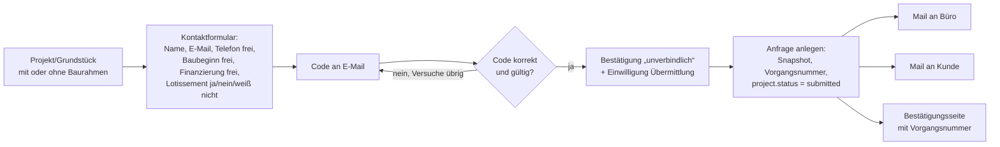
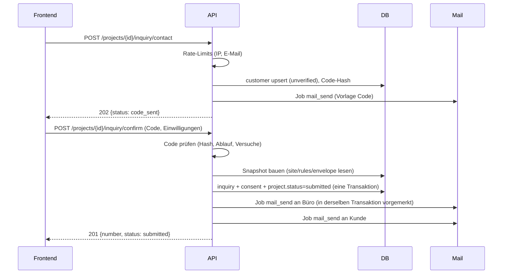

# A – Anfrage – Plan für die Umsetzung

## 1. Ziel und Abgrenzung

Aus einem simulierten Grundstück (G1) mit oder ohne Baurahmen (G3) eine Anfrage an das Architekturbüro machen,
**ohne dass der Kunde etwas konfiguriert** (Umsetzungsplan 3.6). Modul A ist kein Übergangsmodul, das H2/H3/V
später ersetzen – es bleibt dauerhaft als schnellerer Notausgang bestehen (**D14**, 17.09.2026).

**Nicht Teil dieses Plans:** Konfiguration (H1–H3), das volle Übergabe-Dossier mit IFC/Mengen/Plänen (Spez.
5.10, das ist Modul **V**), ein Nachrichtenkanal zwischen Büro und Kunde (kommt erst mit V, Spez. 5.10.8).
Modul A liefert dem Büro eine Anfrage mit Kontakt, Simulationsstand und einer Statusliste – mehr nicht.

## 2. Ausgangslage

Diese Bausteine bestehen bereits und werden **wiederverwendet**, nicht neu gebaut:

| Baustein | Wo | Nutzen für A |
|---|---|---|
| `Project` (anonym, Zugangscookie, `status`) | `platform/models.py`, `platform/projects.py` | Trägt die Anfrage; `status` steuert `retention_cleanup` |
| `AuditLog` (anfügend, Trigger-geschützt) | `platform/models.py`, `platform/audit.py` | Statuswechsel, Löschung protokollieren |
| `LegalText` (versioniert, Trigger-geschützt) | `platform/models.py`, `platform/legal.py` | Trägt Einwilligungs-/Bestätigungstext mit Version |
| `queue_mail`/`mail_send`-Job | `platform/mail.py` | Mail an Büro und Kunde, transaktional mit der Anfrage |
| `rate_limit.check` (IP, PostgreSQL-Fenster) | `platform/rate_limit.py` | Code-Versand bremsen; braucht Erweiterung um einen zweiten Schlüssel (4.1) |
| `FeatureFlag` | `platform/flags.py` | Neuer Schlüssel `inquiry`, gleiches Muster wie `site_selection`/`envelope_simulation` |
| Kantenkorrektur/-bestätigung | `site/api.py` (`PATCH …/site/edges/{seq}`, `POST …/site/edges/confirm`), `site/service.review_queue` | Genau die „Bestätigung beim Prüfen einer Anfrage“ aus Plan Kapitel 7 – **schon fertig** |
| Regelkorrektur je Projekt/Zone | `rules/api.py` (`/admin/projects/{id}/rule-overrides`, `/admin/rule-sets/{id}/versions`) | Genau „Regeln für die Zone oder nur das Projekt korrigieren“ (G21/D11) – **schon fertig** |
| Baurahmen fürs Büro + Steckbrief-PDF | `envelope/api.py` (`GET /admin/projects/{id}/envelope`), `envelope/sheet.py` | Ausdrücklich mit dem Kommentar „für die Prüfung einer Anfrage (Modul A)“ vorbereitet |
| `SiteOut.customer_corrections` | `site/schemas.py` | Zählt unbestätigte Kundenkorrekturen – direkt fürs Snapshot und die Prüfliste nutzbar |

**Modul A ergänzt also nur:** Kontaktaufnahme mit E-Mail-Bestätigung, Einwilligung, Anfrage-Entität mit
Vorgangsnummer und Snapshot, Anfragenliste im Büro, Export/Löschung, sowie die in G21 bereits angekündigte
Einschränkung der bestehenden Grundstücks-Prüfliste auf Projekte mit Anfrage.

## 3. Fachliche Festlegungen

### 3.1 Ablauf für den Kunden



Ein Formularschritt statt der zwei in Spez. 5.10.2/5.10.3: Checkboxen für „unverbindlich“ und Einwilligung
stehen auf demselben Bildschirm wie das Codefeld, der Versand geht erst nach Bestätigung des Codes hinaus.
Das ist die in Umsetzungsplan Kapitel 7 bereits festgehaltene Abweichung „E-Mail-Bestätigung: vor dem
Absenden statt danach“ – hier zusätzlich mit den übrigen Bestätigungen gebündelt, damit kein zweiter
Rückweg zum Formular nötig ist.

Das Kontaktformular ist über die bestehende Projektseite erreichbar (Knopf „Anfrage an das Büro senden“),
**unabhängig davon, ob ein Baurahmen vorliegt** (3.6 unten) – ein Klick, kein eigener Konfigurationsschritt.

### 3.2 E-Mail-Code

- 6 Ziffern, gültig 10 Minuten, höchstens 5 Prüfversuche, danach muss ein neuer Code angefordert werden.
- Gespeichert wird nur der SHA-256-Hash (wie Zugangstoken, `auth/tokens.py`), nicht der Code selbst.
- Rate-Limits: Codeversand höchstens 5-mal je Stunde für dieselbe E-Mail-Adresse **und** höchstens 10-mal je
  Stunde je IP (Abnahmekriterium in Plan 3.6: „Codeversand an fremde Adressen in Serie wird gebremst“).
  `rate_limit.check` kennt bisher nur die IP als Schlüssel; Ergänzung um eine schlüsselwertbasierte Variante
  (4.1).
- **Keine Verfallszustände oder Aufräum-Job nötig** (Abweichung aus Plan Kapitel 7 bereits vorgesehen): Bis
  der Code bestätigt ist, existiert nur eine `customer`-Zeile mit Name/E-Mail/Codehash, keine `inquiry`.
  Bleibt sie unbestätigt, verschwindet sie wie jedes inaktive Projekt nach 90 Tagen über `retention_cleanup`
  – kein eigener Ablauf-Job.

### 3.3 Snapshot

JSON mit `schema_version = 1`, entstehet beim Bestätigen des Codes aus bereits vorhandenen Antworten (keine
neue Berechnung):

- `site`: `SiteOut` des Projekts (Kanten, Klassen, Herkunft, `customer_corrections`).
- `envelope`: `EnvelopeOut` des Projekts – trägt bei fehlendem Baurahmen (3.6 unten) bereits selbst
  `status = "unavailable"` mit `reason` (z. B. `manual_sketch`); kein zusätzliches Null-Feld nötig, die
  bestehenden Schemas kennzeichnen Nichtverfügbarkeit schon.
- `rules`: `ProjectRulesOut` (Zonen, Regeln mit Zitat/Status), ebenso mit eigenem `status`/`reason` bei
  Nichtverfügbarkeit.
- `lotissement`: Antwort des Kunden (`yes`/`no`/`unknown`).
- `consents`: Liste aus `kind`, `legal_text_key`, `legal_text_version`, `confirmed_at`.

Kein IFC, keine Konfiguration, keine Mengen – die gibt es in Modul A nicht. Der Snapshot ist damit deutlich
schmaler als Spez. 5.10.4 (das ist Modul V).

### 3.4 Vorgangsnummer

`EMP-<Jahr>-<6-stellige Sequenz>` aus einer Datenbank-Sequenz (Spez. 5.10.3 – korrigiert das Mockup-Schema,
das am selben Tag Dubletten erzeugt hätte). **Eine Sequenz für alle künftigen Anfragen**, nicht nur für A:
Wenn Modul V später existiert und derselbe Kunde doch konfiguriert, wird **dieselbe** `inquiry`-Zeile erweitert
(D14: „V erweitert dieselbe Anfrage“) – keine zweite Nummer, keine zweite Tabelle.

### 3.5 Lotissement-Frage (RW16)

Frage im Kontaktformular (3.1), Antwort auf `customer.lotissement` (dort erhoben, siehe 4.1). Keine neue
Prüf-Automatik: Das Büro sieht
die Antwort in der Anfrage-Detailansicht und trägt bei Bedarf **denselben bereits bestehenden**
Projekt-Override ein (`PUT /admin/projects/{id}/rule-overrides`, G2) – kein neuer Korrekturmechanismus. Der
feste Hinweis `notice.rules_lotissement` (RW16) bleibt unabhängig davon in jeder Simulation sichtbar.

### 3.6 Anfrage ohne Baurahmen (G18, D13)

Zwei Fälle, in denen G3 keinen Baurahmen liefert, aber die Anfrage trotzdem möglich sein muss (Plan 3.6:
„oder ohne Baurahmen, siehe 2.1“):

1. **Gemeinde ohne ausgewertetes Planwerk** (Grundstück gebildet, G2 `not_imported`/`unavailable`): `rules` und
   `envelope` tragen `status = unavailable`. Anfrage möglich, getestet mit `REGULAR` ohne Planwerk.
2. **Weg E, frei gezeichnetes Grundstück** (`site.origin = manual_sketch`): `envelope` ist laut G1/G3 bereits
   fest `unavailable, reason = manual_sketch`. Anfrage möglich, Snapshot enthält nur die gezeichnete Geometrie.

In beiden Fällen: Kontaktformular und Codebestätigung laufen identisch; einzig der Snapshot und die
Büro-Mail fallen kürzer aus. Keine Sonderlogik im Formular selbst nötig.

**Nicht umgesetzt (Stand 18.09.2026):** Adressen **außerhalb des Einzugsgebiets** (G18). G1 bildet dort kein
Grundstück (nur Hinweis), `_require_site` verlangt eines, und das Formular hängt an der Grundstücksseite –
eine Anfrage ohne Grundstück gibt es also nicht. Diese Kunden können nur über Weg E zeichnen. Der Hinweistext
in G1 („die Anfrage dafür folgt in Kürze“, `site.outside`) verspricht mehr; offen in HANDOFF.md, Abschnitt 3.

### 3.7 Zustände der Anfrage

`neu` (Voreinstellung bei Anlage) → `in_bearbeitung` → `beantwortet` / `geschlossen`. **Freie Übergänge**,
keine Zustandsmaschine wie Spez. 5.10.1 (das ist Modul V mit Konfigurationsrevisionen – hier gibt es keine
Konfiguration, die revisioniert werden könnte). Jeder Wechsel: `PATCH` durch das Büro, Audit-Log-Eintrag.

### 3.8 Prüfung der Simulation durch das Büro (G21, D11)

Die Anfrage-Detailseite **stellt nur zusammen**, was einzeln schon existiert – kein neuer Prüfmechanismus:

- Grundstück mit Kanten: `GET /admin/projects/{id}/site`, Korrektur/Bestätigung wie gehabt.
- Regeln mit Zitat und Status: `GET /admin/projects/{id}/rules`, Korrektur über `rule-overrides` (Projekt)
  oder eine neue `rule_set_version` (Zone).
- Baurahmen: `GET /admin/projects/{id}/envelope`.
- Kontakt, Lotissement-Antwort, Snapshot-Zeitpunkt, Status: neu in diesem Modul.

**Neu, weil in G1 bereits als Vorgriff dokumentiert:** `site.service.review_queue` filtert bisher nicht nach
Anfrage und zeigt deshalb auch Grundstücke anonymer Besucher (Kommentar im Code: „bis Modul A Anfragen
kennzeichnet“). Ergänzung um einen Parameter `require_inquiry: bool = True` (Voreinstellung ab jetzt an),
der auf `EXISTS (SELECT 1 FROM inquiry i WHERE i.project_id = s.project_id)` filtert.

### 3.9 Export und Löschung (Spez. 10.2, offener Punkt S10)

- `GET /projects/{id}/export`: alles, was der Kunde selbst sehen kann, als JSON (Projekt, Grundstück,
  Baurahmen/Regeln falls vorhanden, Kontakt, Einwilligungen, Anfrage-Status). Keine internen Büro-Notizen.
- `DELETE /projects/{id}`:
  - **Ohne Anfrage** (noch keine `inquiry`-Zeile): sofortige kaskadierende Löschung, keine Rückfrage nötig –
    es gibt noch keine berechtigten Interessen Dritter an den Daten.
  - **Mit Anfrage**: `409 deletion_requires_office`. Selbstständige Endlöschung entfällt, sobald das Büro
    eine eigene Grundlage hat, die Unterlagen zu seiner Anfrage zu behalten (Bearbeitung, ggf. Vertrag);
    der Hinweistext verweist auf die Kontaktaufnahme mit dem Büro. **Empfehlung, da D6
    (Datenschutzrolle Emprise↔Büro) noch nicht entschieden ist** – die engere, jederzeit lockerbare
    Variante, bis diese Rechtsfrage geklärt ist. Löscht das Büro danach händisch (künftige `ops`-Funktion),
    ist das nicht Teil dieses Plans.

### 3.10 Einwilligungs- und Bestätigungstexte (L7, L8)

Zwei `legal_text`-Schlüssel: `notice.simulation_confirmation` („unverbindliche Simulation, keine
Kaufverpflichtung“) und `consent.transmission_office` (Einwilligung zur Übermittlung an das namentlich
genannte Büro). Beide brauchen laut Spez. eine **gespeicherte Version** – anders als G16 (reiner
Info-Hinweis mit Übersetzungs-Rückfall) reicht hier kein Fallback ohne Datenbankzeile, weil die Einwilligung
sich auf eine konkrete Version bezieht. **Vorgehen:** Bei der Umsetzung wird je eine erste, ausdrücklich als
vorläufig markierte Version veröffentlicht (Text in Deutsch/Französisch, angelehnt an `Dokumentation.html`
Abschnitt 5 und die bestehenden L7-Hinweise); endgültiger Wortlaut folgt der noch offenen Rechtsberatung
(Priorität-2-Punkt aus HANDOFF Abschnitt 3) und wird dann als neue Version über den bestehenden
`POST /admin/legal-texts` veröffentlicht – ohne Codeänderung.

## 4. Technik

### 4.1 Datenmodell (neu)

```
customer            id, project_id (FK project, unique), name, email, phone, desired_start,
                     financing_clarified, lotissement, email_code_hash, email_code_expires_at,
                     email_code_attempts, verified_at, created_at
inquiry              id, project_id (FK project, unique), customer_id (FK customer), number (aus Sequenz,
                     eindeutig), status, snapshot (JSONB), snapshot_schema_version, created_at, updated_at
consent              id, project_id (FK project), kind, legal_text_key, legal_text_version, confirmed_at
inquiry_number_seq   Datenbank-Sequenz für `inquiry.number`
```

`consent` unveränderlich (Trigger `forbid_modification`, unbedingt – wie `audit_log`/`legal_text`): eine
Einwilligung wird nie nachträglich geändert. `inquiry` bleibt bewusst **ohne** diesen Trigger, weil
`status`/`updated_at`/`updated_by` sich laut 3.7 ändern – nur `number` und `snapshot` sind de facto
endgültig, weil kein Endpunkt sie nach der Anlage schreibt (keine Datenbanksperre nötig, es gibt dafür schon
keinen Schreibpfad). `customer` bleibt änderbar, solange `verified_at IS NULL` (neuer Code, geänderte Adresse
bei Tippfehler); danach schreibt ebenfalls kein Endpunkt mehr darauf.

`rate_limit.check` bekommt eine zweite, wertbasierte Variante (z. B. `check_value(scope, value, limit,
window_seconds)`, HMAC wie bisher über `keyed_digest`) für den Code-Versand je E-Mail-Adresse, ohne die
bestehende IP-Variante zu ändern.

### 4.2 Ablauf (Backend)



Kein Idempotency-Key wie Spez. 5.10.3 nötig: `confirm` ist durch den einmalig gültigen Code selbst schon
gegen doppeltes Absenden gesichert, und `customer_id`/`project_id` sind eindeutig.

### 4.3 Backend

Neues Modul `backend/app/inquiry/` nach dem bestehenden Muster (`models.py`, `schemas.py`, `service.py`,
`api.py`, keine `domain/` – hier gibt es keine reine Rechenlogik wie bei G1/G3, nur Ablauf und Zusammenbau).

**Kunde** (Flag `inquiry`, wie `site_selection`/`envelope_simulation` zunächst intern für `architect`):
- `POST /projects/{id}/inquiry/contact`
- `POST /projects/{id}/inquiry/confirm`
- `GET /projects/{id}/inquiry` (eigener Status, `null` wenn keine Anfrage)
- `GET /projects/{id}/export`
- `DELETE /projects/{id}` (3.9; liegt fachlich hier, weil erst A eine Löschsperre einführt)

**Büro** (Rollen `architect`, `rules_admin`, `ops` zum Lesen und für den Statuswechsel – dieselbe Gruppe, die
auch Grundstücke und Regeln prüft, kein neuer Rollenbedarf):
- `GET /admin/inquiries` (Liste, Filter `status`)
- `GET /admin/projects/{id}/inquiry` (Detail: Nummer, Snapshot, Kontakt, Status)
- `PATCH /admin/projects/{id}/inquiry` (Statuswechsel)
- `POST`/`GET /admin/projects/{id}/envelope/sheet` (neu, dünn: dieselben zwei Schritte wie die Kundenroute,
  `service.request_sheet`/`sheet_bytes`, nur mit Rollenprüfung statt Feature-Flag – damit das Büro den
  Steckbrief zur Anfrage laden kann, 4.4/8)

Änderung an bestehendem Code: `site/service.review_queue` um `require_inquiry` (3.8); `platform/tasks.py`
`retention_cleanup` bleibt **unverändert** – die Bedingung `status = 'draft'` schließt Anfragen bereits aus,
sobald `confirm` den Status auf `submitted` setzt (A11 damit erledigt, ohne die Abfrage selbst anzufassen).

### 4.4 Frontend

- Kunde: Abschnitt „Anfrage an das Büro“ auf der bestehenden Projektseite (`GrundstueckSeite.tsx`) –
  Kontaktformular, Code-Eingabe mit den zwei Bestätigungen, Ergebnis mit Vorgangsnummer. Eigene Komponente
  `frontend/src/inquiry/AnfrageFormular.tsx` (Muster wie `site/FreiesZeichnen.tsx`: eigener API-Client
  `api/inquiry.ts`, eigene i18n-Texte).
- Büro: `frontend/src/pages/buero/Anfragen.tsx` (Liste, Status-Filter) und
  `frontend/src/pages/buero/AnfrageDetail.tsx` (Zusammenschau aus 3.8, mit Knopf zum Steckbrief-Download und
  Statuswechsel), Eintrag in `BueroLayout.tsx`-Navigation neben „Grundstücke“ und „Regeln“.
- Kein Attachment-Versand des Steckbriefs per Mail (Abweichung zu Plan 3.6, siehe 8) – die Büro-Mail verlinkt
  auf `AnfrageDetail.tsx`, von dort der bestehende PDF-Weg.

## 5. Arbeitsschritte

1. Datenmodell und Migration (4.1), `rate_limit.check_value`.
2. Kontakt- und Codebestätigungsablauf (Backend), Snapshot-Zusammenbau (3.3), Vorgangsnummer.
3. Mail-Vorlagen (Code, Büro, Kunden-Kopie) in `platform/locales/{de,fr}.json`.
4. Zwei vorläufige `legal_text`-Versionen veröffentlichen (3.10).
5. Export/Löschung (3.9), `review_queue`-Einschränkung (3.8), Staff-Steckbrief-Route (4.3).
6. Frontend Kunde (Kontaktformular, Codebestätigung, Ergebnis).
7. Frontend Büro (Anfragenliste, Anfrage-Detail, Navigation).
8. Tests (6), `docs/ANNAHMEN.md`-Abschnitt „A – Anfrage“, `docs/BETRIEB.md` falls betrieblich relevant
   (Mailvorlagen, keine neuen externen Dienste).

## 6. Tests und Abnahme

Aus Umsetzungsplan 3.6:
- Doppelklick auf „Absenden“ erzeugt **eine** Anfrage (Code ist einmalig gültig, zweiter Versuch mit
  demselben Code nach Erfolg schlägt fehl – das reicht als Schutz, siehe 4.2).
- Ausfall des Maildienstes verliert keine Anfrage (Job bleibt `queued`/`failed` in der Tabelle, `inquiry`
  selbst ist schon committet).
- Löschung vor einer Anfrage entfernt Projekt, Grundstück, `customer` vollständig; nach einer Anfrage liefert
  `DELETE` `409`.
- Codeversand an dieselbe Adresse in Serie wird ab dem 6. Versuch innerhalb einer Stunde gebremst (`429`).
- Eine Korrektur des Büros für ein Projekt (Rule-Override) ändert die Simulation anderer Projekte nicht; für
  die Zone (neue `rule_set_version`) gilt sie für spätere Simulationen; der Snapshot der bereits gestellten
  Anfrage bleibt in beiden Fällen unverändert (Snapshot ist eine Kopie, keine Referenz).
- Anfrage ohne Baurahmen (außerhalb Einzugsgebiet und Weg E) funktioniert bis zur Bestätigungsseite.
- `review_queue(require_inquiry=True)` zeigt kein Projekt ohne `inquiry`-Zeile.
- Produktionsreife-Kriterien (Umsetzungsplan 4.1): Rate-Limit-Punkt gilt hier für zwei neue öffentliche
  Endpunkte (`contact`, `confirm`).

## 7. Zusammenspiel mit späteren Modulen

- **H2/H3**: unberührt von A; A bleibt parallel bestehen (D14). Sobald H1–H3 existieren, entsteht eine zweite
  Art, eine Anfrage auszulösen (nach Konfiguration) – das ist **Modul V**, nicht A.
- **V**: erweitert **dieselbe** `inquiry`-Zeile (3.4) um Konfiguration, vollen Snapshot (Spez. 5.10.4) und
  Dossier (Spez. 5.10.5), sobald der Kunde nachträglich konfiguriert. `inquiry.status` bekommt dann
  voraussichtlich weitere Werte oder eine zweite Statusspalte für den Konfigurationsteil – hier bewusst nicht
  vorweggenommen, um kein Schema zu entwerfen, das V dann doch ändern muss.
- **X-Module**: keine bekannte Abhängigkeit.

## 8. Abweichungen von Plan 3.6 und Spezifikation

| Thema | Plan 3.6 / Spezifikation | Hier festgelegt | Grund |
|---|---|---|---|
| Steckbrief in der Büro-Mail | „Mail an das Büro mit Steckbrief“ | Mail verlinkt die Anfrage-Detailseite; PDF-Download dort über bestehenden Weg, kein E-Mail-Anhang | Anhänge bräuchten eine binärfähige Erweiterung des generischen Mailjobs für einen einzigen Anwendungsfall; die Detailseite ist ohnehin Pflichtstopp für die Prüfung (3.8) |
| Zustandsmaschine der Anfrage | Spez. 5.10.1 (Mermaid-Diagramm mit Konfigurationsrevisionen) | Vier freie Zustände ohne Maschine (3.7) | Es gibt keine Konfiguration, die revisioniert werden könnte – das Diagramm gehört zu Modul V |
| Löschung nach Anfrage (S10) | Offen | `409`, Verweis auf das Büro, keine Selbstlöschung | D6 (Datenschutzrolle) ungeklärt; engste, jederzeit lockerbare Variante |
| Vorläufige Rechtstexte | Spez. 10.3 verlangt fertige, zweisprachige Texte | Erste Version bewusst als vorläufig veröffentlicht, wie bei G16 im Prinzip, hier aber mit echter `legal_text`-Version | Einwilligung braucht laut Spez. eine gespeicherte Version; ein reiner Übersetzungs-Rückfall ohne Datenbankzeile wäre für eine Einwilligung nicht nachvollziehbar |

## 9. Entscheidungen des Nutzers

| Nr. | Frage | Vorschlag |
|---|---|---|
| 1 | Steckbrief als Mailanhang oder nur Link zur Detailseite? | Nur Link (8) – einfacherer Weg, PDF bleibt einen Klick entfernt |
| 2 | Löschung nach bestehender Anfrage: `409` mit Verweis auf das Büro, oder Löschantrag als neue Büro-Aufgabe schon jetzt bauen? | `409` jetzt; Büro-Aufgabe erst mit D6 |
| 3 | Vorläufiger Wortlaut der beiden neuen Rechtstexte (3.10) – selbst entworfen oder vom Nutzer vorgegeben? | Selbst entworfen, angelehnt an `Dokumentation.html` Abschnitt 5, erkennbar vorläufig; Rechtsberatung ersetzt sie später über die bestehende Veröffentlichungsroute |

## 10. Risiken

- **E2 (Mailanbieter) ist noch offen** – lokal läuft alles über Mailpit, das ändert an diesem Plan nichts;
  erst bei der Auslieferung auf Unraid relevant (bestehender Punkt in HANDOFF Abschnitt 3/4.3).
- **D6 (Datenschutzrolle Emprise↔Büro) ungeklärt** – 3.9/8 wurden bewusst so eng gefasst, dass eine spätere
  Entscheidung sie nur lockern, nicht neu bauen muss.
- **Vorläufige Rechtstexte**: Bis zur Rechtsberatung trägt Emprise das Risiko eines noch nicht geprüften
  Einwilligungswortlauts – dasselbe Risiko besteht bereits bei G16/G30 und ist dort so vermerkt.

## 11. Prüfprotokoll

### 11.1 Beim Schreiben gefundene und behobene Punkte

| Fehler/Unklarheit | Folge, wenn unbehoben | Behoben in |
|---|---|---|
| Plan 3.6 nennt `customer`, `project`, `inquiry`, `consent`, `audit_log` als Tabellen, ohne Beziehung zueinander festzulegen | Uneindeutiges Schema, Gefahr doppelter Zuständigkeit zwischen `customer` und `inquiry` | 4.1: `customer` 1:1 zum Projekt, `inquiry` referenziert beide, `consent` eigenständig und mehrfach je Projekt |
| Spez. 5.10.3 (Vorgangsnummer-Sequenz) ist für Modul V geschrieben; ungeprüfte Übernahme hätte beim späteren Bau von V eine zweite, kollidierende Sequenz nahegelegt | Zwei Nummernkreise, Verwirrung beim Büro | 3.4: eine Sequenz, eine `inquiry`-Zeile pro Projekt, V erweitert statt neu anzulegen |
| Naive Umsetzung hätte den Mailanhang aus Plan 3.6 wörtlich genommen und den generischen `mail_send`-Job um Binäranhänge erweitert | Unnötige Kopplung eines plattformweiten Jobs an ein einzelnes Feature | 4.3/8: Link statt Anhang, mit Begründung und als offene Rückfrage markiert (9.1) |
| `DELETE /projects/{id}` ohne Fallunterscheidung hätte entweder Anfragen beim Büro spurlos verschwinden lassen oder Löschung grundsätzlich verweigert | Datenschutzverstoß (kein Recht auf Löschung vor Anfrage) bzw. überzogene Sperre (Recht auf Löschung nach Anfrage faktisch verweigert) | 3.9: Fallunterscheidung vor/nach Anfrage |

### 11.2 Geprüfte Alternativen

- **E-Mail-Bestätigung nach dem Absenden (wie Spez. 5.10.3) statt davor**: verworfen, weil Umsetzungsplan
  Kapitel 7 die Abweichung bereits für ganz Modul A festgelegt hat („keine zusätzlichen Zustände und
  Verfallsjobs“) – hier nur konsequent zu Ende gedacht (3.2).
- **Eigene Rolle `inquiry_admin` fürs Büro**: verworfen; dieselben drei Rollen, die schon Grundstücke und
  Regeln prüfen, decken die Anfrage ab – kein fachlicher Unterschied, der eine neue Rolle rechtfertigt.
- **`consent` als zwei Boolean-Spalten auf `inquiry` statt eigener Tabelle**: verworfen; eine generische
  Tabelle mit `kind` erweitert sich ohne Schemaänderung, wenn V weitere Einwilligungen braucht.
