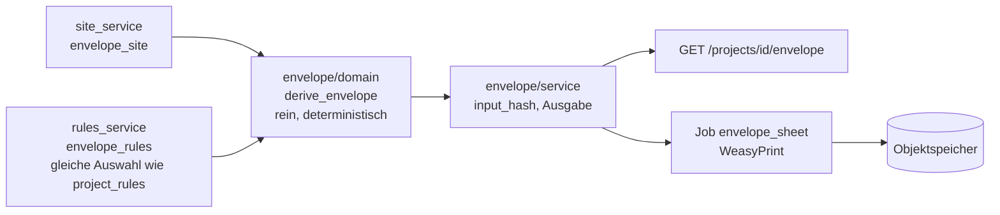

# G3 Baurahmen – Plan für die Umsetzung

> **Status:** umgesetzt am 16.09.2026 (Abschnitt 12) · **Stand:** 16.09.2026
> **Bezug:** `UMSETZUNGSPLAN.md` 3.5 (Zuschnitt, Abnahme), `BACKEND_SPEZIFIKATION.md` 5.2.2, 5.2.4, 5.3, 5.9 (Fachregeln), `docs/ANNAHMEN.md` G01–G25 und RW01–RW27 (Stand von G1 und G2), `Hauskonfigurator.jsx` `SchrittRegelwerk` (Oberfläche)
> **Verhältnis zu Plan 3.5:** Dieser Plan setzt 3.5 um und präzisiert ihn. Wo er abweicht, steht es in Abschnitt 8; bei Beauftragung werden die Abweichungen in Plan 3.5 übernommen.

---

## 1. Ziel und Abgrenzung

**G3 liefert** für ein bestätigtes Grundstück vollautomatisch, ohne Eingaben des Büros (D11), den Baurahmen als unverbindliche Simulation:

- zwei Konturen der bebaubaren Fläche für das Hauptgebäude: **engste** und **weiteste Auslegung** der Regeln (Abschnitt 3.1),
- je Zonen-Teilfläche die Grenzwerte: höchste Grundfläche, Mindestfreifläche, Höhen, Dach, Fassade, Stellplätze, Nebengebäude, jeweils mit Zitat und Status,
- je Kante den Abstand in beiden Auslegungen und Markierungen (nicht ermittelt, Kante unsicher, Kundenkorrektur unbestätigt),
- Bauverbots- und Einschränkungsflächen aus überlagernden Vorgaben, Bauband an der Straße,
- Hinweise (Eckgrundstück, Hanglage, mehrere Zonen, Lotissement, Denkmalschutz, Risiken, L7),
- Tabelle „Was darf ich bauen?“ und Lageplan auf der Grundstücksseite, Steckbrief als PDF.

**G3 liefert nicht:** Haus, Lage, Zulässigkeit von Typen, höhenabhängige Prüfung einer konkreten Konfiguration (alles H2), Versiegelung mit Zufahrt (H3), Snapshot und Mail (A), DXF (V). **G3 fragt keine externen Dienste ab**; alles kommt aus G1 und G2.

---

## 2. Ausgangslage: Was G1 und G2 liefern

| G3 braucht | Quelle | Stand |
|---|---|---|
| Umriss, Kanten mit Art (`street`, `side`, `rear`, `other`), Sicherheit, Herkunft, Hauptstraße, Warnungen `corner_lot`, `flag_lot`, `edges_need_review` | `site_service.load_site` | vorhanden |
| Gelände: Status, Neigung, Bezugshöhe | `site.terrain` | vorhanden; kommt **asynchron** nach `site_enrich`, ohne neue `revision` |
| Regeln je Zone mit Status, Planstand mit Rückfall (`outdated`), Projektkorrekturen, Warnungen | `rules_service.project_rules` | vorhanden |
| **Geometrie** der Zonen-Teilflächen | – | **fehlt**: `_plan_rules` berechnet nur Flächen |
| **Geometrie** und Typcode überlagernder Vorgaben | – | **fehlt**: Kunden-API liefert nur Bezeichnung und Typ |
| Ob ein Bauband für den **ganzen Baukörper** oder nur für die **Straßenfassade** gilt | – | **fehlt** im Schema von `setback_street` (Abschnitt 3.3) |
| Ausgewertete Zonen für echte Grundstücke | G2 mit Claude API | nur Zone Uh als aufgezeichnete Antwort; übrige Kapitel `failed: not_configured` (kein Schlüssel) |

Folge: G3 beginnt mit einer kleinen Vorarbeit in G2 (Schritt 0), und die Abnahme mit echten Grundstücken ist bis zum API-Schlüssel auf Zone Uh beschränkt.

---

## 3. Fachliche Festlegungen

### 3.1 Zwei Konturen: engste und weiteste Auslegung

Spezifikation 5.3.1 sieht `B(H_max)` („sicher bebaubar“) und `B(0)` („bei niedriger Bauweise“) vor. G3 verallgemeinert das: Jede Regel, die mehrere Lesarten zulässt, geht in die **weiteste** Kontur mit der günstigsten und in die **engste** Kontur mit der strengsten Lesart ein. So bleibt jede Unsicherheit sichtbar, ohne zu schätzen oder zu blockieren (D11). Code: `lenient` und `strict`. Die Bezeichnungen in der Oberfläche prüft die Rechtsberatung („sicher“ klingt nach Zusage; Arbeitstitel „engste Auslegung“ / „weiteste Auslegung“).

Grundformel je Zonen-Teilfläche `P` (Spez. 5.3.2), Abstände `d_i` je Kante und Auslegung:

```
B(P) = P − ⋃_i buffer(e_i, d_i, round) − Bauverbot [− Einschränkung, nur strict] [∩ Bauband, siehe 3.3]
```

`e_i` sind nur die Grundstückskanten, nie Zonengrenzen innerhalb des Grundstücks.

| Sachverhalt | `lenient` (weiteste) | `strict` (engste) |
|---|---|---|
| Höhenabhängiger Abstand `max(min_m, f × H)` | `H = 0` → `min_m` (ohne `min_m`: 0) | `H` = Höchsthöhe der Zone nach `height_basis`: `eave` → Traufe, sonst First, sonst Attika; `ridge` → First, sonst Attika; `facade_point` → größte Höhe (Spez. 5.3.2); nur Geschosse → Standardhöhen (3.5); keine Höhe → Kontur `complete = false`, Kante markiert |
| Bauen auf der Grenze erlaubt (`allow_on_boundary`) | `d = 0` | regulärer Abstand |
| Bauband `range` | siehe 3.3 | siehe 3.3 |
| `fixed` (Bauflucht) | `min_m` abziehen, Fluchtlinie zeichnen | wie `lenient`; Lage auf der Flucht prüft H2 |
| `alignment` (Flucht der Nachbarbebauung) | kein Abzug, Kante markiert | kein Abzug, `complete = false` |
| Einschränkende Überlagerung (3.4) | kein Abzug | abziehen |
| Bauverbot (3.4) | abziehen | abziehen |

Warum `lenient` das Bauen auf der Grenze enthält: Spez. 5.3.6 sucht Lagen in `B(0)`, damit „keine gültige Lage verloren geht“. In Zone Uh („soit en limite séparative, soit en retrait … au moins 3 mètres“) wäre eine Kontur mit 3 m zu klein. Die Kontur ist eine Obermenge: Eine Lage 1 m neben der Grenze ist darin, aber unzulässig; das prüft H2 je Kante (Spez. 5.3.4). Die Kante erhält die Angabe „auf der Grenze oder mindestens 3 m“.

Flächen unter 4 m² oder schmaler als 2 m entfallen je Kontur (Spez. 5.3.2).

### 3.2 Fehlende, unsichere und unvollständige Angaben

| Fall | Wirkung |
|---|---|
| Abstandsregel `unknown` | beide Konturen ohne diesen Abstand; Kante „Abstand nicht ermittelt“; `strict.complete = false`; Hinweis, dass die Fläche zu groß sein kann (Plan 3.5) |
| Abstand `not_regulated` (mit Beleg, RW24) | `d = 0` |
| Kante `other` (Rand eines Lochs, Grundstück ohne Hauptstraße) | beide Regeln der *limites séparatives* kommen in Betracht: weiteste Auslegung der kleinere, engste der größere Abstand; Kante markiert (`kind_unclear`). **Bei der Umsetzung geändert** gegenüber „der größere für beide“: Mit dem größeren verlöre die weiteste Kontur gültige Lagen, die Spez. 5.3.6 dort sucht (ANNAHMEN BR03) |
| Kante unsicher (Sicherheit < 0,65) oder Kundenkorrektur unbestätigt | nach aktueller Einordnung rechnen, Kante markieren, Warnung (Plan 3.3, G23) |
| Zone ohne ausgewertete Regeln (`in_progress`, `unavailable`) | Teilfläche **nicht** in den Konturen, im Plan schraffiert „Regeln nicht ermittelt“; Status `partial` bzw. `in_progress` (Entscheidung E-G3-1) |
| Zone mit Grundflächenzahl 0 | Teilfläche nicht in den Konturen (dort ist kein Gebäude zulässig); Grenzwert 0 m² |
| Zone `outdated` (voriger Planstand, RW21) | normal rechnen, Warnung `rules_outdated` bzw. `plan_update_failed` |
| Grundflächenzahl, Freifläche oder Höhe `unknown` | Grenzwert fehlt mit Hinweis, nie geschätzt |
| Gelände `unavailable` oder Neigung > 5 % | Höhengrenzen anzeigen, Hinweis zum Höhenbezug (Spez. 5.9.4); keine Angabe in m NGF |
| Planwerk nicht verfügbar (RNU, kein PLU, keine Zone) | Status `unavailable`, nur Umriss und Hinweis; die Anfrage ohne Baurahmen folgt mit A (Plan 2.1) |
| ≥ 1 % des Grundstücks in keiner Zone (RW27) | Teil wie „Regeln nicht ermittelt“, Warnung `zone_coverage_incomplete` |

### 3.3 Bauband an der Straße

Die Spezifikation behandelt `setback_street` mit `range` als Bedingung „ein Straßenfassadenabschnitt im Band“, nicht als Fläche (5.2.4). Der echte Text von Zone Uh (S. 96–97) sagt etwas anderes: *„Les constructions principales, hors extension, doivent être implantées dans une bande située entre 5 m et 20 m“* und *„hors bande d'implantation, les constructions nouvelles ne sont pas autorisées“* – das ganze Hauptgebäude liegt im Band. Andere PLU meinen mit *„recul compris entre 0 et 5 m“* dagegen nur die Lage der Fassade. Ohne Unterscheidung wird die Fläche entweder deutlich zu groß (Uh: Grundstück bis 60 m Tiefe statt 20 m) oder bei schmalen Bändern fast leer.

**Festlegung:** G2 erhält den Parameter `setback_street.band ∈ {building, facade}` (Schritt 0). G3 rechnet:

| `band` | `lenient` | `strict` |
|---|---|---|
| `building` | `∩ ⋃_Straßen buffer(e, max_m)`, `− buffer(e, min_m)` | wie `lenient` |
| `facade` | `− buffer(e, min_m)`; Band als Streifen zeichnen, Bedingung prüft H2 | wie `lenient` |
| nicht angegeben | wie `facade` | wie `building`; Hinweis „Auslegung des Baubands unklar“ |

Das Band gilt je Straßenkante, die Vereinigung über alle Straßenkanten (Uh: *„par rapport à toutes les voies“*); bei Eckgrundstücken Hinweis. Ausnahmen des Textes (Uh: Sackgassen unter 5 Wohnungen lösen kein Band aus) kann G3 nicht erkennen; sie stehen in `notes` der Regel und erscheinen als Hinweis.

### 3.4 Überlagernde Vorgaben

Wirkung nach Typcode des CNIG-Standards (`typepsc`), Tabelle als Konstante in `envelope/domain/overlays.py`, vor Umsetzung gegen den aktuellen Standard geprüft (Spez. 0 Punkt 5) und in ANNAHMEN dokumentiert:

| Wirkung | Typen (Vorschlag) | Beispiel Treillières |
|---|---|---|
| `no_build`: beide Konturen abziehen | 01 Espace boisé classé, 05 Emplacement réservé | ER K21 „Aménagement du carrefour“, K46 Radweg |
| `restricts`: nur `strict` abziehen, Hinweis | 02 Risiko- oder Nutzungsbeschränkung, 07 Schutz Patrimoine/Landschaft (Fläche), 25 Boisement/continuité écologique, 31 zones humides | „risque d'inondation par ruissellement“, „Présomption de zones humides“ |
| `info`: nur Hinweis | alle übrigen Vorschriften, `info-surf`, Servituden; Linien (Hecken 07, Baulinie 15) als Linie im Plan | Mixité sociale, Lärmsektor, Assainissement |

Unbekannte Typcodes sind `info` mit Hinweis „Wirkung nicht bewertet“. Denkmalschutz-Servitude (AC1) erzeugt den Hinweis auf die Zustimmung des Architecte des Bâtiments de France.

### 3.5 Grenzwerte je Teilfläche

| Wert | Rechnung |
|---|---|
| Höchste Grundfläche | `ratio × Fläche(P)` (Spez. 5.3.2; Uh: *„à l'intérieur de la zone“*); daneben Fläche der Konturen in `P` |
| Mindestfreifläche, pleine terre | `ratio × Fläche(P)` bzw. `full_soil_ratio × Fläche(P)` (Annahme, analog zur Grundfläche; bei einer Zone gleich Spez. 5.9.2) |
| Höhen | Werte der Regel mit `reference` und `measured_at`; Geschosse als Angabe (`R+1+C`) |
| Standardhöhen bei nur Geschossen | nur für die `strict`-Kontur, nie als angezeigter Grenzwert: Geschoss 3,00 m, Traufe `(1 + n) × 3,00`, First bei `C` Traufe + 5,00, Attika bei `A` `(2 + n) × 3,00`; Annahme in `provenance` (Plan 3.5), Werte vor Umsetzung in ANNAHMEN begründen |
| Dach, Fassade, Stellplätze, Nebengebäude, Bepflanzung, Zaun | Werte der Regel, Anzeige wie `frontend/src/rules/format.ts` |
| `measured_from = roof_edge`/`any_projection` | keine andere Kontur (ohne Haus kein Überstand), Hinweis „gemessen ab Dachüberstand“; H2 prüft |

Jeder Wert trägt Zone, Status, Herkunft (`extraction`, `office`, `project`), Seite, Zitat, `quote_verified` und Link, damit Steckbrief und Snapshot (A) ohne `/rules` vollständig sind (L3). Die Konturen gelten für das Hauptgebäude; Regeln für Nebengebäude und Pools erscheinen in der Tabelle, ihre Flächen rechnet H2 mit derselben Funktion.

---

## 4. Technik

### 4.1 Ablauf



### 4.2 Backend

| Teil | Inhalt |
|---|---|
| `app/site/service.py` | `envelope_site(db, project_id)`: Umriss (Lambert-93), Kanten mit Art, Herkunft, Sicherheit und Ring, Hauptstraße, Warnungen, Gelände, `local_origin`, `revision`, `engine_version`. Ohne Umgebung und GeoJSON, damit der Abruf schlank bleibt |
| `app/rules/service.py` | `envelope_rules(db, project_id)`: dieselbe Auswahl von Planstand, Rückfall, Zonen, Regeln und Korrekturen wie `project_rules` (eine gemeinsame interne Funktion, damit Anzeige und Baurahmen nie auseinanderlaufen), zusätzlich Geometrie je Teilfläche (`ST_Intersection`, `ST_MakeValid`) und überlagernde Vorgaben mit Typcode und Geometrie im Grundstück |
| `app/envelope/domain/` | `inputs.py` (unveränderliche Datenklassen), `setbacks.py` (Abstand je Kante und Auslegung), `bands.py`, `overlays.py` (Typcodes), `heights.py` (Geschosse), `derive.py` (`derive_envelope(site, rules) → Envelope`), `tolerances.py`, `ENGINE_VERSION = "g3-1.0.0"`. Rechnung in Lambert-93-Metern mit Shapely, Ausgabe lokal (Verschiebung um `local_origin`) |
| `app/envelope/service.py` | Eingaben laden, `input_hash` bilden, ableiten, Antwort bauen; GeoJSON der Konturen über `ST_Transform` wie in `load_site` |
| `app/envelope/api.py` | `GET /projects/{id}/envelope` (Projekt-Cookie, Flag `envelope_simulation`, setzt `site_selection` und `rules_simulation` voraus); `GET /admin/projects/{id}/envelope` (`architect`, `rules_admin`, `ops`, für A); `POST /projects/{id}/envelope/sheet` (200 mit vorhandenem PDF für den aktuellen Hash, sonst 202 mit Job, Rate-Limit); `GET /projects/{id}/envelope/sheet` (PDF über die API, klein) |
| `app/envelope/jobs.py` | `envelope_sheet`: leitet erneut ab, prüft den Hash, rendert HTML und Lageplan-SVG, WeasyPrint, legt `envelope-sheets/<project>/<hash>.pdf` ab; Idempotenz über den Hash |
| `app/envelope/sheet.py` | SVG des Lageplans und HTML des Steckbriefs (Vorlage mit `string.Template`, keine neue Template-Bibliothek) |
| Migration `0005` | nur `envelope_sheet` (`project_id`, `input_hash`, `engine_version`, `storage_key`, `created_at`); Löschung mit dem Projekt (`retention_cleanup`, A11) |
| `app/cli.py` | `envelope-check --commune 44209 [--zone Uh] [--sample N]`: Robustheitslauf über echte Parzellen (4.4) |
| Image | WeasyPrint mit Pango und Schriften des Mockups (Lizenz prüfen) im Runtime-Image; kein neuer ausgehender Zugang |

**`input_hash`** über den **Inhalt** der Eingaben (kanonisches JSON, Zahlen auf Millimeter gerundet) plus `ENGINE_VERSION`, nicht über Revisions- und Versionsnummern. Gelände kommt ohne neue `revision`, Projektkorrekturen und der Wechsel auf den Rückfall-Planstand ändern keine Regelwerksversion; ein Hash über Nummern würde dann einen alten Baurahmen liefern.

**Kein Cache `site_envelope`** zunächst: Die Ableitung ist klein (ein Polygon, bis etwa 30 Kanten, wenige Zonen); der Abruf wird bei jedem Aufruf neu gerechnet. Liegt p95 über 300 ms, folgt ein Cache mit dem Inhaltshash als Schlüssel. Snapshot (A) und Steckbrief speichern das Ergebnis ohnehin mit Hash.

### 4.3 Antwort (gekürzt)

```json
{
  "simulation": true,
  "status": "ok | partial | in_progress | unavailable",
  "reason": null,
  "engine_version": "g3-1.0.0",
  "input_hash": "sha256:…",
  "site_revision": 3,
  "local_origin": {"e": 350123.4, "n": 6700456.7, "crs": "EPSG:2154"},
  "contours": {
    "lenient": {"rings_local": [], "geojson": {}, "area_m2": 412.3, "complete": true},
    "strict":  {"rings_local": [], "geojson": {}, "area_m2": 188.0, "complete": false,
                "incomplete_reasons": ["setback_unknown:rear"]}
  },
  "street_bands": [{"edge_seq": 1, "min_m": 5.0, "max_m": 20.0, "band": "building", "rings_local": []}],
  "edges": [{"seq": 2, "kind": "side", "classification_source": "auto", "confidence": 0.9,
             "setbacks": [{"zone_code": "Uh", "status": "effective", "lenient_m": 0.0, "strict_m": 3.0,
                           "params": {"min_m": 3.0, "allow_on_boundary": true}, "citation": {}}],
             "markers": []}],
  "parts": [{"zone_code": "Uh", "zone_status": "simulated", "area_m2": 742.0, "rings_local": [],
             "excluded": null,
             "limits": [{"key": "footprint_max_m2", "value": 185.5, "status": "effective", "citation": {}}]}],
  "constraints": [{"effect": "no_build", "category": "prescription", "type_code": "05",
                   "label": "Emplacement réservé …", "rings_local": []}],
  "warnings": ["corner_lot"],
  "notices": ["notice.envelope_simulation", "notice.rules_simulation", "notice.rules_lotissement",
              "notice.cadastre_accuracy"],
  "provenance": {"site_engine_version": "g1-1.1.0", "rules_engine_version": "g2-1.1.0", "plan_id": "…",
                 "rule_set_version_ids": [], "project_overrides": 0, "terrain_status": "ok",
                 "assumptions": ["storey_height_3.00"]}
}
```

### 4.4 Frontend

- `api/envelope.ts` (TanStack Query, Typen aus OpenAPI), `envelope/Baurahmen.tsx`, `envelope/BaurahmenPlan.tsx` mit `Planblatt`, `PlanSvg`, `Masskette` (y-Achse umkehren, Nord oben).
- Aufbau wie `SchrittRegelwerk` des Mockups: links Tabelle „Was darf ich bauen?“ (Gruppen Geschosse und Höhen, Grundfläche, Abstände, Freifläche, Dach, Fassade), rechts Lageplan. Zeile mit Kantenbezug hebt die Kanten hervor; jeder Wert öffnet Zitat und Seite.
- Lageplan: `strict` gefüllt, `lenient` gestrichelt, Bauband schraffiert, Bauverbot und Einschränkung eigene Schraffur, Teilflächen ohne Regeln grau, Markierungen an Kanten, Maße je Kante. Stempel „Simulation – unverbindlich“ an Plan und Tabelle.
- Grundstücksseite: Grundstück prüfen → Baurahmen → Regeln mit Zitaten als aufklappbare Herleitung (bestehendes `RegelnSimulation`), damit dieselben Werte nicht zweimal nebeneinander stehen.
- Zustände: in Auswertung, teilweise, nicht verfügbar, Gelände ausstehend (Abfrage wiederholen, solange `terrain.status = pending`).
- Knopf „Steckbrief (PDF)“ mit Jobstatus über `/jobs/{id}`. Texte fr/de, Tastatur, Kontraste (Plan 4.1 Kriterien 7, 8).

---

## 5. Arbeitsschritte

Jeder Schritt endet mit grünen Prüfungen (ruff, mypy, pytest, ESLint, tsc, Build) und ist für sich lauffähig.

| Nr. | Schritt | Ergebnis | Aufwand |
|---|---|---|---|
| 0 | **G2-Vorarbeit, vor dem Eintragen des API-Schlüssels:** Parameter `band` (Schema, Prompt, Zitatprüfung, Anzeige, Korrekturformular), `PROMPT_VERSION` erhöhen, Aufzeichnung `uh_output()` ergänzen (`band: building`); `envelope_rules` mit Geometrien, gemeinsame Auswahlfunktion mit `project_rules`; Tests | G2 liefert alles, was G3 braucht; spätere Auswertungen kosten nicht doppelt | 1,5 T |
| 1 | Fachlogik `envelope/domain` mit Einheits-, Eigenschafts- und goldenen Tests (6.1) | `derive_envelope` vollständig, ohne Datenbank | 5 T |
| 2 | `envelope_site`, Service, API, Flag, Zugriffstests, `openapi.json`, `pnpm api:types` | Baurahmen per API für Uh-Seed und synthetische Fälle | 2 T |
| 3 | Frontend: Tabelle, Lageplan, Zustände, i18n, Komponententests, E2E „Kunde sieht Baurahmen“ | intern nutzbar hinter Flag | 4 T |
| 4 | Robustheitslauf `envelope-check` auf ganz Treillières im lokalen Stack; Leistung messen; 12 zufällige Lagepläne durch die Entwicklung ansehen; Befunde beheben | Zahlen in ANNAHMEN, Freigabe intern | 1,5 T |
| 5 | Steckbrief-PDF: WeasyPrint im Image, SVG, Vorlage, Job, Speicher, Download, Tests | PDF für jedes Grundstück | 3 T |
| 6 | Dokumentation: ANNAHMEN (Abschnitt G3, E01 …), BETRIEB 10 (Baurahmen fehlt oder unplausibel, PDF scheitert), Unraid README 11 (Flag, Image), Hinweisschlüssel `notice.envelope_simulation`; Flag lokal für `architect` | Plan 4.1 Kriterien 9, 10 | 1 T |

Summe etwa 18 Tage (3,5–4 PW), innerhalb der Größe M aus Plan 3.5. Schritte 1–4 hängen nicht am API-Schlüssel; die Abnahme mit mehr als Zone Uh schon.

---

## 6. Tests und Abnahme

### 6.1 Automatische Tests

| Art | Fälle |
|---|---|
| Golden (Plan 3.5, Spez. 11.2, Anhang D) | Parität 20 × 31 m, Zone UB: beide Konturen 14,0 × 21,0 m = 294,0 m² · D4 `max(3,0; H/2)` mit Traufe 7,0 m: `strict` 3,50 m, `lenient` 3,00 m · D10 600 m² (500 UB 40 %, 100 N 0 %): Grenzwert UB 200 m², N 0 m², N nicht in den Konturen |
| Echte Daten | Grundstück AD 65 in Zone Uh mit aufgezeichneter Auswertung: Bauband 5–20 m als Fläche, seitlich `lenient` 0 m / `strict` 3 m, Grundfläche 25 % |
| Sonderfälle | Eckgrundstück (Bänder vereinigt), Pfeifenstielgrundstück, Grundstück mit Loch (`other`), mehrere Zonen mit einer ohne Regeln, Bauverbot (ER), Einschränkung (Risiko), Abstand `unknown`, `alignment`, nur Geschosse, Neigung > 5 %, Planstand `outdated`, Projektkorrektur, RNU |
| Hash | Eintreffen des Geländes, Projektkorrektur und Wechsel auf den Rückfall-Planstand ändern `input_hash` und Ergebnis |
| Eigenschaften (`hypothesis`, zufällige konvexe und konkave Polygone, Abstände, Zonen) | `strict ⊆ lenient ⊆ Grundstück`; jeder Stichprobenpunkt in `strict` hat zu jeder Kante mindestens `d_strict − 0,01`; größerer Abstand verkleinert nie die Fläche; Konturen liegen nur in Teilflächen mit Regeln; Ergebnis deterministisch (gleicher Hash, gleiche Ausgabe) |
| Integration (PostGIS) | Zugriff je Rolle und Flag (`test_access_policies.py`), 404 ohne Grundstück, `partial`, `unavailable`, gleiche Zonenauswahl wie `/rules` |
| Frontend | Legende, Markierungen, Stempel, Zustände, Hervorhebung beim Überfahren; E2E Kunde |
| PDF | Job erzeugt PDF mit Seitenzahl ≥ 1 und Hinweistext; zweiter Aufruf mit gleichem Hash erzeugt keinen Job |

### 6.2 Abnahme (Plan 3.5 und 4.1)

1. Alle Tests aus 6.1 grün in CI.
2. `envelope-check` über alle Parzellen von Treillières in ausgewerteten Zonen: 0 Ausnahmen, 0 ungültige Geometrien, `strict ⊆ lenient` überall; p95 von `GET /envelope` unter 300 ms.
3. Steckbriefe für die realen Testgrundstücke aus G1 automatisch erzeugt, ohne Eingabe des Büros.
4. Hinweise L7 auf Französisch und Deutsch; Flag `envelope_simulation` intern für `architect`; Log `envelope_derive_failed` als Alarm; BETRIEB 10.
5. Nach Eintragen des API-Schlüssels und der Referenzmenge (HANDOFF 4.1): Robustheitslauf über alle Zonen wiederholen, Anteil `complete = false` und Teilflächen ohne Regeln in BETRIEB festhalten.

---

## 7. Zusammenspiel mit späteren Modulen

- **A:** Snapshot übernimmt die Antwort mit `input_hash`; das Büro sieht sie über `GET /admin/projects/{id}/envelope`; Mail hängt den Steckbrief an.
- **H2:** nutzt `setbacks.py` und `derive.py` mit den Höhen der Konfiguration statt `H_max` (Spez. 5.3.4), prüft Bauband-Bedingung `facade` und Flucht `fixed`, rechnet Nebengebäude mit ihren Regeln. Den Endpunkt `/buildable?height_m=` legt H2 an.
- **V:** DXF aus denselben Konturen in Lambert-93 und lokal.

---

## 8. Abweichungen von Plan 3.5 und Spezifikation

| Thema | Plan / Spezifikation | Hier | Grund |
|---|---|---|---|
| Konturen | `B(0)` und `B(H_max)` (Spez. 5.3.1) | weiteste und engste Auslegung aller Regeln, `B(0)` mit Bauen auf der Grenze | Unsicherheit sichtbar statt geschätzt; Spez. 5.3.6 braucht eine Obermenge |
| Bauband `range` | Fassadenbedingung, keine Fläche (Spez. 5.2.4) | Parameter `band`; `building` begrenzt die Fläche | Wortlaut Zone Uh; Fläche sonst bis dreifach zu groß |
| Cache | Tabelle `site_envelope`, ungültig bei neuer Revision oder Regelwerksversion | kein Cache; Hash über den Inhalt | Gelände, Projektkorrekturen und Rückfall ändern keine Nummer (Prüfprotokoll 1) |
| Zone ohne Regeln | nicht behandelt | nicht in den Konturen, schraffiert | eine Zone N sähe sonst vollständig bebaubar aus |
| Kante `other` | keine Regelart | größerer Abstand aus seitlich und hinten | vorsichtig, markiert |
| Endpunkt `/buildable?height_m=` | Spez. 6.3 | erst H2 | ohne Haus keine Höhe |
| Höhenbezug Straße, m NGF | Spez. 5.9.4 | nur Angabe des Bezugs | G3 ohne externe Abfragen; Höhe an der Straße braucht den Höhendienst, H2 fragt unter dem Haus ab (G11) |

---

## 9. Entscheidungen des Nutzers

| Nr. | Frage | Empfehlung |
|---|---|---|
| E-G3-1 | Teilfläche einer Zone ohne ausgewertete Regeln: nicht bebaubar darstellen oder ohne Abzüge in die weiteste Kontur? | **nicht bebaubar, schraffiert** – eine Zone N oder A wäre sonst als bebaubar gezeichnet; die Anfrage bleibt möglich · *so umgesetzt (BR04)* |
| E-G3-2 | Wirkung überlagernder Vorgaben nach 3.4: Emplacement réservé und Espace boisé classé als Bauverbot, Risiko- und Schutzflächen nur in der engsten Auslegung | **ja**, Liste vor Umsetzung gegen den CNIG-Standard prüfen · *so umgesetzt (BR05); die Liste ist an den Daten von Treillières geprüft, der Abgleich mit dem CNIG-Standard steht vor einer Erweiterung des Einzugsgebiets an* |
| E-G3-3 | Schritt 0 (Parameter `band` in G2) **vor** dem Eintragen des API-Schlüssels umsetzen | **ja** – danach kostet jede Prompt-Änderung eine neue Auswertung aller Kapitel (RW26) · *so umgesetzt (BR13): `PROMPT_VERSION g2-prompt-3`, `ENGINE_VERSION g2-1.2.0`* |
| E-G3-4 | Steckbrief-PDF in G3 (Schritt 5, WeasyPrint im Image) oder erst mit A, wo die Mail ihn braucht | **in G3 als letzter Schritt** – Plan 3.5 und 6.3 sehen es vor; Schritte 1–4 sind vorher intern nutzbar, der Schritt kann bei Bedarf zu A wandern · *so umgesetzt (BR10)* |

---

## 10. Risiken

- **Qualität der Regeln** ist ungemessen (HANDOFF 4.1); G3 macht Lesefehler von G2 als Fläche sichtbar. Gegenmittel: Zitat je Wert, Robustheitslauf nach der Referenzmenge.
- **Auslegungen** (Band über alle Straßen, Ausnahmen, Dérogations) sind vereinfacht; sie erscheinen als Hinweis, nicht als Fläche.
- **Rechtliche Wirkung** der Bezeichnungen: „sicher bebaubar“ darf nicht als Zusage lesbar sein (Plan 6.9); Bezeichnungen und `notice.envelope_simulation` gehen zur Rechtsberatung.
- **Zwei Zeichnungen** (React im Browser, SVG in Python für das PDF) können auseinanderlaufen. Gegenmittel: dieselbe Antwort als einzige Quelle, Snapshot-Test des SVG, schlichte Darstellung im PDF.
- **Image-Größe** durch WeasyPrint und Schriften (grob +80 MB); im Security-Job mit Trivy prüfen.

---

## 11. Prüfprotokoll

Der Plan wurde nach dem Schreiben vollständig gegengelesen und gegen Code (G1, G2), Spezifikation und den Text von Zone Uh geprüft.

### 11.1 Gefundene Fehler

| Nr. | Fehler | Folge ohne Korrektur | Behoben in |
|---|---|---|---|
| 1 | Plan 3.5 macht den Cache ungültig bei neuer Grundstücksrevision oder Regelwerksversion. Gelände trifft aber nach `site_enrich` ohne neue Revision ein (`site/service.py`), Projektkorrekturen und der Rückfall auf den vorigen Planstand (RW21) ändern keine Regelwerksversion | Kunde sieht nach dem Eintreffen des Geländes oder nach einer Korrektur des Büros den alten Baurahmen | 4.2: Hash über den Inhalt, kein Cache; Test in 6.1 |
| 2 | Spez. 5.2.4 behandelt ein Bauband nur als Fassadenbedingung; Zone Uh verbietet Hauptgebäude außerhalb des Bands | Fläche in Uh bis zur ganzen Grundstückstiefe statt 20 m | 3.3, Schritt 0 |
| 3 | `B(0)` mit „nur Mindestabständen“ enthält keine Lagen auf der Grenze, obwohl Spez. 5.3.6 in `B(0)` sucht, damit keine Lage verloren geht | In Uh fehlen H2 alle Lagen auf der seitlichen Grenze | 3.1 |
| 4 | Die Regel „fehlender Abstand → Fläche ohne Abstand“ aus Plan 3.5 hätte eine Zone ohne jede Regel als voll bebaubar gezeichnet | Zone N oder A als Bauland dargestellt | 3.2, E-G3-1 |
| 5 | Plan 3.5 prüft D10 mit „N 0 m²“, nennt aber nicht, was die Kontur in einer Zone mit Grundflächenzahl 0 zeigt | Lageplan zeigt bebaubare Fläche, Tabelle 0 m² | 3.2 (Zone mit 0 nicht in den Konturen), 6.1 |
| 6 | G1 kennt die Kantenart `other` (Löcher, Grundstück ohne Hauptstraße), G2 keine Regel dafür | Ausnahme oder Abstand 0 m | 3.2 |
| 7 | Die Kunden-API von G2 liefert weder Teilflächen- noch Vorgabengeometrie; eine eigene Verschneidung in G3 hätte die Zonenauswahl (Splitter, Rückfall-Planstand, Nachbarplan) doppelt und womöglich anders umgesetzt | Baurahmen und Regelanzeige nennen verschiedene Zonen | 4.2: gemeinsame Auswahlfunktion in G2 |
| 8 | Eine Änderung am Prompt nach Eintragen des Schlüssels verwirft alle gespeicherten Antworten (Prüfsumme, RW26) | Auswertung aller Kapitel doppelt bezahlt | Schritt 0, E-G3-3 |
| 9 | Standardgeschosshöhen als angezeigter Grenzwert hätten eine nicht im Text stehende Meterangabe als Regel ausgegeben | Kunde liest geschätzte Höhe als Festsetzung | 3.5: nur für die engste Kontur, Angabe bleibt `R+1+C` |
| 10 | Erster Entwurf nannte eine Template-Bibliothek für das PDF | neue Abhängigkeit ohne Bedarf | 4.2: `string.Template` |

Nachgerechnet: Parität 20 − 2 × 3 = 14 m, 31 − 5 − 5 = 21 m, 294 m²; runde Enden der Puffer schneiden bei einem Rechteck nichts zusätzlich ab, weil jeder innere Punkt senkrecht auf die Kante fällt. D4: `max(3,0; 7,0 / 2) = 3,50 m`. D10: 0,40 × 500 = 200 m². Uh: 0,25 × Fläche der Teilfläche.

### 11.2 Geprüfte Alternativen

| Frage | Gewählt | Alternative | Die Alternative ist besser, wenn … |
|---|---|---|---|
| Darstellung der Unsicherheit | zwei Konturen (engste, weiteste) | eine Kontur mit markierten Kanten | Kunden in der Beta zwei Konturen nicht verstehen; dann nur `lenient` mit Markierungen zeigen, `strict` im Steckbrief |
| Bauband ohne Angabe `band` | Parameter in G2 | Heuristik in G3 nach Banddicke (z. B. ≥ 10 m = Baukörper) | eine neue Auswertung zu teuer wäre; das ist vor dem Schlüssel nicht der Fall |
| Speicherung | Neuberechnung je Abruf | Cache-Tabelle | p95 über 300 ms liegt oder viele gleichzeitige Abrufe entstehen |
| Steckbrief | WeasyPrint im Worker | Druckansicht im Browser | kein PDF auf dem Server gebraucht würde; A braucht es für die Mail |
| Lageplan im PDF | SVG in Python | SVG aus dem Browser hochladen | nie: der Server wäre nicht mehr maßgeblich (L5) und die Datei ungeprüft |
| Zone ohne Regeln | nicht bebaubar | ohne Abzüge in `lenient` | viele Wohnzonen scheitern in G2 dauerhaft; dann verliert der Kunde zu viel |
| Grundstückskanten `other` | größerer Abstand aus seitlich und hinten | Kante als `unknown` | die Referenzmenge zeigt, dass `other` meist Straßen am Rand des Einzugsgebiets sind |

**Offene Risiken:** Qualität der Regeln (G2 ungemessen), Wortlaut der Bezeichnungen (Rechtsberatung), CNIG-Typliste ungeprüft.

---

## 12. Stand der Umsetzung (16.09.2026)

Umgesetzt in einer Sitzung, alle Schritte aus Abschnitt 5. Die Empfehlungen zu E-G3-1 bis E-G3-4 wurden dabei als Entscheidung genommen (Abschnitt 9); sie stehen als Annahmen BR01–BR15 in [ANNAHMEN.md](ANNAHMEN.md) und sind umkehrbar.

| Schritt | Ergebnis |
|---|---|
| 0 G2-Vorarbeit | Parameter `setback_street.band`, Prompt und Prüfsumme (`g2-prompt-3`), `ENGINE_VERSION g2-1.2.0`; `rules_service.envelope_rules` mit Geometrie der Teilflächen und Vorgaben aus derselben Auswahl wie `project_rules` |
| 1 Fachlogik | `backend/app/envelope/domain` (`inputs`, `setbacks`, `bands`, `heights`, `overlays`, `local`, `derive`, `tolerances`), `ENGINE_VERSION g3-1.0.0`; 24 Einheits-, Golden- und Eigenschaftstests |
| 2 Dienst und API | `site_service.envelope_site`, `envelope/service.py` mit Inhaltsprüfsumme, `GET /projects/{id}/envelope`, `GET /admin/projects/{id}/envelope`, Flag `envelope_simulation`, Migration 0005, `openapi.json`; 13 Integrationstests |
| 3 Oberfläche | `frontend/src/envelope` (Tabelle, Lageplan mit beiden Konturen, Bauband, Bauverbot, Markierungen), Einbau in die Grundstücksseite, Regeln als Herleitung, fr/de; 8 Komponententests, E2E erweitert |
| 4 Robustheit | `app.cli envelope-check`; Lauf über 200 Parzellen der Zone Uh: 0 Fehler, p95 122 ms (BR12); Ansicht im Browser geprüft |
| 5 Steckbrief | Job `envelope_sheet` mit WeasyPrint, SVG aus Python, Ablage je Prüfsumme, Download über die API |
| 6 Dokumentation | ANNAHMEN BR01–BR15, BETRIEB 10, Unraid README 11, README, AGENTS |

**Prüfungen:** Backend `ruff`, `ruff format`, `mypy`, 247 Tests grün (davon 37 für G3); Frontend `tsc`, ESLint, 34 Tests, Build grün.

**Offen:** Die Abnahme mit mehr als Zone Uh und die Messung der Qualität hängen weiter am Schlüssel der Claude API (HANDOFF 4.1). Ohne ihn bleibt `band` in den vorhandenen Auswertungen leer, und die Konturen unterscheiden sich allein wegen dieser Auslegung (Hinweis `band_unclear`). Die Bezeichnungen der beiden Konturen gehen mit den Hinweistexten nach L7 in die rechtliche Prüfung (Plan 6.9).
