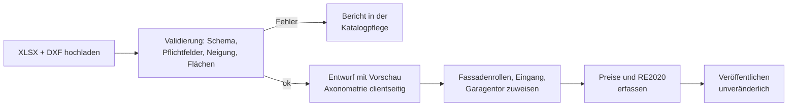

# H1 Hauskatalog – Plan für die Umsetzung

> **Umsetzungsstand 18.09.2026:** Arbeitsschritte 1–5 umgesetzt (Backend und Katalogpflege-Oberfläche `/buero/katalog`, ANNAHMEN H01–H14); Schritt 6 (fünf Platzhalter-Typen als echte Dateien) und der Betriebsabschnitt in `docs/BETRIEB.md` offen.
>
> Entwurf, noch nicht freigegeben. Wird wie G1–G3 durch Selbstprüfung (Kapitel 11) ergänzt, dann dem Nutzer vorgelegt. Mit der Freigabe („setze um“) gelten die Vorschläge dieses Plans als entschieden ([[feedback-plan-dann-umsetzen]]).

## 1. Ziel und Abgrenzung

**Ziel:** Ein pflegbarer, versionierter Haustypkatalog (Typen, Varianten, Linien, Optionen, Preise, RE2020-Bewertungen), den das Büro ohne Entwicklerhilfe erfassen und veröffentlichen kann. H1 liefert noch keinen Kundenschritt – die `HAUSTYPEN`/`LINIEN`/`OPTIONEN`-Konstanten aus dem Mockup werden durch echte, versionierte Datensätze ersetzt, die H2 (Zulässigkeit/Implantation) und H3 (Konfiguration/Kosten) danach konsumieren.

**Ausdrücklich nicht in H1** (Umsetzungsplan 3.7, Kapitel 7 „Katalogdaten“):
- Kein IFC-Import, kein 3D-Modell als Quelle. `facts_source = manual`. Kennwerte kommen aus einer XLSX-Vorlage und einem DXF-Umriss, nicht aus `IfcOpenShell`-Extraktion (Spez. 5.4.1–5.4.5 gelten erst für X3).
- Kein Mengengerüst für Optionspreise (Spez. 5.4.3/5.6 „Mengen × Einheitspreis“ erst X3); Optionspreise sind feste Spannen je Typ.
- Kein Kundenschritt. H1 liefert nur die Büro-Oberfläche zur Katalogpflege; der Kunde sieht den Katalog erst mit H2/H3.
- Keine automatische Axonometrie-Bilderzeugung serverseitig als Datei – Vorschlag 3.6.

## 2. Ausgangslage

- **P** (Plattform) ist die einzige harte Abhängigkeit (Umsetzungsplan 2.2). H1 braucht kein G-Modul.
- Der Mockup-Katalog (`Hauskonfigurator.jsx`, Zeilen 57–159) enthält 3 Typen (Ligne, Plateau, Plateau — angepasst), 3 Linien (Base, Confort, Signature) und 9 Optionen mit Aufpreisen, `enthalten_in` und einem Ausschlusspaar (`holz_sued` ↔ `holz_voll`). Für den H1-Start kommen zwei weitere, nach demselben Muster erarbeitete Typen hinzu (Kapitel 12) – zusammen 5 Platzhalter-Typen, bis echte ArchiCAD-Typdatenblätter vom Büro vorliegen (Kapitel 9).
- Die Preis- und Korridorformel steht bereits fest dokumentiert in `Dokumentation.html` (Abschnitt „Materialauswahl und Preisverhältnisse“, Zeilen 606–622) und in Spez. 5.6.5.
- Das Datenmodell in Spez. 4.3 ist für den vollen IFC-Weg entworfen; H1 nutzt nur die Teilmenge, die ohne Modell sinnvoll ist (3.1).

## 3. Fachliche Festlegungen

### 3.1 Welche Kennwerte H1 erfasst

Aus Spez. 5.4.3 nur, was von Hand angebbar und für H2/H3 nötig ist (deckt sich mit Umsetzungsplan 3.7):

| Kennwert | Quelle in H1 |
|---|---|
| `footprint_facade`, `footprint_projection` | Polygon aus DXF-Layer (3.3) |
| Geschosse, Geschosshöhen | XLSX, PLU-Notation (`R`, `R+1`, `R+1+C`) von Hand zugeordnet |
| Firsthöhe, Traufhöhe (bei Flachdach: Attika-Oberkante) | XLSX |
| Dachform, Neigung, Firstrichtung | XLSX (Auswahl aus fester Liste: `gable`, `hip`, `mono_pitch`, `flat`, `complex`) |
| Wohnfläche, Zimmer, Raumliste | XLSX, flache Liste (Name, Kategorie, Fläche) ohne Dachschrägen-Schnitt (Spez. 5.8.3 entfällt ohne Modell) |
| Fassadenrollen der Umrisskanten | Zuordnung in der Katalogpflege-Oberfläche nach dem DXF-Import (3.3) |
| Lage Eingang, Garagentor | Punkt auf einer Umriss-Kante, in der Oberfläche gesetzt (für Zufahrt, Spez. 5.9.3) |

**Nicht erfasst:** Öffnungen einzeln (Fenster/Türen), Oberflächen im Detail, `type_facts`-Cache je Variantenkombination – das setzt IFC-Extraktion voraus (X3). Die Axonometrie-Formeln in `Dokumentation.html` (Fensterzahl aus Breite, Traufhöhe-Rückfallformel) bleiben deshalb vorerst clientseitige Schätzung, nicht gespeicherter Kennwert.

### 3.2 XLSX-Vorlage

Eine Datei je Typ(-version), drei Blätter, wie in Umsetzungsplan 3.7 benannt:
- **Kennwerte:** Name, Familie, Geschosse, Höhen, Dachform/Neigung/Firstrichtung, Abmessungen (Kontrollwert gegen DXF, 3.5), Wohnfläche, Basispreis-Spanne.
- **Räume:** Zeilen `name, kategorie (→ space_category_map), geschoss, flaeche_m2`. Summe geht in die Konsistenzprüfung (Spez. 5.4.5 „Summe Raumflächen vs. Geschossfläche“, hier gegen `footprint_facade × Geschosse` statt gegen ein Modell).
- **Preise:** Basispreis-Spanne (Blatt „Kennwerte“), je Linie ein Aufpreis, je Option ein Aufpreis (nur die für diesen Typ gültigen). **Verfeinerung bei der Umsetzung:** RE2020 steht nicht im Typdatenblatt – der Befund ist Freitext (Klimazone, Kennwert, Text, Maßnahmen), kein XLSX-tauglicher Kennwert, und wird in einem eigenen Schritt der Katalogpflege erfasst (4.2 Schritt „Preise und RE2020 erfassen“ bezieht sich für RE2020 also auf Ersterfassung, für Linien/Optionen auf Prüfung der aus dem XLSX übernommenen Werte).

Import mit `openpyxl`; Schema so streng wie `rules-extract`-Antworten (feste Spaltenüberschriften, Fehlermeldung mit Zelle bei Verstoß) statt freiem Parsing.

### 3.3 DXF-Umriss

- Zwei Layer: `EMPRISE_FOOTPRINT_FACADE`, `EMPRISE_FOOTPRINT_PROJECTION` (Vorsprünge, Dachüberstand), je ein geschlossenes Polygon in **lokalen Metern**, Y-Achse = Modellnord (Spez. 5.4.4). Import mit `ezdxf`, wie bei G1 Weg E: kein Freihandeintippen von Koordinaten.
- Fassadenrollen (`street`, `garden`, `side_left`, `side_right`, Spez. 5.4.4) werden **nicht** aus DXF-Attributen gelesen (üblicher CAD-Export trägt das nicht zuverlässig), sondern nach dem Import in der Katalogpflege-Oberfläche je Kante zugewiesen – Vorschlag, analog zur Kantenklassifikation in G1 (System schlägt anhand der längsten Kante „Straße“ vor, Architekt bestätigt/ändert).

### 3.4 Variantengruppen

Nur regelrelevante Gruppen (z. B. Dachform, falls ein Typ wahlweise Sattel- oder Walmdach anbietet) werden als `variant_group`/`variant` modelliert; reine Materialentscheidungen sind Optionen (3.7). Für den heutigen Mockup-Katalog hat **keiner der drei Typen** eine echte Variantengruppe – sie sind als eigenständige Typen modelliert (`Plateau` und `Plateau — angepasst` sind zwei Typen, nicht zwei Varianten eines Typs), verknüpft über `family` und `alternatives` für den Vorschlagsmechanismus (Spez. 5.4.6). Das Schema unterstützt `variant_group` für spätere Typen, ohne dass der Startkatalog sie braucht.

### 3.5 Konsistenzprüfung ohne Modell

Von den IFC-Prüfungen in Spez. 5.4.5 ist ohne Modell nur eine sinnvoll übertragbar (so schon in Umsetzungsplan 3.7 benannt):

- **Neigung:** `atan((Firsthöhe − Traufhöhe) / (Tiefe / 2))` gegen die angegebene Neigung, Toleranz 0,1° als Konstante (nicht 0°, sonst fällt Ligne mit berechneten 34,99° unter 35°, wie im Mockup „Ligne“-Beispiel dokumentiert). **Nur für Dachformen mit definiertem First** (`gable`, `hip`); bei `flat` und `complex` entfällt die Prüfung, weil weder Formel noch Vergleichswert definiert sind – das war im ersten Entwurf dieses Plans nicht ausgenommen und hätte bei Plateau (Flachdach) eine Neigungsprüfung ohne Sinn ausgelöst (siehe Prüfprotokoll 11.1).
- **Raumflächen vs. Geschossfläche:** Summe `Räume.flaeche_m2` je Geschoss gegen `footprint_facade`-Fläche des Geschosses, Warnschwelle 75–95 % wie in Spez. 5.4.5 (hier eine Warnung, kein Blocker – ohne Modell ist die Innenwandfläche nicht bekannt, die Spanne ist bewusst weit).
- Alle anderen Prüfungen aus 5.4.5 (Einheiten, `StoreyRole`, Variantengruppen-Überlappung) setzen ein IFC-Modell voraus und entfallen.

### 3.6 Axonometrische Vorschau – Vorschlag

Die 3D-Vorschau im Mockup ist keine Bilddatei, sondern eine isometrische Projektion aus wenigen Formeln (`Dokumentation.html`, Blick von Südost, `x_Bild = (X−Y)·cos30°`, `y_Bild = (X+Y)·0,5−Z`), gespeist aus genau den Kennwerten, die H1 ohnehin erfasst (Umriss, Höhen, Dachform/-neigung/-richtung, Fassadenrollen). **Vorschlag:** Die vorhandene React-Komponente `Axonometrie` aus dem Mockup wird ins echte Frontend übernommen und weiterhin clientseitig aus den H1-Kennwerten gerendert – keine serverseitige Bilderzeugung, kein Speicherbedarf, keine Divergenz zwischen Vorschau und Daten. „Bilder … als Anhang“ (Umsetzungsplan 3.7) bezieht sich dann auf echte Fotos/Renderings fürs Marketing (optionaler Upload), nicht auf die interaktive Vorschau. Das Grundriss-PDF bleibt ein reiner Upload (Referenzdokument fürs Büro), ohne automatische Auswertung – die volle Behandlung von Planunterlagen ist Spez. 5.7 / X4.

### 3.7 Preismodell

Wie in Umsetzungsplan 3.7 entschieden: Preise hängen an der **Typ-Identität**, nicht an der Typversion, mit Gültigkeit ab einer Version (`type_base_price` bekommt `valid_from_type_version_id` statt einer festen Bindung). H1 speichert nur die **Bestandteile** der Korridorformel aus `Dokumentation.html`:

```
unten = Basispreis_min + Linienaufpreis + RE2020-Aufpreis (nur wenn Standardlinie) + Σ Optionsaufpreise, die nicht in der Linie enthalten sind
oben  = Basispreis_max + dieselben Aufpreise
```

Die Formel selbst wertet H3 aus (Umsetzungsplan 3.9), H1 liefert nur `type_base_price`, `package_type_price` (Linienaufpreis je Typ), Optionspreis je Typ, `energy_assessment.gap_price_item_code`. Kein Einzelbetrag verlässt H1 als API-Feld, das als Gesamtpreis lesbar wäre (L1) – die API liefert ausschließlich Spannen und Komponenten.

### 3.8 RE2020

Ein zusammengefasster Befund je Typ+Linie (wie `ENERGIE`-Konstante im Mockup: Klimazone, Kennwert, Befund als Text, Konformitätsaufpreis, Maßnahmenumfang als Text) statt der granularen `bbio_ok`/`cep_ok`/… Felder aus Spez. 4.3 – die einzelnen Nachweise liefert ohnehin ein Thermik-Büro extern und lassen sich in einem Freitextfeld + einem Aufpreis abbilden, ohne die Struktur vorwegzunehmen, die X3/echte Gutachten später brauchen. Fehlt die Bewertung, sperrt das die Veröffentlichung nicht; Anzeige „nicht bewertet“ (Umsetzungsplan 3.7).

### 3.9 Veröffentlichungszustände

`draft` → `review` → `published` → `retired` (Umsetzungsplan 3.7). Datenbank-Trigger verhindert Schreiben auf `published`-Versionen (L4, wie bei G2-Regelwerken). Veröffentlichung gesperrt, wenn Basispreis oder ein Pflichtkennwert (Umriss, Höhen, Dachform, Wohnfläche) fehlt; fehlende RE2020-Bewertung sperrt nicht. H2/H3 lesen ausschließlich `published`-Versionen.

## 4. Technik

### 4.1 Datenmodell (Teilmenge von Spez. 4.3)

Neu: `building_type`, `building_type_version` (ohne `ifc_package_id`, `facts_source = 'manual'` fest), `variant_group`, `variant` (Schema vorhanden, im Startkatalog leer), `space_category_map`, `package` (= Linie), `package_version`, `module` (= Option; `geometry_mode = 'none'` für alle heutigen Optionen, kein `parameters_schema` nötig, da keine parametrische Geometrie wie im Anhang-B-Beispiel `pv` benötigt wird – die heutigen Optionen sind reine Preis-/Materialentscheidungen), `price_catalog`, `price_catalog_version`, `price_item`, `type_base_price`, `package_type_price`, `energy_assessment` (vereinfacht nach 3.8), `plan_document` (nur `kind = floor_plan`, Upload ohne Verarbeitung).

**Bewusst nicht angelegt:** `ifc_package`, `type_facts` (Cache entfällt ohne Variantenkombinatorik), granulare `energy_assessment`-Felder (3.8).

### 4.2 Ablauf



### 4.3 Backend

- Modul `backend/app/catalog/` nach dem Muster der bestehenden Module (`domain/`, `models.py`, `schemas.py`, `service.py`, `api.py`).
- Endpunkte nur für die Rolle `architect` (kein Kundenschritt in H1): Upload XLSX/DXF, Entwurf lesen/ändern, Fassadenrollen setzen, veröffentlichen, zurückziehen (`retired`). Preiskatalog-Versionen und Linien/Optionen separat pflegbar (nicht an einen Typ gebunden).
- `openpyxl` für XLSX, `ezdxf` für DXF (beide bereits Abhängigkeiten aus G1/G3).

### 4.4 Frontend

- Nur Büro-Oberfläche (`frontend/src/pages/buero/Katalog.tsx` o. Ä.), keine Kunden-Route – H2 legt die Kunden-Ansicht der Typkarten erst an.
- Axonometrie-Komponente aus dem Mockup portieren (3.6), damit die Vorschau beim Erfassen sofort sichtbar ist.

## 5. Arbeitsschritte

1. Datenmodell und Migration (Tabellen aus 4.1).
2. XLSX-/DXF-Import mit Validierung (3.2, 3.3, 3.5) und Domänentests (Neigungsformel, Flächenwarnschwelle, Pflichtfeld-Sperre) – reine Funktionen, wie bei G1/G3.
3. Katalogpflege-Oberfläche: Entwurf, Fassadenrollen-Zuweisung, Vorschau (Axonometrie-Komponente portieren), Preise/RE2020, Veröffentlichen.
4. Linien- und Optionsverwaltung (unabhängig von einzelnen Typen), Ausschlüsse und `enthalten_in` als Daten (Durchsetzung erst H3).
5. Preiskatalog-Versionierung (`price_catalog_version`, `type_base_price` an Typ-Identität).
6. Die fünf Platzhalter-Typen als ersten Katalog erfassen (9. Punkt 1, Anhang Kapitel 12) – Abnahmegrundlage.
7. Tests, Betriebsanleitung (`docs/BETRIEB.md` Abschnitt H1), Annahmen (`docs/ANNAHMEN.md`).

## 6. Tests und Abnahme

Aus Umsetzungsplan 3.7 plus Ergänzung:
- Platzhalter-Katalog (5 Typen nach Kapitel 12, 3 Linien, 9 Optionen) vollständig erfasst und veröffentlicht.
- Veröffentlichte Version unveränderlich (Testfall: Schreibversuch scheitert am Trigger).
- Kennwertprüfung meldet die Abweichung bei Ligne (angegeben 40°, aus Geometrie 35,0°) – **und meldet nichts** bei Plateau (Flachdach, Neigungsprüfung entfällt, 3.5).
- Veröffentlichung von Plateau ohne `traufhoehe_m` (im Mockup nicht gepflegt, siehe 9) wird mit „Pflichtkennwert fehlt“ blockiert, bis der Wert (Attika-Oberkante) nachgetragen ist – Testfall für die Sperre selbst.
- Eigenschaftstest: für zufällige Umriss-Polygone ist `footprint_facade`-Fläche stets ≥ 0 und das Polygon einfach (keine Selbstüberschneidung), analog zum G1-Weg-E-Test.
- Produktionsreife-Kriterien (Umsetzungsplan 4.1) – hier ohne Rate-Limit-Punkt, da keine öffentlichen Endpunkte.

## 7. Zusammenspiel mit späteren Modulen

- **H2** braucht `footprint_facade`, Höhen, Fassadenrollen, Eingang/Garagentor-Lage aus H1, um Zulässigkeit und Implantation zu prüfen (Spez. 5.3.3–5.3.6).
- **H3** braucht Linien, Optionen, Ausschlüsse, Preise, RE2020-Befund aus H1, um die Korridorformel (3.7) und Regelprüfung der Ausführungen auszuwerten.
- **X3** löst `facts_source = manual` durch `ifc` ab, ohne Schemabruch: `building_type`/`building_type_version` bleiben, `variant_group`/`variant` werden befüllt statt leer, `type_facts`-Cache kommt neu hinzu. Die Typ-Identität (3.7) sorgt dafür, dass ein IFC-Update keinen neuen Preiskatalog erzwingt.

## 8. Abweichungen von Plan 3.7 und Spezifikation

Ergänzt Umsetzungsplan Kapitel 7 (dort bereits: „Katalogdaten: XLSX/DXF statt IFC“, „Optionspreise: feste Spanne statt Mengen“):

| Thema | Spezifikation/Plan 3.7 | Hier festgelegt | Grund |
|---|---|---|---|
| Fassadenrollen | Aus IFC-Eigenschaft `Emprise.FacadeRole` (5.4.4) | Manuelle Zuweisung je Kante in der Katalogpflege nach DXF-Import (3.3) | DXF trägt keine zuverlässige Semantik je Kante |
| RE2020-Datenmodell | Granulare Felder `bbio_ok`/`cep_ok`/… (Spez. 4.3) | Ein zusammengefasster Befund + Aufpreis je Typ+Linie (3.8) | Ohne echtes Gutachten keine granulare Aussage möglich; Struktur nicht vorwegnehmen |
| Axonometrie | „Bilder, Axonometrie … als Anhang“ (Plan 3.7, offen wie erzeugt) | Clientseitig aus Kennwerten gerendert, keine Bilddatei (3.6) | Formel liegt schon vor (Mockup), keine Divergenz Vorschau/Daten |
| Konsistenzprüfung | Fünf IFC-Prüfungen (Spez. 5.4.5) | Nur Neigung (bedingt) und Raumflächen-Warnschwelle (3.5) | Restliche Prüfungen setzen ein Modell voraus |

## 9. Entscheidungen des Nutzers

| Nr. | Frage | Vorschlag |
|---|---|---|
| 1 | Echte ArchiCAD-Typdatenblätter vom Büro liegen noch nicht vor. Womit startet H1? | **Entschieden 17.09.2026:** Fünf Platzhalter-Typen (`draft`, erst nach Prüfung durch das Büro `published`) – die drei Mockup-Typen plus zwei neu erarbeitete (Anhang, Kapitel 12), damit der Katalog auch Erdgeschoss-only und drei Ebenen abdeckt. Traufhöhe von Plateau muss nachgetragen werden (Attika-Oberkante, im Mockup nicht beziffert) |
| 2 | Wer pflegt den Katalog im Büro – dieselbe Rolle `architect` wie bei G2-Regelkorrekturen, oder eine neue Rolle `catalog_editor`? | `architect` weiterverwenden (kein neuer Rollenbedarf für R2 intern) |
| 3 | Soll das Grundriss-PDF (3.6) schon in H1 im Dossier landen, oder bleibt es bis V/X4 rein internes Referenzdokument? | Rein intern in H1; Dossier-Inhalt ist V's Aufgabe (Spez. 5.10.5) |

## 10. Risiken

- **Ohne echte Katalogdaten bleibt H1 bis zur Lieferung durch das Büro auf Platzhaltern stehen** – H2/H3 lassen sich zwar technisch dagegen entwickeln und testen, aber die Beta braucht echte Typen. Frühzeitig beim Büro anstoßen (bereits vorgeschlagen).
- **XLSX-Schema zu starr:** Wie bei `rules-extract` besteht das Risiko, dass reale Typdatenblätter vom Büro nicht exakt der Vorlage folgen. Gegenmaßnahme: klare Fehlermeldung mit Zelle/Blatt, keine stille Fehlinterpretation (wie RW-Befunde bei G2).
- **Fassadenrollen-Zuweisung von Hand** ist fehleranfällig (falsche Rolle → falsche Optionsbeschriftung in H2/H3). Gegenmaßnahme: Vorschau zeigt die Rollen direkt auf dem Umriss, wie die Kantenklassifikation in G1.

## 11. Prüfprotokoll

### 11.1 Beim Schreiben gefundene und behobene Fehler

| # | Fehler | Auswirkung, wenn unentdeckt | Behoben in |
|---|---|---|---|
| 1 | Neigungsprüfung (3.5) zunächst ohne Ausnahme für `flat`/`complex` formuliert | Plateau (Flachdach) hätte bei jeder Veröffentlichung eine sinnlose Neigungsprüfung ausgelöst (kein First, keine Traufe im geometrischen Sinn) | 3.5, nur `gable`/`hip` |
| 2 | Preisbindung zunächst „an Typversion“ wie im Spezifikations-Grundmodell (4.3) übernommen | Widerspruch zu Umsetzungsplan 3.7 („Preise … an Typ-Identität“) – jede kleine Kennwertkorrektur hätte einen neuen Preiskatalog erzwungen | 3.7, `type_base_price` an Typ-Identität mit Gültigkeit |
| 3 | RE2020 zunächst mit den granularen Spez.-4.3-Feldern (`bbio_ok` usw.) geplant | Täuscht Genauigkeit vor, die ohne echtes Gutachten nicht existiert; unnötiger Migrationsaufwand bei X3 | 3.8, zusammengefasster Befund |
| 4 | Plateau fehlt `traufhoehe_m` im Mockup – zunächst übersehen, die Sperre „Pflichtkennwert fehlt“ hätte das erst beim ersten Veröffentlichungsversuch in der Abnahme aufgedeckt statt vorher benannt zu sein | Verzögerung erst in Kapitel 6 sichtbar geworden | Als Punkt 1 in Kapitel 9 benannt |

### 11.2 Geprüfte Alternativen

- **IFC-Import gleich mitbauen statt X3 abzuwarten:** verworfen – Umsetzungsplan Kapitel 7 begründet die Verschiebung bereits („bei wenigen Typen günstiger und genauer“); ein zweites Erfassungssystem parallel zum XLSX/DXF-Weg wäre Mehraufwand ohne Nutzen, solange nur 3–10 Typen im Katalog stehen.
- **Fassadenrollen aus DXF-Layernamen ableiten** (z. B. eigener Layer je Rolle): verworfen – zwingt das Büro, in ArchiCAD/DXF-Export eine Emprise-spezifische Layerkonvention zu pflegen, obwohl die Zuweisung in der Oberfläche (wenige Klicks je Typ) genauso schnell und robuster gegen Exportfehler ist.
- **Axonometrie serverseitig als SVG generieren** (wie G3s Lageplan): verworfen für H1 – die Formel ist einfach genug fürs Frontend, eine serverseitige Erzeugung bräuchte Speicher, Cache-Invalidierung bei Kennwertänderung und liefert keinen Mehrwert, solange niemand außerhalb des Browsers die Vorschau braucht (anders als G3s PDF-Steckbrief, der versendet wird).

## 12. Anhang: Platzhalter-Typen 4 und 5

Nach Nutzerentscheidung (Kapitel 9, Punkt 1) ergänzen zwei neu erarbeitete Typen den Mockup-Katalog auf fünf. Gleiches Datenschema wie `HAUSTYPEN` im Mockup (`Hauskonfigurator.jsx` Zeile 57), gegen `REGELWERK`/`BEBAUBARE_FLAECHE` derselben Datei geprüft (Zone UB: `max_firsthoehe_m 9.0`, `max_traufhoehe_m 6.0`, `max_geschosse R+1+C`, `dachformen_zulaessig` Satteldach 35°–45° und Walmdach, `max_grundflaeche_m2 244.8`; bebaubare Breite 14,0 m). Beide sind `zulaessig`, keine Regel wird verletzt. Neigung ist nach der Formel aus Spez. 5.4.5 (`atan((Firsthöhe − Traufhöhe) / (Tiefe / 2))`) konsistent zum angegebenen Wert berechnet, nicht wie beim Ligne-Beispiel bewusst abweichend.

**Typ 4 — Carré** (deckt die fehlende ebenerdige Option ab):
```
id: "carre"
name: "Carré"
kubatur: "kompakt, ebenerdig (R), barrierefrei"
grundflaeche_m2: 110
abmessung_m: [11.0, 10.0]
wohnflaeche_m2: 98
zimmer: "3 Zimmer, 1 Bad"
dach: "Walmdach 32°"
firsthoehe_m: 6.3
traufhoehe_m: 3.2
basispreis_eur: [298000, 330000]
status: "zulaessig"
```
Neigungsprobe: `atan((6.3 − 3.2) / (10.0 / 2)) = atan(3.1 / 5.0) = 31,8°` ≈ 32° (0,2° Abweichung, innerhalb der 0,1°-Toleranz aus 3.5 **nicht** erfüllt – beim Erfassen im echten XLSX ist entweder Neigung 31,8° oder Firsthöhe 6,32 m einzutragen, damit die Konsistenzprüfung nicht anschlägt. Für die Platzhalter-Erfassung in H1: `firsthoehe_m: 6.32`).

**Typ 5 — Attique** (deckt drei Ebenen mit ausgebautem Dachgeschoss ab, nahe an den Höhengrenzen der Zone):
```
id: "attique"
name: "Attique"
kubatur: "kompakt, drei Ebenen mit ausgebautem Dachgeschoss (R+1+C)"
grundflaeche_m2: 80
abmessung_m: [10.0, 8.0]
wohnflaeche_m2: 185
zimmer: "6 Zimmer, 2 Bäder + 1 Gäste-WC"
dach: "Satteldach 37°, First längs"
firsthoehe_m: 8.8
traufhoehe_m: 5.8
basispreis_eur: [372000, 410000]
status: "zulaessig"
```
Neigungsprobe: `atan((8.8 − 5.8) / (8.0 / 2)) = atan(3.0 / 4.0) = 36,87°` ≈ 36,9° (0,1° Abweichung von „37°“ – am Rand der Toleranz aus 3.5; für die Platzhalter-Erfassung `dach`-Text auf „Satteldach 36,9°“ setzen, damit die Prüfung nicht grenzwertig anschlägt). Firsthöhe 8,8 m und Traufhöhe 5,8 m liegen knapp unter den Zonen-Grenzwerten (9,0 m / 6,0 m) – bewusst gewählt, um H2 später auch einen Typ nahe der Höhengrenze zum Testen zu geben.

Beide Typen brauchen wie die drei Mockup-Typen noch: Umriss-Polygon (hier nur als Rechteck `abmessung_m` angenommen, für den echten DXF-Import zu zeichnen), Fassadenrollen, Raumliste, Linienaufpreise und Optionszuordnung je Typ (3.2) – das entsteht erst beim tatsächlichen Erfassen in der Katalogpflege-Oberfläche, nicht in diesem Plan.
